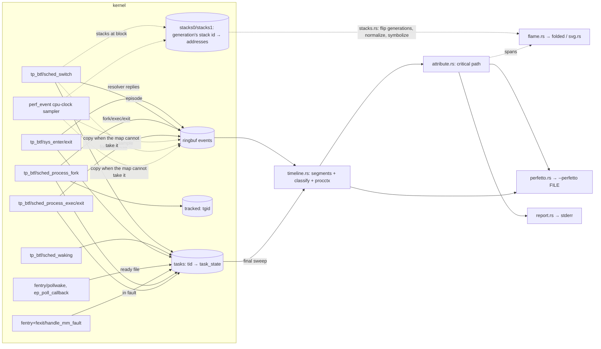

# whytime — agent guide

`whytime -- COMMAND` runs COMMAND, traces it and every process it starts with eBPF, and
prints to stderr where its wall-clock time went (on-CPU, waiting on children, timer sleep,
fsync, network peers, locks, ...). COMMAND's output passes through; whytime exits with
COMMAND's code. `whytime -p PID` does the same for a running process and its descendants,
from the attach until PID exits, `--duration` elapses or Ctrl-C.

**Name.** The crate and binary are `whytime` (https://github.com/Arinerron/whytime): the
`why` crate name is taken on crates.io. Use `whytime` everywhere in code, docs and output.

**Status: v0.1.0, the first release.** Wrap mode and attach mode (`-p PID`), plus trace
files for both: `--record FILE` saves a run and `whytime report FILE` replays it offline into
the identical report. Network peers are named after the host the traced tree resolved
(`example.com:443`). Every mode also takes the report options `--json`, `--timeline` (the
window in slices), `--perfetto FILE` (a Chrome Trace Event file of every thread and the
critical path) and `--flamegraph FILE` / `--folded FILE` (the critical path as a wall-clock
flamegraph). `whytime doctor` checks the system; `whytime completions SHELL` prints
completion scripts. User-facing docs: `README.md`; release notes: `CHANGELOG.md` (Keep a
Changelog; add user-visible changes under `[Unreleased]`).

## Commands

The shared tracekit crates are a git submodule: clone with `--recursive`, or run
`git submodule update --init` once (else cargo fails with "failed to read
`…/tracekit/crates/wire/Cargo.toml`"). All cargo invocations need these, because `/tmp` has
a tight quota:

```sh
mkdir -p ~/.cache/whytime-tmp ~/.cache/whytime-target
export TMPDIR=~/.cache/whytime-tmp CARGO_TARGET_DIR=~/.cache/whytime-target
```

| What | Command |
|---|---|
| Build (debug) | `cargo build` (default member: `whytime`) |
| Release binary | `cargo build --release -p whytime` → `$CARGO_TARGET_DIR/x86_64-unknown-linux-musl/release/whytime` (static) |
| Unit tests | `cargo test --workspace` (no root; includes the replay fixtures, see Unit tests) |
| Replay fixtures | `cargo xtask record-fixtures` (needs `sudo -n`) re-records the trace files and expected outputs in `crates/whytime/tests/fixtures/`; `WHYTIME_BLESS=1 cargo test -p whytime --test fixtures` rewrites the expected files from the existing traces |
| End-to-end suite | `cargo xtask test-e2e` (needs passwordless `sudo -n`) |
| aarch64 | `cargo check --target aarch64-unknown-linux-musl --workspace`; `cargo build --release -p whytime --target aarch64-unknown-linux-musl` (static, linked by `rust-lld`; smoke with `qemu-aarch64 …/whytime --version`) |
| Completions | `whytime completions <bash\|zsh\|fish\|elvish\|powershell>` (stdout) |
| Man pages | `cargo xtask man [DIR]` (default `$CARGO_TARGET_DIR/man`) |
| Third-party notices | `cargo xtask licenses [FILE]` (default `$CARGO_TARGET_DIR/THIRD_PARTY_LICENSES.md`): the license texts of every crate in the binary's graph (both release targets) and of the vendored libbpf headers; fails if a dependency ships no license file |
| Run | `sudo $CARGO_TARGET_DIR/x86_64-unknown-linux-musl/release/whytime -- sleep 1` |
| Attach | `sudo whytime -p PID [--duration 30s] [--record t.wt]` (report on exit, deadline or Ctrl-C; exit 0) |
| Doctor | `whytime doctor [--json]` (exit 0 ready, 3 cannot run) |
| Record / replay | `sudo whytime --record t.wt -- CMD` (or `-p PID --record t.wt`), then `whytime report t.wt [--json]` (no privileges; exit 0, or 2 if the file cannot be replayed) |
| Timeline / Perfetto | `--timeline` and/or `--perfetto t.json` with any of wrap, `-p PID` or `report FILE` (`cli::OutputArgs`; open `t.json` in ui.perfetto.dev or chrome://tracing) |
| Flamegraph | `sudo whytime --flamegraph out.svg [--folded out.folded] -- CMD` (or `-p PID ...`); from a trace recorded with either flag: `whytime report t.wt --flamegraph out.svg` (exit 2 if it has no stacks); also `cli::OutputArgs` |
| Debug logging | `WHYTIME_LOG=debug whytime ...` (prints the verifier log on load failures) |

Toolchain: `rust-toolchain.toml` pins **stable** with the `x86_64-unknown-linux-musl` and
`aarch64-unknown-linux-musl` targets, and `.cargo/config.toml` makes x86_64 musl the default
build target, so every binary (including tests and xtask) is static; aarch64 links with
`rust-lld` against Rust's self-contained musl (no cross gcc). No nightly, no `bpf-linker`: the
BPF side is C, compiled by clang (22 here; any clang with BPF CO-RE works, override with
`CLANG=`).

License: MIT (`LICENSE`). The BPF object's `SEC("license")` string stays `Dual MIT/GPL`: the
verifier only lets GPL-compatible programs call GPL-only helpers (`bpf_probe_read_kernel`,
`bpf_get_current_task_btf`, ...). Vendored libbpf headers are `LGPL-2.1 OR BSD-2-Clause`
(their `LICENSE` and `LICENSE.BSD-2-Clause` are copied from the libbpf release beside them).
Release tarballs carry `THIRD_PARTY_LICENSES.md` (`cargo xtask licenses`, in
`xtask/src/licenses.rs`): crates reached through normal dependencies of `whytime` and through
first-party build dependencies (the BPF header generation), proc macros included, with the
license files found in each package's source directory, identical texts printed once.

CI (`.github/workflows/ci.yml`): x86_64 build + unit tests + completions/man smoke +
`cargo xtask licenses`, aarch64 check/build/qemu smoke, and `cargo xtask test-e2e` inside a
virtme-ng VM. `release.yml`: a `v*` tag publishes
`whytime-vX.Y.Z-{x86_64,aarch64}-linux-musl.tar.gz` (binary, `LICENSE`,
`THIRD_PARTY_LICENSES.md`, `README.md`, `completions/`, `man/`) with a `.sha256` each; the
README's install snippet depends on these names. Both check out with
`submodules: recursive`; `.github/actions/setup` installs clang and the toolchain.

Releasing: date the `CHANGELOG.md` section, push to main and wait for green CI, then
`git tag -a vX.Y.Z -m 'whytime X.Y.Z' && git push origin vX.Y.Z`. Once `release.yml` has
published, replace its generated notes with the CHANGELOG section plus an install snippet
pinned to the tag: `gh release edit vX.Y.Z --title 'whytime X.Y.Z' --notes-file NOTES.md`.
In the e2e VM (Ubuntu runner rootfs, no systemd), `dns-varlink` is a SKIP: there is no
systemd-resolved.

`crates/whytime/src/cli.rs` is also compiled into xtask (`#[path]`, for `cargo xtask man`):
keep it self-contained (std, clap, clap_complete only; no `crate::` items).

Do not run `cargo fmt`/`cargo clippy` as part of feature work unless asked; lints are the
tracekit block (`clippy::all` + `pedantic`) in the root `Cargo.toml`.

## Layout

```
Cargo.toml                 workspace (excludes tracekit/), shared deps, lint block, release
                           profile (lto, strip, abort)
.cargo/config.toml         default target x86_64 musl, aarch64 linker rust-lld, `xtask` alias
rust-toolchain.toml        stable + both musl targets
crates/whytime-abi/        src/lib.rs: wire! records + wire_consts! shared with C; feature
                           std → header(), feature user → aya::Pod impls
crates/whytime-bpf/        build.rs + bpf/ ; src/lib.rs exports OBJECT, STACKS_OBJECT (the two
                           .o) and ABI_HASH
  bpf/whytime.bpf.c        the BPF programs (C CO-RE)
  bpf/vmlinux_min.h        hand-curated preserve_access_index subset of vmlinux.h (pt_regs per arch)
  bpf/include/bpf/         vendored libbpf v1.8.0 headers and their license files
crates/whytime/            the binary
  src/main.rs              wrap flow, event loop (epoll: ring, pidfd, signalfd), sudo handling,
                           helpers shared with attach (preflight, load, collect, recording,
                           meta, report), `report` subcommand (replay)
  src/attach.rs            attach flow: target checks, tree membership, seeding, event loop
  src/snapshot.rs          /proc → task_state of pre-existing threads (syscall, fd, peers)
  src/cli.rs               clap derive CLI, --duration parser
  src/tracer.rs            aya loader: load, attach (required + optional sets), maps, detach
  src/percpu.rs            vmlinux BTF reader: __preempt_count's distance from runqueues
  src/spawn.rs             fork, park-on-pipe, priv drop, exec with error pipe, pidfd;
                           create_as: output files opened by a child running as the user
  src/timeline.rs          records → per-thread segments, procctx table, final sweep
  src/classify.rs          (syscall, fd, kernel path, ready fd, fault, waker) → class + subject;
                           FdTarget: /proc fd link and maps fallback; peers named via dns.rs
  src/dns.rs               resolver records → ip → hostname (DNS wire answers, resolved varlink)
  src/sys.rs               syscall table (libc numbers) → kind + BPF sys_flags bits (describe,
                           resolver capture ops)
  src/attribute.rs         critical-path walk (follows wakers) → spans that partition the window;
                           names same-comm processes apart; CPU holders of runqueue lines
  src/report.rs            whytime.report/1 JSON + human rendering, parallelism, timeline slices
  src/perfetto.rs          --perfetto: Chrome Trace Event JSON writer
  src/record.rs            trace files: Recorder (--record), format, parse + replay
  src/stacks.rs            stack capture: generation flips of the stack maps, live
                           normalization of user stacks (maps, files), stack copies,
                           ELF/kallsyms symbolization → Symbols (recorded in trace files)
  src/flame.rs             spans + samples + block stacks → folded stacks; folded writer
  src/svg.rs               flamegraph SVG renderer (layout, palette, zoom/search script)
  src/testkit.rs           #[cfg(test)] synthetic records and traces for unit tests
  src/doctor.rs            bpfdoctor Tool, probe.sched / syscalls / dns / readiness / faults /
                           stacks, kernel.kallsyms checks
  src/logger.rs            tiny stderr logger (WHYTIME_LOG); stderr! (eprintln! that ignores
                           write errors), used for every stderr write
  tests/fixtures.rs        replay fixtures: each recorded trace must still replay to its
                           expected report (and folded / Perfetto output)
  tests/fixtures/          NAME.wt + NAME.report.json [+ NAME.folded, NAME.perfetto.json]
crates/whytime-testbins/   e2e workloads (src/bin/): wt-sleep, wt-burn, wt-fsync, wt-child,
                           wt-futex, wt-tcp, wt-attach, wt-threads, wt-vfork, wt-flock,
                           wt-syscalls, wt-poll, wt-fault, wt-fifo, wt-dns (DNS client and the
                           suite's DNS server), wt-flame; src/lib.rs: argument and timing helpers
xtask/                     cargo xtask test-e2e | record-fixtures | man [DIR] | licenses [FILE]
.github/                   workflows ci.yml, release.yml; actions/setup (clang, rustup);
                           ISSUE_TEMPLATE (bug, feature forms), pull_request_template.md,
                           dependabot.yml
tracekit/                  git submodule, Arinerron/tracekit pinned at a release tag (v0.1.0)
README.md                  user documentation (install, usage, report, limits)
CHANGELOG.md               release notes (Keep a Changelog)
CONTRIBUTING.md, SECURITY.md, CODE_OF_CONDUCT.md   contributor and security policy
LICENSE                    MIT
```

Shared foundation: the `tracekit` submodule (https://github.com/Arinerron/tracekit), path
deps `tracekit/crates/{wire,procctx,bpfdoctor}`, pinned at a release tag. **Do not modify**
it here; report gaps to the orchestrator. It is a workspace of its own, hence
`exclude = ["tracekit"]` in the root `Cargo.toml` (without it cargo cannot inherit the
crates' `workspace.package` fields). Bump it to a new release with
`git -C tracekit fetch --tags && git -C tracekit checkout vX.Y.Z && git add tracekit`, then
build and commit the new gitlink.

## How the BPF objects are built

`crates/whytime-bpf/build.rs`:

1. renders `whytime_abi::header()` to `$OUT_DIR/whytime_wire.h` (structs, `_Static_assert`s on
   every size/offset, `#define`s for the `wire_consts!`, `WHYTIME_WIRE_H_ABI_HASH`) and
   writes the hash to `$OUT_DIR/abi_hash.rs`;
2. runs `clang -target bpfel -O2 -g -mcpu=v3 -Wall -Werror -D__TARGET_ARCH_{x86,arm64} -I bpf
   -I bpf/include -I $OUT_DIR -c bpf/whytime.bpf.c` twice: `whytime.bpf.o` (plain runs) and,
   with `-DWHYTIME_STACKS`, `whytime_stacks.bpf.o` (stack capture: the stack maps, stacks
   at blocks in `on_switch`, the `on_sample` sampler; ~172 KB against ~153 KB). Plain runs
   create no stack map and attach no sampler, so nothing about stack capture can keep them
   from loading (a STACK_TRACE map deeper than `kernel.perf_event_max_stack` fails to create
   with EINVAL, flags or not). Arch from `CARGO_CFG_TARGET_ARCH`; other arches
   panic, as `vmlinux_min.h` declares `pt_regs` for x86 (`di`, `si`, `dx`) and arm64
   (`pt_regs.orig_x0` via libbpf's `pt_regs___arm64`, then `user_pt_regs.regs[]`) only;
3. `src/lib.rs` embeds both with `aya::include_bytes_aligned!` (`OBJECT`, `STACKS_OBJECT`).

To change a record: edit `crates/whytime-abi/src/lib.rs` only; the C side picks the new
layout up through the generated header (a mismatch is a clang error), then update the C code
that fills it and `timeline.rs` that reads it.

## Architecture and data flow



Wrap-mode startup (`main.rs`, `spawn.rs`):

1. `bpfdoctor` preflight; on FAIL print diagnostics, exit 125.
2. Load the object and attach all programs (`tracer.rs`). Scheduler programs are required;
   the syscall, resolver capture, readiness and page-fault sets are optional: if one fails,
   continue with a warning and a report note (`record::Probes`, in the trace header). Before
   loading, `percpu.rs` reads `/sys/kernel/btf/vmlinux` and sets the `.rodata` global
   `preempt_count_from_rq` (see `on_waking`). With `--flamegraph`/`--folded`, the stack
   capture object (`STACKS_OBJECT`) is loaded instead of the plain one, and its `perf_event`
   sampler attached to every online CPU; if any of it fails (a `kernel.perf_event_max_stack`
   below 127 is checked first, EINVAL), the plain object is loaded to finish the probe, then
   whytime prints the `probe.stacks` diagnosis (observed, impact, fix) and exits 125 before
   running COMMAND, without creating the output files. With `--record`, create the trace
   file now, and the `--perfetto`, `--flamegraph` and `--folded` files too
   (`main.rs::OutputFiles`; before COMMAND runs, so a bad path fails fast with 125). Under
   sudo the invoking user creates them (`spawn::create_as`: a forked child drops to the
   user, opens the file and passes the descriptor back over `SCM_RIGHTS`), so the user's
   permissions apply (a symlink to a file only root may write is refused) and a new file
   is theirs; whytime never opens an output as root.
3. Under sudo (`euid 0` + `SUDO_UID`/`SUDO_GID`), compute the invoking user's credentials
   and groups, and restore `HOME`/`USER`/`LOGNAME` to that user.
4. Ignore SIGINT/SIGQUIT (the TTY delivers them to COMMAND's process group, which whytime
   shares; whytime must survive to report). Route SIGTERM/SIGHUP to a signalfd; they are
   forwarded to COMMAND with `pidfd_send_signal`. A signal whytime inherited ignored
   (`nohup`, a non-interactive shell's background job) stays ignored by both: an ignored
   SIGTERM/SIGHUP is not routed, and COMMAND gets SIGINT/SIGQUIT back as inherited.
5. `fork`; the child blocks reading a CLOEXEC "go" pipe. The parent inserts the child's tgid
   into `tracked`, then writes "go". The child drops to the invoking user, restores
   SIGINT/SIGQUIT as inherited and SIGPIPE to default (Rust's runtime ignores it before
   `main`), clears the mask, and `execvp`s. A second CLOEXEC pipe returns `(stage, errno)`
   on failure: exec ENOENT → 127, other exec errors → 126, privilege drop failure → 125.
   whytime changes no rlimit (BPF memory is charged to memcg on every supported kernel),
   so COMMAND keeps the caller's `RLIMIT_MEMLOCK`.
6. The window starts at the child's `sched_process_exec` record (the root's first task
   entry is created there) and ends at the root thread group's exit record (or
   `--duration` after the start). The loop polls ring buffer, pidfd and signalfd with epoll;
   with stack capture it also flips stack generations (see Flamegraphs), waking for them
   when the ring is quiet.
7. On window end: with stack capture, read `/proc/kallsyms` (while whytime's programs are
   loaded: see `stacks.rs`); drop the `Ebpf` (detaches every program; the maps were taken
   out and stay alive), wait 2 ms for in-flight programs, drain the ring, then **sweep** the
   `tasks` map to close every still-open interval at the window end. With stack capture,
   symbolize (`Collector::finish`). With `--record`, write the stack frames, the sweep and
   the end frame. Attribute, report, return COMMAND's code (with `--duration`, keep
   forwarding signals until it exits). The report step is one function for all three paths
   (`main.rs::report(trace, end, meta, &OutputArgs, files, symbols)`): attribute once, write
   the `--perfetto` file and the `--flamegraph`/`--folded` files (`OutputFiles`, created
   before the run like the trace file) if asked (a failure is printed first: the report
   stays last on stderr), then the report, human or `--json`, with the `--timeline` slices
   if asked. Every stderr write goes through `logger::stderr!`, which ignores write errors:
   a closed stderr (EPIPE) neither aborts whytime nor changes its exit code.

Attach-mode startup (`attach.rs`, `snapshot.rs`; `whytime -p PID`):

1. Check the target before anything privileged (exit 1 with a `fix:` line when refused):
   `/proc/PID` exists and is a thread-group leader (a thread id → "use -p TGID"), not a
   zombie, not whytime itself (it would trace its own event loop) and not pid 1 (everything
   descends from init: a whole-system trace with init's event loop as the critical path).
   Without root, the target's real/effective/saved uid and gid must all be the invoking
   user's (the ptrace rule; file capabilities must not let users watch each other), unless
   whytime has `CAP_SYS_PTRACE`. The pidfd is opened before these checks read `/proc/PID`,
   and `pidfd_send_signal(pidfd, 0)` then confirms the held process is not reaped (so the
   pid was not recycled in between and the checks saw it); `track_tree`'s scan gets the
   same confirmation before seeding.
2. Preflight and load as in wrap mode (exit 125 on failure); create the output files as in
   wrap mode. Block SIGINT/SIGTERM/SIGHUP into a signalfd: from here on they end the
   observation; the target is never signalled.
3. **Membership** (`track_tree`): scan `/proc/*/stat`, walk parent links from the target
   (skipping whytime), insert each live process into `tracked` with `BPF_NOEXIST`; repeat
   until a scan inserts nothing. `EEXIST` means a tracked parent forked it after its insert:
   the kernel side owns it (its FORK record is queued). Termination: a process still
   untracked after a scan was forked by a parent before that parent's insert, so the next
   scan sees it; a scan that inserts nothing proves every live member was tracked before
   it began. Lost only: a process forked in that race whose parent exits before the next
   scan (reparented out of the tree). Capped at 32 scans (warning).
4. **Threads** (`seed_threads`), after membership so new threads are already created in
   kernel: for every thread in `/proc/PID/task`, build a `task_state`
   (`snapshot::task_state`, the one function to adapt when `task_state` changes) and insert
   it with `BPF_NOEXIST` (`EEXIST`: the kernel created it on a fork or exec; its records
   describe it). Re-read the thread's stat afterwards; if it exited meanwhile, delete the
   entry (no exit record would). A member with no live thread left is untracked.
5. **Trace** (`Trace::seed`, pure: replay can feed it recorded `ProcSeed`s): one `Proc` per
   member (target = root, parents linked by ppid), one `Thread` per seeded entry, and a
   procctx record per member through `on_exec` with the comm, ppid and argv read from
   `/proc`; key = `(pid, StartClock::ticks_to_start(starttime))`, which is tick precision
   (10 ms at `USER_HZ` 100) instead of the kernel's exact `start_boottime`. Later records
   never re-key a process: `on_exec` keeps the known key, and a FORK recorded before the
   window start names a task the seeding may already have added (it reuses it).
6. The window starts after seeding (monotonic now) and ends at the target's thread-group
   exit (EXIT record, or the pidfd), `--duration` after the start, or the first
   SIGINT/SIGTERM/SIGHUP (`ended_by: interrupt`). If the target's exit record shows up in
   the final drain before the deadline/signal time, the window ends there (`exit`). With
   `--record`, the header and seed frames are written when the window starts. Detach,
   drain, sweep and report as in wrap mode; whytime exits 0. `exit_code` is the target's
   (from its EXIT record) when it exited in the window.

`task_state` from `/proc` (`snapshot.rs`), per `/proc/TID/stat` state letter:

| State | Entry | Fields set (all others zero, as in a fresh kernel entry) |
|---|---|---|
| `R` | `ST_RUNNING` | `seg.start`/`last_ts` = now, `sys` = none. A thread that was queued, not on a CPU, gets its first queue wait folded into the first mixed segment (split proportionally) |
| `S` `D` `I` `P` ... | `ST_BLOCKED` | also `block_ts` = now, `block_state` (`S`→1, `D`→2, `I`→0x402, `P`→0x40), `sys` from `/proc/TID/syscall`: `nr`, `detail.args` = its arguments 0–2, `detail.flags` = `SYSD_DESCRIBED`, and for `SYSF_FD0` syscalls `fd` = arg0 described like `describe_blocked` (`stat` of `/proc/TGID/task/TID/fd/N` → `S_IFMT`, ino, dev re-encoded as `major << 20 \| minor`; `flags:` from `fdinfo`; sockets: family/peer from `/proc/TGID/net/{tcp,udp}{,6}` and `unix`, cached per network namespace; `detail.magic` = `statfs` `f_type` of the link; anonymous inodes: `detail.path` = the name after `anon_inode:` in the link, no `SYSD_PATH_*` flag). No path is captured for files (no `SYSD_PATH_ROOTED`), so their subject comes from the classifier's `FdTarget` fallback when the record is processed; a descriptor `/proc` cannot stat stays undescribed (the kernel describes it if the syscall blocks again). `running` there → `ST_RUNNING`; `-1` → no syscall; unreadable (no ptrace access) → `nr = NR_UNREADABLE` (-2, user space only) → `other` "blocked since attach, syscall unreadable", counted in a report note |
| `T` / `t` | `ST_BLOCKED` | `block_state` `TASK_STOPPED` / `TASK_TRACED`, `sys` = none (stops happen after `sys_exit`) → `other` "stopped" |
| `Z` `X` | none | exited |

## Probes (verified BTF prototypes on 7.2.6)

| Program | Attach point | Prototype (`btf_trace_*`) | Does | Fallback |
|---|---|---|---|---|
| `on_switch` | `tp_btf/sched_switch` | `(void *, bool preempt, struct task_struct *prev, struct task_struct *next, unsigned int prev_state)` | prev: add on-CPU time; `!preempt && prev_state != 0` → BLOCKED (record block ts + state), else RUNNABLE. next: RUNNABLE → add runqueue time; BLOCKED/WOKEN → emit EPISODE, open a new segment. CPU holders: a preempted prev remembers `next` (`pend_tgid/comm`); when a RUNNABLE thread runs again, the longest such wait of the segment and its holder go to `seg.preempt_*` (a new task's holder is the `prev` it replaced); an episode carries `prev` as `run_holder_*`. At a block: `note_block` (clear the waker; inside a page fault `describe_file(vma->vm_file)` into `fault`), then at the first block of a syscall **describe** it (below) | required; needs ≥ 5.18 for `prev_state` (min_kernel) |
| `on_waking` | `tp_btf/sched_waking` | `(void *, struct task_struct *p)` | BLOCKED → WOKEN, record wake ts and the waker (current) tid/tgid, plus its comm when it is outside `tracked` and not exiting. Interrupt context (preempt_count has NMI, HARDIRQ or SOFTIRQ_OFFSET bits) → waker stays 0/0. preempt_count: `thread_info.preempt_count` where it exists (arm64, riscv); on x86-64 the per-CPU `__preempt_count` at `current->se.cfs_rq->rq` (checked `rq->curr == current`) + `preempt_count_from_rq` (user space: `.data..percpu` DATASEC offsets in vmlinux BTF, `pcpu_hot.preempt_count` on 6.2–6.14); aya cannot load `__ksym`s. Without either (no BTF var, no `CONFIG_FAIR_GROUP_SCHED`): waker = current, as before | required |
| `on_fork` | `tp_btf/sched_process_fork` | `(void *, struct task_struct *parent, struct task_struct *child)` | parent tracked → add child tgid to `tracked` (in kernel: the child can never run untracked), create its task entry (RUNNABLE), emit FORK | required |
| `on_exec` | `tp_btf/sched_process_exec` | `(void *, struct task_struct *p, pid_t old_pid, struct linux_binprm *)` | tracked tgid: create the root's task entry (window start) or flush the segment; migrate `old_pid`'s entry if a non-leader thread exec'd; emit EXEC with comm, argv (≤ 256 B from `mm->arg_start`), leader `start_boottime`; forget the process's resolver sockets (`dns_procs`) | required |
| `on_exit` | `tp_btf/sched_process_exit` | `(void *, struct task_struct *p, bool group_dead)` | close the segment, emit EXIT (exit_code, group_dead), delete the task entry; last thread → remove from `tracked` and `dns_procs` | `group_dead` is computed from `p->signal->live.counter == 0` instead of the argument, which older kernels lack |
| `on_sys_enter` | `tp_btf/sys_enter` | `(void *, struct pt_regs *regs, long id)` | remember nr and arguments 0–2 (`PT_REGS_PARMn_SYSCALL`: direct BTF loads, no helper calls), clear `detail.flags`; nothing else, it runs on every syscall | optional: if the pair fails, all blocked time is `other` and a note says so |
| `on_sys_exit` | `tp_btf/sys_exit` | `(void *, struct pt_regs *regs, long ret)` | clear nr | attached before `sys_enter` so a half-attached pair is harmless; only when `on_sys_exit_dns` does not load |
| `on_sys_exit_dns` | `tp_btf/sys_exit` | same | `on_sys_exit` plus the **resolver capture** (below); attached in its place, never both | optional (`probe.dns`): without it peers stay `ip:port` and a note says so; reported unavailable when `sys_enter` is missing |
| `on_pollwake` | `fentry/pollwake` | `int (struct wait_queue_entry *wait, unsigned mode, int sync, void *key)` | poll/select: `container_of(wait, poll_table_entry, wait)->filp` is the ready file, `((poll_wqueues *)wait->private)->polling_task` the poller; tracked + BLOCKED + key matches `entry->key` → the first source claims `ready` (`describe_file`, fd −1) | optional (with `on_ep_poll_callback`: `probe.readiness`); without them poll waits stay `poll` |
| `on_ep_poll_callback` | `fentry/ep_poll_callback` | same | epoll: `container_of(wait, eppoll_entry, wait)->base` is the epitem, its `ffd.file`/`ffd.fd` the ready file; the thread woken is the first entry of `epi->ep->wq` (exclusive waiters), `->private` its task; skipped when the item is disabled (`event.events` only `EP_PRIVATE_BITS`) or the key misses its events | optional |
| `on_fault_exit` / `on_fault_enter` | `fexit` / `fentry` `handle_mm_fault` | `vm_fault_t (struct vm_area_struct *vma, unsigned long address, unsigned int flags, struct pt_regs *regs)` | entry: `in_fault = 1`, `fault_file = vma->vm_file`; exit: `in_fault = 0`. Covers faults inside syscalls (copy_to_user) too | optional (`probe.faults`); fexit attaches first |
| `on_sample` | `perf_event`, `PERF_COUNT_SW_CPU_CLOCK` at `SAMPLE_HZ` (199 Hz) on every online CPU (`PerfEventScope::AllProcessesOneCpu`), stack capture object only | `(void *ctx)` | current tracked (`tasks` lookup) → user (`BPF_F_USER_STACK`) and kernel `stack_ref` in the current generation, then emit SAMPLE (stacks first, so a STACK copy precedes it in the ring) with the thread comm | `probe.stacks`: failure → exit 125 with the diagnosis (only `--flamegraph`/`--folded` load it) |

**Describe** (`describe_blocked`, once per syscall, guarded by `SYSD_DESCRIBED`): at
`sched_switch` `current` is still `prev`, so its fd table and user memory are at hand. Per
`sys_flags[nr]`: arg0's fd (`task->files->fdt->fd[fd]` → `describe_file`: `f_inode->i_mode &
S_IFMT`, ino, `i_sb->s_dev`, `f_flags`; sockets: `private_data→sk→__sk_common` family,
daddr/v6_daddr, dport), the filesystem (`i_sb->s_magic`), for regular files, directories,
block devices and anonymous inodes the **path** (`capture_path`: `f_path.dentry→d_parent`
names, crossing mounts through `container_of(vfsmount, struct mount, mnt)` →
`mnt_mountpoint`/`mnt_parent`, until the mount whose parent is itself; ≤ 32 steps, names leaf
first into 256 bytes, whole names only), and for `connect` the user sockaddr. Syscalls that
never block cost only the `sys_enter`/`sys_exit` stores.

**Resolver capture** (`dns_exit`, in `on_sys_exit_dns`, tracked threads only; the syscall's
`DNSOP_*` sits in `sys_flags[nr] >> SYSF_DNS_SHIFT`, user space fills it from
`sys.rs::RESOLVER_IO`). It marks **resolver sockets** in `dns_procs` (tgid → 8 slots of fd,
socket inode, transport): `connect` (ret 0 or `-EINPROGRESS`) whose user sockaddr is inet
port 53 (`DNS_UDP`, or `DNS_TCP` when `socket->type` is `SOCK_STREAM`) or the unix path
`/run/systemd/resolve/io.systemd.Resolve` (`DNS_VARLINK`); `sendto` (dest in args 4/5, read
from `regs` at exit: arguments survive in `pt_regs`) and `sendmsg`/`sendmmsg` (`msg_name` of
the first header) to port 53. `connect` elsewhere and `close` forget the fd. Exec and the last
thread's exit drop the process's entry. On a successful recv-family exit (`read`, `recvfrom`,
`readv`, `recvmsg`, `recvmmsg`: first buffer / first message) on a marked fd, and for varlink
also the send family (`write`, `sendto`, `writev`, `sendmsg`, `sendmmsg`: the request names
the host), the fd's inode is checked against the slot (a reused number is forgotten) and up to
`DNS_BYTES` (1024) of the payload go into a `dns_record`. While the `.bss` counter
`dns_live` (entries in `dns_procs`) is 0, every I/O and close exit returns after the
`sys_flags` array lookup (inlined by the verifier) and that read: programs that never talk to a
resolver pay no hash lookup. Lost marks (map or slots full) and failed copies count in
`STAT_DNS_LOST`, reported as a note, not in `quality.dropped`.

**Stack capture** (only in `whytime_stacks.bpf.o`, `#ifdef WHYTIME_STACKS`): at every
voluntary switch-out of a tracked thread, `on_switch` reads the current generation from
`stack_gen`, stores it in `task_state.stack_gen` and `stack_ref(…, BPF_F_USER_STACK)` /
`(…, 0)` in `user_stack`/`kernel_stack` (`current` is still `prev`, so these are where it
blocked); the next EPISODE (or the sweep) carries them with the thread's comm.
`stack_ref` calls `bpf_get_stackid` on `stacks0` (even generation) or `stacks1` (odd): a
reference is `id + 1`. When the map cannot take the stack (`-EEXIST` bucket collision,
`-ENOMEM` full) it copies it whole with `bpf_get_stack` into a STACK record (thread, capture
time = block or sample time) and returns `STACK_INLINE` (−4096); only when the ring has no
room either is it lost (the errno stays, `STAT_STACK_LOST`). 0 = none captured (zeroed
entries, seeded threads); `-EFAULT` = empty (no kernel stack for a sample taken in user
mode). 199 Hz: a prime rate, off the 100/250/1000 Hz timer ticks; 5 ms resolution; 56
bytes of ring/trace per sample, 40 in memory.

**Generations** (`Collector` in `stacks.rs`): the kernel never frees stack map entries, and
a map without chaining loses a growing share of new stacks as it fills (one 16384-bucket
map lost 66 stacks in 16 s of `xz -T4`, 291 in 77 s). So the two maps alternate. Every
second (`FLIP_NS`), or 10 ms after the last flip once the current generation has read a
quarter of a map's capacity in distinct ids, the event loop flips:

1. `advance`: write generation g+1 to `stack_gen` (its map is empty), then a **barrier**:
   store `stack_gen` into the `stack_barrier` ARRAY_OF_MAPS; a map-in-map update returns
   only after an RCU grace period (`maybe_wait_bpf_programs`, ~0.2 ms here), so no program
   still uses generation g (tracepoint and perf_event programs are RCU readers);
2. `keep`: scan `tasks`; the gen-g map ids of BLOCKED/WOKEN threads are read now (their
   episode or the sweep comes later), then a second barrier: every record reserved so far
   is committed;
3. drain the ring: every record referring to generation g is consumed, which reads its
   stacks (user stacks normalized, kernel addresses kept for symbolization);
4. `retire`: empty g's map (delete every key) for generation g+2.

A failed barrier skips the emptying (stale entries only cause collisions: ids are content
addressed and never overwritten); a gen-g id is read from its map only while that slot still
holds g. Kept and copied stacks are keyed by `StackKey` (`Map {generation, id}` or
`Inline {tid, at, kernel}`). The loop wakes for due flips even when the ring is quiet, so a
thread blocked across flips is always kept. 76 s of `xz -T4`: 76 flips emptied 11230
entries, 161 stacks kept across flips, 113 copied, 0 lost.

Maps: `events` RINGBUF 4 MiB; `tasks` HASH tid → `task_state` (32768); `task_zero` ARRAY of
one zeroed `task_state`, the template `new_task()` copies (task_state exceeds the 512-byte BPF
stack, so no program may hold one on its stack); `tracked` HASH tgid (16384); `sys_flags`
ARRAY nr → `SYSF_*` and `DNSOP_*` (512, filled by user space from libc numbers, so the C
code has no syscall numbers); `stats` PERCPU_ARRAY of counters, `STAT_NR` (6) slots: ring
full, tasks full, tracked full (→ `quality.dropped`, `Maps::dropped`), resolver captures
lost (`STAT_DNS_LOST`, `Maps::dns_lost` → a note), stacks copied into STACK records
(`STAT_STACK_INLINE`, `Maps::inline_stacks` → a debug line) and stacks lost
(`STAT_STACK_LOST`, `Maps::lost_stacks` → a warning; neither in `dropped`: the records are
intact); `path_buf` PERCPU_ARRAY, one 512-byte buffer where `capture_path` assembles names
(twice `PATH_BYTES` so variable-offset reads verify); `dns_procs` HASH tgid → resolver
sockets (1024); `.bss` `dns_live`, the count of `dns_procs` entries (atomic add/sub). Both
objects (`whytime.bpf.o` and `whytime_stacks.bpf.o`) are built from the same source, so
every program and map above, the resolver capture included, is in both and attaches the
same way. Stack capture object only: `stacks0`/`stacks1` STACK_TRACE id →
`STACK_DEPTH` (127) addresses, `STACKS_MAX` (8192) entries each (~8 MiB each,
preallocated; `WHYTIME_STACK_MAP_ENTRIES` shrinks them for tests); `stack_gen` ARRAY of one
`u32` (the current generation, written by user space); `stack_barrier` ARRAY_OF_MAPS of one
(inner: a `stack_gen`-like array; never read by programs). Ids are `hash & (buckets - 1)`
without `BPF_F_REUSE_STACKID`, so an id never changes meaning within a generation: a
different stack hashing to a taken bucket is copied (`-EEXIST`), not overwritten.

CO-RE: `vmlinux_min.h` declares only the fields used, under
`#pragma clang attribute push(preserve_access_index)`, with `__VMLINUX_H__` defined so
`bpf_tracing.h` uses kernel `pt_regs` names. Field order there is irrelevant. `struct mount`
is private to `fs/` but in vmlinux BTF; its `mnt` offset comes from
`bpf_core_field_offset(struct mount, mnt)`.

## Wire records (`whytime-abi`)

All records start with `ev_header {kind, tid, tgid, _pad, ts}` (`ts` = `bpf_ktime_get_ns`,
CLOCK_MONOTONIC, the same clock user space reads for deadlines). `cpu_segment {start,
run_ns, rq_ns, preempt_max_ns, preempt_tgid, preempt_comm[16]}` is the in-kernel
accumulation since `start` (plus the longest single preemption and who held the CPU); its end
is the record's own boundary, so a thread's segments chain without gaps. New fields are
appended at the end of a struct, 8-byte aligned.

| Record | Size | Fields |
|---|---|---|
| `fork_record` (EV_FORK) | 40 | hdr (parent), child_tid, child_tgid, child_start (`start_boottime`) |
| `exec_record` (EV_EXEC) | 376 | hdr, seg (up to exec), start (leader `start_boottime` = procctx key), ppid, old_tid, comm[16], argv_len, argv[256] |
| `episode_record` (EV_EPISODE) | 624 | hdr (ts = switch-in), seg (up to block), block_ts, wake_ts (0 = unseen), sys_info, waker_tid/tgid (0/0 = unknown or interrupt context), block_state (`prev_state`), sys_detail, flags (`EPF_FAULT`, `EPF_READY`), run_holder_tgid/comm (ran just before the switch-in), waker_comm (out-of-tree waker, else empty), ready (sys_info of the file that ended a poll), fault (sys_info of the faulting vma's file; mode 0 = anonymous), user_stack/kernel_stack/stack_gen (at the block; see Stack capture), comm (the thread's own name) |
| `exit_record` (EV_EXIT) | 96 | hdr, seg (up to exit), start, code (`task->exit_code`), group_dead |
| `dns_record` (EV_DNS) | 1072 | hdr (ts = syscall exit), ino (resolver socket's inode: the connection), fd, transport (`DNS_UDP`, `DNS_TCP` = 2-byte length prefixes, `DNS_VARLINK` = NUL-terminated JSON), sent (1: a varlink request), total (bytes the syscall moved; first message for `*mmsg`), len, data[1024] (leading bytes of the first buffer) |
| `task_state` (map value) | 616 | seg, last_ts, block_ts, wake_ts, sys_info, tgid, state (`ST_*`), block_state, waker_tid/tgid, sys_detail, ready, fault, fault_file (kernel `struct file *`), in_fault, has_ready, pend_tgid/comm (took the CPU at the last preemption), waker_comm, user_stack/kernel_stack/stack_gen (last block's) |
| `sample_record` (EV_SAMPLE = 6) | 56 | hdr (sampled thread, ts = sample time), user_stack, kernel_stack, stack_gen, comm[16] (thread name) |
| `stack_record` (EV_STACK = 7) | 1048 | hdr (thread; ts = capture time: the block or sample time it belongs to), kernel (0 user, 1 kernel), nr, ips[127] (innermost first): a stack the map could not take, before the record that refers to it with `STACK_INLINE`; the timeline ignores it |
| `sys_info` | 48 | nr (−1 = none), fd, mode (`S_IFMT` bits), f_flags, ino, dev (kernel `dev_t`), family, port (host order), addr[16]; for the syscall all but nr valid only with `SYSD_DESCRIBED`; `ready`/`fault` are complete when set (user space classifies them as described, without a path) |
| `sys_detail` | 296 | args[3] (raw, from `sys_enter`), magic (`s_magic`), flags (`SYSD_DESCRIBED`, `SYSD_PATH_ROOTED` = whole path, `SYSD_PATH_TRUNCATED` = tail only, neither = pseudo-fs name), path_len, path[256] (names leaf first, NUL-terminated: `lock\0app\0home\0` = `/home/app/lock`) |

One EPISODE per block → wake → run cycle; on-CPU and preemption are accumulated in kernel,
so a CPU-bound task emits nothing until it blocks or exits.

## Attribution model (what the numbers mean)

The window is `[exec of COMMAND, exit of COMMAND's last thread)` (attach mode: `[end of
seeding, exit of the target's last thread / deadline / signal)`); `wall_ns` is its length.
The walk (`attribute.rs`) cuts it into **spans** (`Attribution.spans`: `start, end, class,
subject, proc, thread, depth, holder`), time-ordered and gap-free; report lines are the
spans summed by `(class, subject)`, so every nanosecond is in exactly one line and shares
sum to 1 (the e2e suite checks 1 ± 0.001; in practice exactly 1 up to float rounding).
`critical` in JSON is "some span came from this process". The walk:

- Follows COMMAND's **main thread**: the original leader while it lives, then whichever
  live thread outlives the rest (covers `pthread_exit` from main and multithreaded exec).
- Mixed segments split proportionally into on-CPU and `runqueue` (preempted, or woken and
  not yet running); in spans the on-CPU part comes first. On-CPU of COMMAND's own process
  (any thread) is `cpu` ("on-CPU (comm)"); on-CPU of a descendant process is `child`
  ("waiting on child: comm", subject = the descendant that was computing).
- Blocked time goes to its class from the in-flight syscall and descriptor:
  `fsync` (fsync/fdatasync/sync_file_range/syncfs/msync and writes to `O_DSYNC`/`O_SYNC`
  files; subject = directory, `~`-abbreviated), `file` (other regular-file/blockdev I/O and
  path syscalls), `lock` (`flock`, `fcntl` with `F_SETLKW`/`F_OFD_SETLKW`; subject = the
  file's directory), `aio` (`io_uring_enter`, `io_getevents`, `io_pgetevents`), `net` (inet
  sockets; subject = peer from `connect`'s sockaddr or the socket's `daddr:dport`, as
  `host:port` when the traced tree resolved the address (`dns.rs` parses the resolver
  records; see the hostname limit below), else `ip:port`; distinct socket inodes =
  "connections"), `ipc` (pipes, FIFOs, unix sockets, eventfds, SysV
  semaphores/message queues, POSIX message queues), `tty` (character devices), `futex`,
  `sleep` (nanosleep/clock_nanosleep, timerfd reads), `poll` (poll/select/epoll; inotify and
  fanotify reads with subject `inotify`/`fanotify`), `signal` (incl. signalfd reads), `other`
  (unknown syscall, off-CPU outside syscalls, stopped, or `untraced` gaps from lost records),
  `fault` (blocked inside a page fault; subject = the mapped file's directory, from
  `/proc/<pid>/maps` via `FdTarget::mapped_file` matched by dev:ino, or `anonymous memory
  (swap)`; takes precedence over the syscall the fault interrupted). Anonymous inodes are
  recognized by `s_magic == ANON_INODE_FS_MAGIC` and classified by the file's dentry name
  (`[timerfd]`, `[eventfd]`, ...); other ones are `other`.
- A poll/select/epoll wait whose readiness source was seen is classified as that descriptor
  would be: socket → `net`/`ipc`, FIFO → `ipc`, character device → `tty`; anything else
  (eventfd, timerfd, inotify, regular files) stays `poll`.
- `ipc` and `poll` blocks woken by a process-context task outside the traced tree get
  subject `woken by <comm>` (e.g. dbus-daemon). Wakers in interrupt context are unknown
  (0/0), never the interrupted task.
- All of this holds unless the block is **followed**:
- **Following**: a block explained by another tracked task is replaced by a walk of that
  task over the same interval, recursively with the same rules (its blocks keep their own
  class, so a lock held across a sleep is `sleep`, `sh -c 'sleep 1'` is `sleep`):
  - `futex`, `ipc`, `poll` blocks whose waker (`Block.waker_tid`/`waker_tgid`) is a
    tracked thread → that **thread** (any tracked process, including other threads of the
    same one: joined workers, lock holders, pipe writers/readers, a child whose exit
    signal ended a `pselect`);
  - **retried waits**: a `futex`/`poll` block without a tracked waker (a timeout, usually)
    takes the waker of the same thread's next block of that class if only `Mixed`/`Runq`
    segments with less than 1/8 of the block's length on-CPU lie between (it re-checked
    and waited again), chaining through further such blocks; memoized per segment.
    Needed in practice: xz's main thread waits in 300 ms timed condvar waits, CPython's
    GIL in 5 ms ones, so most of their waits end by timeout, not by the worker's wake;
  - `wait4`/`waitid` → the child **process** that ended it (the waker if it is a child;
    else the child that exited last inside the block; else the youngest child alive at its
    end), along its main line;
  - `clone`/`clone3`/`vfork` blocks woken by a child (`CLONE_VFORK`: `posix_spawn`, `vfork`)
    → that child until its exec/exit; its pre-exec CPU is `child` with the parent's comm.
  Waker 0 (unknown, or interrupt context, contract with the kernel side) is never
  followed. Lookups take the latest task with that tid/tgid born by the wake, dead or alive
  (exit-time wakeups may follow the exit record). Parts of the interval outside the
  followed task's lifetime keep the waiting block's line (for waits: `child`, subject the
  child). A task already on the walk stack (mutual waits, A↔B) and anything at
  `MAX_DEPTH` (64) is not followed; the block keeps its own class.
- **Process names** (`names`/`tell_apart`): a subject that names a process (cpu, child,
  runqueue, and blocks whose subject is the process, e.g. `sleep`) is formed after the walk
  from the process **image** it refers to (`Proc.images`: comm and argv per fork/exec/seed;
  a fork's first image is its parent's, so a child before its exec carries the parent's
  name and arguments). All images named on the path are grouped by comm; a group with
  images of two or more processes whose arguments differ (2 to `MAX_VARIANTS` = 4 distinct
  argument lists) names each by `comm` plus the shortest common-length suffix of its
  arguments (after `argv[0]`) that tells the lists apart: `sort -R` / `sort -n`,
  `make … lib all` (`…` = leading arguments left out; suffixes over 40 characters keep
  their end). Arguments unknown (empty) or cut short in kernel (256 B; equal cut bytes are
  one variant, as a fork shares its parent's) give `comm[pid]` (the variant's lowest pid),
  and so do suffixes that clash after shortening. Equal argument lists stay one line
  (a loop running `sleep 1`), and more than 4 variants stay `comm` (a build's compiler
  runs). Unique comms are unchanged. Other subjects (paths, `host:port`/`ip:port` peers,
  syscalls, `woken by …`) are final when the walk emits them and never renamed.
- **CPU holders** (`Line.held_by`, JSON `held_by` on runqueue lines): the kernel records
  who held the CPU (`timeline::Holder`, interned per `(tgid, comm)`, `HolderId` on the
  segment): a mixed segment's longest single preemption's holder (`cpu_segment.preempt_*`;
  for a still-preempted thread at the sweep, `task_state.pend_*` when that stretch is
  longer) takes **all** of its preempted part; a woken-not-running `Runq` segment's holder
  is the task that ran just before the switch-in (`episode_record.run_holder_*`; unknown
  for a thread still waiting at the sweep). Every runqueue span carries its holder
  (`Span.holder`), and a line sums them per `(tgid, comm)`; a holder whose tgid is a traced
  process alive then is named by that process's comm (the kernel's is the thread's), tgid
  0 is `idle` (an idle CPU's swapper). Time without a recorded holder is in no entry.
- **Parallelism** (`report::parallelism`): on-CPU time of every traced thread within the
  window (each mixed segment's `run` clipped proportionally to the window, unlike
  `processes[].cpu_ns`, which counts whole segments including before the window start),
  the processes that had any, and `cpu_ns / wall_ns`.
- **Timeline** (`report::slices`, `--timeline`): `[start, end)` in 10 equal slices (integer
  boundaries `wall × i / 10`, so they tile it exactly), each with the spans' time inside it
  summed by `(class, subject)`.

Honesty limits (state them when presenting results):

- One critical path. Work that ran in parallel with the path (threads or children other
  than the one that ended a wait) does not appear in the lines; `parallelism` (the `cpu …
  × parallel` line) sums every traced thread's CPU in the window and `processes[].cpu_ns`
  each process's total. Joining N parallel workers shows the one that finished the wait.
- Following trusts the last waker: a futex is followed to the thread that woke it (the
  releasing lock holder, the signalling producer), which is the critical path only if that
  thread was what the waiter needed. A `poll`/`epoll` wait is followed only when a tracked
  thread raised the wakeup; readiness from outside the tree (network, devices, daemons)
  stays `poll` (or the ready descriptor's class). Retried waits are joined without knowing
  the futex address, by timing only; a timed wait whose chain ends without a tracked wake
  stays `futex`/`poll`.
- The readiness source is the first descriptor reported ready while the thread blocked; an
  epoll wait with several waiters on one eventpoll is credited to the first waiter.
- Hidden dependencies outside the tree (a daemon, the X server, a remote service) are only
  visible as the resource COMMAND blocked on (`net`, `ipc`).
- Network subjects are `host:port` only for addresses whose lookup the traced tree did
  inside the window, through a resolver whytime reads: DNS over UDP/TCP port 53 (glibc's
  `dns` module, musl, Go, c-ares, dig, ...) or systemd-resolved's varlink socket (glibc's
  nss-resolve). Not seen, so `ip:port`: lookups before the window (attach mode, a program's
  own cache), by another process (a local caching daemon is outside the tree; only what the
  tree received counts), `/etc/hosts` read by glibc's `files` module, DNS-over-TLS/HTTPS from
  the program itself, resolvers on other ports, and payload beyond the first 1024 bytes of a
  reply (or of a read's first buffer). The name is the one the program asked for (the DNS
  question; varlink: the request's name, else the reply's canonical one), the latest answer
  per address wins, and a socket keeps the name it had when first classified. The report
  notes how many peers stayed numeric.
- `file`/`fsync`/`lock` paths are captured in kernel at the syscall's first block, so they
  survive short-lived processes. They show the file as it was then (a later rename is not
  seen; the first path seen per dev:ino is kept), relative to the root of the blocked task's
  mount namespace: a process in a container shows the path inside the container, and a
  chroot is not applied. Paths longer than 256 bytes or 32 dentries/mounts are truncated;
  then `/proc/<pid>/fd/<fd>` (checked against the kernel's dev:ino) is tried when the record
  is processed, then the captured tail (`…/a/b`), else the subject is `dev M:m ino N`.
- A syscall is described at its first block only; one that blocks again on another
  descriptor keeps the first description (none of the classified syscalls does).
- A wake that races the switch-out (seen before the block is recorded) is not observed;
  that whole off-CPU gap counts as blocked (µs scale) with waker 0, so it is not followed
  (child waits fall back to the exit-time heuristic).
- Mixed segments split on-CPU vs. preempted proportionally when clipped to a sub-interval.
- A mixed segment's whole preempted time goes to its longest single preemption's holder,
  and the kernel names the task that took the CPU at the preemption: a CPU-bound thread
  that never blocks is one segment, so one preemption by an unrelated task followed by the
  usual competitor's turn can name the unrelated task for all of it. Threads that block
  often (most programs) have many segments, and the holders add up per segment.
- Attach mode does not see time before the attach. Each pre-existing thread's first
  interval is classified from `/proc` at attach (state letter, `/proc/TID/syscall`, fd
  description), sampled a few µs before its entry exists: a thread that changes state in
  between has that first interval misread (µs-scale race). Its file subject has no kernel
  path: it comes from `/proc/<pid>/fd/<fd>` when the record is processed (`dev M:m ino N` if
  the descriptor is gone by then). A thread running inside a syscall at attach that then
  blocks in it shows that block as `other` (outside syscalls), because its `sys_enter`
  predates the attach. Without ptrace access to the target (`kernel.yama.ptrace_scope` ≥ 1
  under file capabilities), `/proc/TID/syscall` is unreadable and blocked threads' first
  interval is `other` (a note says so).
- Attach-mode procctx keys are `/proc` start times (tick precision, see above), and a
  process forked by a not-yet-tracked member in the scan race, whose parent exits before
  the next scan, is not traced.

## Report

Human (stderr): `wall`, then `cpu 8.62s across 7 processes · 3.8× parallel` (the
`parallelism` object; two decimals below 1×), then lines ≥ 1% (at most 8, `other`-class
lines such as `other (outside syscalls (page faults, kernel locks))` included; a runqueue
line whose largest CPU holder took at least half of it ends `— mostly chrome 61%`), a final
`other` collecting the rest, with `--timeline` a `timeline (626ms slices):` section (one
row per slice: its range, then up to 3 of its lines ≥ 1% of it as `class subject share`),
then `critical path: N processes · M events lost` and notes (one per unavailable optional
probe set; how many network peers stayed `ip:port` while the resolver capture was on;
resolver captures lost in kernel).
JSON (`--json`, stderr), schema `whytime.report/1`:

| Field | Type | Meaning |
|---|---|---|
| `schema` | string | `"whytime.report/1"` |
| `command` | string[] | COMMAND and its arguments; attach mode: the target's argv (its comm if empty) |
| `attached_pid` | u32, optional | the target PID; present only in attach mode |
| `wall_ns` | u64 | window length: COMMAND's exec (attach: end of seeding) to its exit, the `--duration` deadline or (attach) the signal |
| `ended_by` | `"exit"` \| `"duration"` \| `"interrupt"` | why the window ended (`interrupt`: attach mode only) |
| `exit_code` | i32 \| null | COMMAND's code (128 + signal if killed); attach mode: the target's if it exited in the window; null if still running |
| `parallelism.cpu_ns` | u64 | on-CPU time of every traced thread within the window (mixed segments clipped proportionally) |
| `parallelism.processes` | usize | processes with on-CPU time in the window |
| `parallelism.factor` | f64 | `cpu_ns / wall_ns`: CPUs busy on average |
| `lines[]` | object[] | the breakdown, largest first; `share`s sum to 1 |
| `lines[].class` | string | `cpu`, `child`, `runqueue`, `sleep`, `fsync`, `file`, `aio`, `net`, `ipc`, `futex`, `lock`, `poll`, `signal`, `tty`, `fault`, `other` (see `classify::Class`) |
| `lines[].share` | f64 | fraction of `wall_ns` |
| `lines[].ns` | u64 | nanoseconds |
| `lines[].subject` | string | what within the class: comm (`comm args…` or `comm[pid]` when processes with different arguments share the comm), directory, `ip:port` or `host:port`, syscall |
| `lines[].connections` | usize, optional | distinct sockets (`net` lines only) |
| `lines[].addr` | string, optional | `net` lines whose subject is a resolved `host:port`: the numeric peer `ip:port` (IPv6 as `[addr]:port`) that took most of the line's time |
| `lines[].held_by` | object[], `runqueue` lines only | who held the CPU meanwhile, largest first: `{comm, tgid, ns}` (`comm` of the holding thread, or of the process if it is traced; `idle`/0 for an idle CPU); time without a recorded holder is in none |
| `timeline` | object[], with `--timeline` only | the window in 10 equal slices: `{start_ns, end_ns, lines: [{class, subject, ns}]}`, offsets from the window start, lines largest first summing to `end_ns - start_ns` |
| `processes[]` | object[] | every process of the tree, in order of appearance |
| `processes[].pid` / `.ppid` | u32 / u32 \| null | ids |
| `processes[].comm` / `.argv` | string / string[] | last comm; argv capped at 256 B in kernel |
| `processes[].cpu_ns` | u64 | on-CPU time over all its threads |
| `processes[].exit_code` | i32 \| null | null while running |
| `processes[].critical` | bool | some span of the attribution came from it |
| `quality.events` | u64 | ring buffer records received |
| `quality.dropped` | u64 | records or tracked tasks lost in kernel |
| `quality.syscalls` | bool | syscall tracepoints attached (blocks classified by resource) |
| `quality.readiness` | bool | poll/epoll readiness probes attached (poll waits classified by the ready descriptor) |
| `quality.faults` | bool | page-fault probes attached (blocks in page faults are `fault`) |
| `quality.dns` | bool | resolver capture attached (`net` subjects can be `host:port`) |
| `notes` | string[] | caveats for this report |

**Versioning policy.** `whytime.report/1` changes only additively: new optional fields, new
`class` values, new notes. Removing or renaming a field, changing its type, or changing its
meaning bumps the schema to `whytime.report/2` (`Report::SCHEMA`). Consumers must ignore
unknown fields and treat an unknown `class` as `other`. Every new field or class goes into
this table.

Exit codes: COMMAND's (128 + signal if killed); 125 whytime failed before/at start (with
doctor diagnostics, or a trace/flamegraph file that cannot be created); 126 not executable;
127 not found; `doctor`: 0 ready / 3 cannot run; `report`: 0, or 2 if the trace file cannot
be replayed (or `--flamegraph`/`--folded` cannot be drawn from it). Attach mode: 0 after the
report, 1 PID cannot be attached to (missing, thread, zombie, whytime, pid 1, another
user's), 125 as above. A `--perfetto` file that cannot be written prints `whytime: writing
the Perfetto trace FILE: …` before the report and leaves the exit code alone. A flamegraph
that cannot be written (write error) is reported on stderr before the report too; the exit
code stays COMMAND's (attach: 0; `report`: 2).

### `--perfetto FILE` (`perfetto.rs`)

Chrome Trace Event JSON (`{"displayTimeUnit":"ms","traceEvents":[…]}`), written after the
window from the same `Trace` and `Attribution` as the report (so `report FILE --perfetto`
writes the identical file), into the file created before the window like the trace file
(`main.rs::OutputFiles`, by the invoking user under sudo):

- `critical path`: a synthetic process and thread, pid = tid = 4194304 (`PID_MAX_LIMIT`,
  never a real id; `process_sort_index` −1), one `X` slice per span: name `class subject`,
  `cat` the class, args `class, subject, pid, tid, comm, depth` and `cpu_held_by`
  (`comm (tgid)`) on runqueue spans.
- One track per traced thread (pid/tid as the kernel numbered them; a later lifetime with an
  already used pid or tid gets 4194305+), `process_name` = last comm and arguments (≤ 80
  characters), `thread_name` = comm at the thread's birth; an `X` slice per segment clipped
  to the window: `cpu` (mixed; args `run_ns`, `preempted_ns`, `cpu_held_by`), `runqueue`
  (`cpu_held_by`), blocked `class subject` (args `subject`, `syscall`, `waker_tid`, `waker`;
  the classified subject, so a resolved peer reads `net example.com:443` as in the report).
- Process-scoped instants (`ph: i`, `s: p`): `fork` (birth inside the window of a process
  whose first image is not an exec; args `parent`), `exec COMM` (every exec image inside
  the window; args `comm`, `argv`), `exit` (args `code`).
- Timestamps are integer microseconds from the window start: each slice spans
  `[floor(start µs), floor(end µs))`, so slices of one track never overlap (viewers drop or
  mis-nest overlapping `X` events, and float µs round differently per field), the critical
  path's add up to `wall_ns / 1000`, and stretches inside one microsecond are left out.

## Flamegraphs (`--flamegraph FILE`, `--folded FILE`)

A wall-clock flamegraph of the critical path (`flame.rs`): the spans tile the window, so
every attributed nanosecond is in exactly one stack and the total width is the wall time.
Each stack, outermost first: the report line's label, exactly as the human report prints
the line (`report::line_label`: `on-CPU (xz)`, `fsync on ~/.cache`, `waiting on child: sort
-n` after same-comm naming, `blocked on network: example.com:443 (2 connections)` with the
resolved host, `waiting for a CPU (cc1) — mostly chrome 61%` with the CPU holder), the comm
of the span's process, the thread's own name when it differs (from SAMPLE/EPISODE records),
then the stack:

- **on-CPU** (`cpu`/`child` spans over a mixed segment): split evenly over the thread's
  samples in the stretch of the segment the span stands for. A mixed segment's on-CPU and
  preempted time interleave, and the attribution puts the on-CPU part first, so a span
  `[x, y)` stands for `[x, x + (y−x)·(run+rq)/run)` of the segment. No sample there: the
  nearest sample of the thread within one period (`NEAREST_NS`, 5 ms) carries it all, else
  `[no sample]` (on-CPU stretches far shorter than 5 ms between blocks are typical);
- **blocked**: the user then kernel stack captured when that block began (the episode, or
  the sweep for threads blocked at the end); `[no stack]` when none was captured (threads
  blocked since before an attach);
- **runqueue** (`[runqueue]` leaf), and `other (untraced)` (the line alone).

Frames: user frames root → leaf, then kernel frames root → leaf with `_[k]` (the
FlameGraph convention). `[stack lost]` / `[stack lost]_[k]`: the kernel could store the
stack neither in the map nor as a copy (ring full), or user space could not read it.
`[unknown]`: an
address in no executable mapping (JIT code, or a broken frame-pointer chain; runs of them
collapse into one). `[libfoo.so]`: in a mapped file without a covering symbol (stripped).
`[vdso]`. `[kernel]_[k]`: the kernel stack when `/proc/kallsyms` hides addresses. `;` in a
name becomes `:`, control characters spaces.

**Symbolization** (`stacks.rs`, live only): the `Collector` follows the records as they
arrive. User addresses only mean something in their process image, so each new user stack
(key: procctx key, image = index into `Proc::images`, `StackKey`) is read at once (from its
generation's map, the stacks kept at a flip, or its STACK record copy; kernel stacks too)
and normalized against a per-pid cache of `/proc/PID/maps` (read at each EXEC, copied to a
child at FORK, re-read on a miss while the image is current, dropped at group exit): address
(return addresses − 1) → mapping → (file, file offset). Each mapped file is opened then,
through `/proc/PID/map_files/START-END` (root; works for deleted files), else
`/proc/PID/root/PATH` checked against the mapping's dev:ino, and kept open: identity by the
inode itself (stronger than a build-id; a rebuilt binary does not mislead). At the window's
end the stacks no record carried (the sweep) are read too, `/proc/kallsyms` is read *before*
the programs are detached (whytime's own BPF frames are named only while loaded; they and
`bpf_trace_run*`/`__traceiter_*` are cut from the inner end of `sched_switch` stacks, which
thus end in `__schedule`), and every file's `.symtab` (else `.dynsym`) is read with
`object` (no DWARF: no inlined frames, no separate debug files or debuginfod). Rust names are
demangled without the hash, C++ with `cpp_demangle`. Each distinct stack is symbolized once
(after a flip the same stack gets a new id). The result, `Symbols` (distinct frame lists;
user and kernel keys → index), is everything the graph takes from outside the trace;
`--record` writes it (frame 8, one per distinct stack), so `whytime report F --folded` /
`--flamegraph` reproduce the live files byte for byte.

Output: `--folded` is Brendan Gregg's folded format (`frame;frame;... count`, sorted, one
line per distinct stack) in **microseconds** (rounded; stacks under 0.5 µs are omitted), for
`flamegraph.pl`, inferno or speedscope. `--flamegraph` is drawn by `svg.rs` (no
dependency; inferno, CDDL-1.0, was dropped for the MIT binary) from the same counts:
flame layout (roots at the bottom), 1200 px wide, 16 px frames, children ordered by name,
width ∝ time, frames under 0.1 px elided with their children; title `whytime: COMMAND`,
subtitle with the wall time; each frame a `<title>` tooltip `NAME (TIME, P% of wall)` and a
monospace label truncated with `..`; root frames colored by class (on-CPU warm, runqueue
yellow, sleep grey, storage blue, network green, waits on other tasks purple), the rest by
an FNV-1a hash of the name (flamegraph.pl "hot", `_[k]` frames orange). A 57-line embedded
script: click to zoom (Reset Zoom), Ctrl-F / Search with a regex (`Matched: X%`, nested
matches once), hover details. Deterministic (fixed formatting, no hash maps): a replay
draws the identical bytes.

Limits (state them with flamegraphs):

- User stacks unwind by **frame pointers** only. Code without them (most distributions'
  packages before Arch/Fedora/Ubuntu turned them on, musl, many language runtimes) truncates
  or garbles the chain: frames whose return addresses are not in an executable mapping show
  as `[unknown]`; a leaf function without a frame pointer hides its caller (the frame record
  found belongs to the caller's caller); a tail call hides the caller. Stacks deeper than
  127 frames lose their outermost frames.
- One stack per block: a block's whole duration gets the stack at its start.
- Samples (199 Hz) stand for evenly split time; short on-CPU stretches take the nearest
  sample within 5 ms, which may be from a neighbouring stretch.
- `kernel.perf_event_max_stack` must be at least 127, the maps' depth (else
  `--flamegraph`/`--folded` exit 125 with the fix; plain runs do not care).
- Stack copies cost a 1 KB ring record each; generations keep them rare (113 in 76 s of
  `xz -T4`), but a flood of distinct stacks within one generation (thousands of short-lived
  processes) copies more, and a full ring loses records (`quality.dropped`) and stacks.
- A process that exits before its records are processed (µs to ms) cannot be normalized past
  what its maps showed at exec: libraries it mapped later are `[unknown]`.
- Symbol tables only: stripped binaries show exported symbols or `[file]`; no inline frames.
  Interpreters (Python, Node) show the interpreter's C frames, not script functions.
- Kernel frames need `/proc/kallsyms` addresses (root, `CAP_SYSLOG`, or `kptr_restrict=0`
  with `perf_event_paranoid ≤ 1`); else one `[kernel]_[k]` frame (doctor `kernel.kallsyms`).
- Only the critical path is drawn; `processes[].cpu_ns` still shows all CPU.

## Trace files (`--record` / `report`)

`--record FILE` (wrap or attach mode, with or without `--json`/`--duration`) writes, next to
the normal run, everything the report is computed from; `whytime report FILE [--json]` feeds
it through the same `Trace::seed` → `Trace::ingest` → `sweep` → `attribute` → `Report` code
and prints the identical report (byte for byte: the e2e suite compares the JSON, for both
modes, with `--timeline`, and the `--perfetto`, `--folded` and `--flamegraph` files).
Parallelism, process names, CPU holders, the timeline and the Perfetto file derive from
records already in the file (the holders travel in `cpu_segment`/`episode_record`/
`task_state`), so they need no frame of their own and files recorded by any whytime with the
same `VERSION` and ABI hash replay with them. Replay needs no BPF, no privileges and none of
the traced processes. The format (versioned, little-endian frames) is documented in
`record.rs`'s module doc. `record::VERSION` is 5: 1 the first format; 2 attach mode (seed
frame 6); 3 the readiness and page-fault probe bytes and mapping frame 7; 4 the dns probe
byte and the end frame's lost resolver captures; 5 the stack capture byte and stack frame 8.
Contents:

- preamble: magic `WHYTRACE`, format version, `whytime_bpf::ABI_HASH`;
- header frame: arch (syscall numbers), command line, root pid, home dir for `~`, optional
  probe sets attached (syscalls, readiness, faults, dns), stack capture (off / on: stack
  frames follow), `AT_CLKTCK` (procctx start clock); attach mode also the count of blocked
  threads whose syscall was unreadable (its presence marks an attached trace: root pid =
  target, command line = the target's);
- attach mode only, before any record: the seed frame, `Trace::seed`'s input (window start,
  and per `ProcSeed` key, ppid, comm, argv, seed time and seeded threads). The `task_state`s
  attach wrote into the `tasks` map are not recorded: they reach the trace only through
  later records and the sweep;
- every ring buffer record verbatim, in arrival order (undecodable ones too: they count in
  `quality.events`). Resolver replies are records too, so hostnames need no lookup frame:
  `dns.rs` makes no lookup of its own (no reverse DNS, no `/etc/hosts`);
- every `FdTarget` answer, keyed by `(dev, ino)` like the classifier's cache and recorded by
  the `Logged` wrapper as lookups happen: `/proc/<pid>/fd/<fd>` → path (lookup frames; asked
  only when the kernel's path walk did not reach the root: truncated walks, threads seeded at
  attach; kernel paths travel inside the records) and `/proc/<pid>/maps` → a page fault's
  mapped file (mapping frames);
- with stack capture, the symbolized stacks (`Symbols`: one stack frame per distinct frame
  list, with the user and kernel `StackKey`s that have it);
- the final `tasks` sweep, then the end frame: window start/end, ended by (exit, duration,
  interrupt), exit code, dropped count, lost resolver captures. A file without the end frame
  (whytime killed or failed, or the target exited during attach) is "truncated".

procctx needs nothing recorded: whytime calls only its event handlers and `get_key`, which
never read `/proc` (attach's seeding feeds it `on_exec` events built from the seed frame).
Rules that keep replay exact:

- **Anything external that affects the report goes through the recording**: a new lookup
  (`/proc`, DNS, clocks, env) needs a seam like `FdTarget` with a live (logged) and a
  replayed implementation, plus a frame; a new `Meta` input goes in the header or end frame
  (`main.rs::meta` builds `Meta` from them for all three paths: wrap, attach, replay); a new
  input to the trace before its first record goes in the seed frame.
- Changing framing or a payload: bump `record::VERSION`. Changing a wire record: the ABI hash
  changes and old files are refused with both hashes named (re-record them).
- Files are rejected, never half-replayed: preamble, frame structure and every payload are
  checked before the first record is ingested. Exit 2 with `FILE: <reason>`.
- Under sudo the invoking user creates the file (`spawn::create_as`), never root: their
  permissions decide where whytime may write, and a new file is theirs (no `chown`).

## Unit tests

`testkit.rs` (`#[cfg(test)]`) builds ring records from all-zero bytes and sets only named
fields (`exec`, `fork`, `episode`, `exit`, `sample`, `task`, `seg`, `sys`, `dns`), so fields appended
to the ABI keep a neutral 0 and tests survive layout growth; an `episode` inside a syscall is
`SYSD_DESCRIBED` without a captured path, so file subjects go through the trace's
`FdTarget`. `testkit::trace(pid)` is a `Trace` with no `/proc` access. Timeline, attribution
and attach-seeding tests feed records like the ring buffer would and assert on segments and
lines; follow-the-waker tests in `attribute.rs` push `Proc`/`Thread`/`Seg`s into such a
trace directly and check that the spans tile the window. `classify.rs` tests build
`SysDetail`s (kernel paths rooted, truncated, anonymous inodes) with an in-memory `FdTarget`.
`record.rs` tests round-trip a recorded run (wrap and attach, with a resolver answer naming a
peer) to the identical JSON report (with `--timeline`), and its stacks (two generations, a
copy, two keys sharing one frame list: one stack frame each distinct stack) to the identical
folded output (whose network root frame names the resolved host), and reject damaged files.
`flame.rs` tests fold testkit traces with synthetic samples and `Symbols` (sample weighting
across a preempted segment, nearest sample, `[no sample]`/`[no stack]`/`[stack lost]`,
untraced time, thread names, one id meaning different stacks in two generations, user and
kernel copies found by thread and capture time, a copy that never came) and check the folded
writer's rounding. `svg.rs` tests check the layout (root widths sum to the drawing width,
children contiguous within their parent, siblings by name, repeats merged), elision under
0.1 px, escaping of `<`, `&`, quotes and U+FFFD for characters XML forbids (with a small
well-formedness checker), label truncation, root colors and byte-identical output.
`snapshot.rs` tests read this process's own `/proc` (threads blocked on a socket, a pipe and
an eventfd). `dns.rs` tests build DNS
messages (CNAME chains, compression pointers, errors) and varlink JSON and feed every
truncation and single-byte corruption of them to the parsers (no panic; complete records
kept). `timeline.rs` checks that `net` lines take the resolved name (per socket, with `addr`
and per-socket connection counts) and that holders reach segments (idle CPUs merged, the
sweep's pending holder). `attribute.rs` also tests process naming (`tell_apart`: suffix
length, elision, cut and unknown arguments, the variant cap) and runqueue `held_by` from
records carrying holders; `report.rs` the timeline slicing and rendering, the `mostly
HOLDER` threshold and escaped control characters; `perfetto.rs` writes a testkit trace and
checks the JSON (disjoint slices per track, the critical path summing to the window, names,
instants, holders).

**Replay fixtures** (`crates/whytime/tests/fixtures.rs`, run by `cargo test --workspace`, so
by CI; no root, x86_64 only: the traces carry x86_64 syscall numbers): real traces of the
e2e workloads in `crates/whytime/tests/fixtures/` (`sleep`, `cpu-burn`, `child`,
`lock-holder`, `threads-cpu`, `fsync`, `flock-path`, `poll-ready`, `dns-udp`,
`attach-spawn`, `flame`; 164 KB in all, `fsync.wt` the largest at 64 KB), each `NAME.wt`
with the expected outputs of the built binary's `whytime report NAME.wt --json --timeline`
(`NAME.report.json`, its stderr), plus `--folded` (`flame.folded`) and `--perfetto`
(`child.perfetto.json`) where those files exist. The test compares them byte for byte (a
mismatch prints a diff hunk), checks each report on its own (shares sum to 1 ± 0.001, lines,
`quality.dropped` 0), and fails on a file that belongs to no trace. A trace whose ABI hash
is not `whytime_bpf::ABI_HASH`, or that `report` refuses (format `VERSION`), fails with "run
cargo xtask record-fixtures": never skipped. After an intended output change,
`WHYTIME_BLESS=1 cargo test -p whytime --test fixtures` rewrites the expected files (review
the diff). After a record layout or format change, or to add a fixture, `cargo xtask
record-fixtures` (needs `sudo -n`) builds like the e2e suite, copies `whytime` and the
testbins to `/var/tmp/whytime-fixtures` (the root filesystem, not tmpfs: fsync and flock
wait there) and records each workload with `--record --json --timeline` from there, as root
through `sudo -n env -i` (no `SUDO_*`, so no user's passwd home in the header: root's
`/root`; `PATH` and a `HOME` under that directory only; the attach target runs with the same
environment). It checks each live report with the e2e scenario's check, the replay against
the live report and files, and that no file names the user, the host name or `$HOME`
(`strings`-style runs, names as words), then replaces the fixture directory's files
(dotfiles stay) and removes its scratch directory. Keep fixtures small: workloads of about a
second, few records.

## Privileges

Required: `CAP_BPF` + `CAP_PERFMON` (verified sufficient), or root. Two ways:

- `sudo whytime -- CMD`: COMMAND runs as the invoking user (`SUDO_UID`/`SUDO_GID`, groups
  from `getgrouplist(SUDO_USER)`), with `HOME`/`USER`/`LOGNAME` restored.
- `sudo setcap cap_bpf,cap_perfmon+ep /path/to/whytime` once, then run unprivileged. File
  caps are ignored on `nosuid` mounts (`/tmp` here): install to an ext4 path. Exec drops
  the caps for COMMAND (non-root exec without ambient caps).

Optional: `CAP_SYS_PTRACE` to resolve, through `/proc/<pid>/fd`, file paths the kernel's
walk could not capture (see the `file` limit above) of descendants running as another user,
and, in attach mode without root, to read `/proc/TID/syscall` of the target's threads
under Yama `ptrace_scope` ≥ 1 (else their first interval is `other`) and to attach to
processes of other users. Without root or it, attach mode only accepts the invoking
user's own processes.

## Doctor checks

`Doctor::with_shared()` (platform, kernel ≥ 5.18, BTF, capabilities, file caps, nosuid, nnp,
lockdown, LSM, sysctls incl. `perf_event_paranoid`, memlock, namespaces, seccomp, ringbuf,
memcg) plus:

| Id | Required | Observed / impact / fix |
|---|---|---|
| `probe.sched` | yes | loads the real object and attaches the 5 scheduler programs; PASS shows verified insn count. FAIL shows the errno; impact "cannot observe scheduling"; fixes by errno: EPERM/EACCES → `sudo setcap cap_bpf,cap_perfmon+ep <exe>` or run with sudo; ENOENT/EINVAL/E2BIG/EOPNOTSUPP → kernel ≥ 5.18 with `CONFIG_DEBUG_INFO_BTF`; else `WHYTIME_LOG=debug whytime doctor` for the verifier log |
| `probe.syscalls` | no | attaches `sys_exit` then `sys_enter`; WARN impact "blocked time is reported as other"; SKIP if the scheduler probe failed |
| `probe.dns` | no | `on_sys_exit_dns` (the `sys_exit` with the resolver capture) loaded and attached in place of `on_sys_exit`; WARN impact "network peers are reported as ip:port"; fixes by errno as for the scheduler probe, else the verifier log; also WARN when `sys_enter` failed; SKIP if the scheduler probe failed |
| `probe.readiness` | no | attaches `fentry/pollwake` and `fentry/ep_poll_callback`; WARN impact "poll/select/epoll waits are reported as poll"; fixes: BPF trampolines (x86-64 ≥ 5.5, arm64 ≥ 6.0) + BTF, or the verifier log; SKIP if the scheduler probe failed |
| `probe.faults` | no | attaches `fexit` then `fentry` on `handle_mm_fault`; WARN impact "page-fault time is reported as other or as the interrupted syscall"; same fixes; SKIP if the scheduler probe failed |
| `probe.stacks` | no | `kernel.perf_event_max_stack` ≥ 127, then loads the stack capture object (two stack maps, `on_switch` capture, `perf_event` sampler on every CPU); WARN impact "whytime refuses --flamegraph and --folded"; fixes: EPERM → caps/sudo, EINVAL → `sudo sysctl kernel.perf_event_max_stack=127`, else `CONFIG_PERF_EVENTS` + verifier log. With the flags, a failure is printed as this check and whytime exits 125 |
| `kernel.kallsyms` | no | any non-zero address in the first 4 KiB of `/proc/kallsyms` (hidden ones are all zero; x86_64 6.12 lists per-CPU symbols from 0 first); WARN impact "kernel frames collapse into one [kernel] frame"; fixes: sudo, or setcap with `cap_syslog` |

Wrap and attach mode run `Doctor::preflight()` first, and after a load failure re-run
`ids_for_errno(errno)` and print the non-passing checks.

## Performance budget

Measured (7.2.6, x86-64, other agents' load around 10 on 22 cores; CPU and wall agree):
`dd if=/dev/zero of=/dev/null bs=1 count=3000000` (6 M syscalls), best of 3, interleaved:

| Run | Wall | Extra per syscall |
|---|---|---|
| untraced | 1.42 s | — |
| traced, describing at every `sys_enter` (before lazy description) | 2.84 s | ~238 ns |
| traced, lazy description at block time | 1.99 s | ~95 ns |
| traced, `sys_enter`/`sys_exit` programs that only `return 0` (floor) | 1.70 s | ~46 ns |
| traced, `on_sys_exit_dns` (the shipped `sys_exit`; best of 3 and of 5 at load 13–19) | 2.04–2.09 s (untraced 1.45–1.55 s) | ~82–107 ns |

So the syscall programs themselves cost ~50 ns per syscall (two hash lookups, three
argument loads, a few stores); the rest is the `raw_syscalls` tracepoint machinery, which
puts every task on the system on the syscall slow path while whytime runs. The `overhead`
e2e scenario guards this (`wt-syscalls`: 1.4–1.8× on-CPU time traced vs untraced, limit
2.5). Measure with `bpftool prog show` after `sysctl kernel.bpf_stats_enabled=1` only for
per-program cost; the programs fire for every task, so averages mix tracked and untracked.
The resolver capture adds, for tracked threads only, one inlined `sys_flags` array lookup and
a `dns_live` read per syscall exit (no hash lookup while no traced process has a resolver
socket open): within the noise above, and the `overhead` scenario measured 1.77 with it.

Flamegraphs (wall of the whole run, best of 3 interleaved, load ~17–21 on 22 cores; whytime's
load, verification, kallsyms read and symbolization included, so the ratios are higher than
the `overhead` scenario's command-only CPU; `a64ea64` = the commit before flamegraphs):

| Workload | untraced | `a64ea64` traced | traced | traced `--folded` |
|---|---|---|---|---|
| `wt-syscalls 2000000` (syscalls) | 0.45 s | 1.16 s | 1.03 s (2.3×) | 1.56 s (3.4×) |
| `perf bench sched pipe -l 100000` (context switches) | 0.59 s | 1.26 s | 1.23 s (2.1×) | 2.18 s (3.7×) |

Plain runs pay nothing for flamegraphs: they load the object without stack maps or sampler
(the only shared cost: 8 more bytes and three stores per EPISODE for the stack fields, and
the thread comm). The `overhead` scenario measures 1.60–1.65 as before. With capture on,
every block of a tracked thread costs two `bpf_get_stackid` walks and a generation lookup,
the two 8 MiB maps are preallocated, user space reads each new stack and `/proc/PID/maps`
per process image as records come, and a flip (≥ 1 s apart unless a map fills) costs two
~0.2 ms barriers, a `tasks` scan and emptying the old map.

Targets (not benchmarked unless noted):

- `sched_switch` with untracked prev and next: two hash lookups (skipped for the idle task),
  no clock read, ≤ ~150 ns. A tracked thread's first block in a described syscall adds
  ~10 probe reads plus up to 32 dentry/mount steps for the path.
- `sys_enter`/`sys_exit` for untracked tasks: one hash lookup, ≤ ~100 ns. A tracked thread's
  exit: the `sys_flags` lookup; `connect` and `sendmsg`/`sendmmsg` read their sockaddr or
  `msghdr` from user memory (one or two probe reads), `sendto` only with a destination; I/O
  and `close` on any fd while a traced process has a resolver socket: one `dns_procs` lookup;
  on a resolver socket: the fd-table walk (inode check) and a ≤ 1024-byte copy into a
  1072-byte record (a handful per name lookup).
- `sched_waking`, fork/exec/exit: one lookup for untracked tasks. A tracked wakee adds the
  preempt_count read (3 probe reads on x86-64) and one `tracked` lookup.
- `pollwake`/`ep_poll_callback`: a few probe reads and one `tasks` lookup per wakeup callback
  system-wide (they fire for every poll/epoll wakeup, tracked or not).
- `handle_mm_fault` entry/exit: one `tasks` lookup per page fault system-wide.
- Ring traffic: one 624-byte EPISODE record per block cycle of a tracked thread; CPU-bound
  threads emit nothing (on-CPU accumulates in kernel). Measured with 424-byte records (an
  earlier layout): a pipe ping-pong (~200 k episodes in 1.8 s) loses none with the 4 MiB
  ring.
- After the window (user space, once): naming, holders, parallelism and the timeline are
  linear in segments and spans. Measured on a 24 MB trace (`dd bs=4k count=3000000 | cat`,
  8.7 s, ~110 k segments), best of 3: `whytime report` 0.29 s, with `--timeline` 0.29 s,
  with `--perfetto` 0.36 s (a 14.8 MB file, ~130 B per slice). serde_json writes a few
  bytes at a time, and musl's `memcpy` per piece cost 0.55 s here until `perfetto::Chunk`
  copied short pieces inline.

## e2e suite

`cargo xtask test-e2e` builds release `whytime` + testbins, then runs (all via
`sudo -n whytime --json --` unless noted; every report must sum to 1 ± 0.001 with
`quality.dropped == 0`). Its scratch directory is `~/.cache/whytime-e2e`, or
`$WHYTIME_E2E_DIR` (set a distinct one per checkout to run suites in parallel):

1. `sleep`: `wt-sleep 1000` → `sleep` ≥ 0.9, wall 1.0 s ± 10%
2. `cpu-burn`: `wt-burn 1000` → `cpu` ≥ 0.9
3. `fsync`: `wt-fsync ~/.cache/whytime-e2e 200` (ext4; the suite refuses tmpfs) → top line
   `fsync`/`file` ≥ 0.5
4. `child`: `wt-child 1000` (spawns `wt-burn`, waits) → `child` subject `wt-burn` ≥ 0.8
5. `lock-holder`: `wt-futex 500` (a thread sleeps holding a mutex the main thread waits
   on) → `sleep` ≥ 0.8 (the futex is followed to the holder)
6. `tcp-slow`: xtask runs a 127.0.0.1 server in its own process (outside the tree) that
   replies 300 ms after accept; `wt-tcp ADDR 3` → `net` subject = server `ip:port` ≥ 0.6
7. `exit-code`: `sh -c 'exit 7'` → exit 7
8. `nopriv`: the build output run as the user without caps → exit 125 and a `setcap` line
9. `setcap`: copy to `~/.cache/whytime-e2e/bin`, `setcap cap_bpf,cap_perfmon+ep`, run
   unprivileged on `wt-sleep 300` → `sleep` ≥ 0.9
10. `threads-cpu`: `wt-threads 4 600` (main joins 4 spinning threads) → `cpu` subject
    `wt-threads` ≥ 0.8
11. `threads-timed`: `wt-threads 4 600 50` (main first waits on a condvar in 50 ms timed
    waits, most of which time out) → `cpu` subject `wt-threads` ≥ 0.8 (retried waits)
12. `vfork`: `wt-vfork 600` (`clone(CLONE_VM|CLONE_VFORK)` child spins 600 ms, then execs
    `wt-sleep 0`) → `child` subject `wt-vfork` ≥ 0.8
13. `flock-path`: `wt-flock DIR 600` (fresh DIR in the scratch dir): a holder child keeps a
    `flock` for 600 ms; a waiter child blocks on it; once `/proc/<waiter>/syscall` shows it
    asleep in `flock`, the parent renames DIR, then waits for the waiter, which exits right
    after getting the lock → `lock` subject = DIR (`~`-abbreviated, the pre-rename name, so
    only the in-kernel path passes) ≥ 0.6, and no `dev M:m ino N` subject
14. `overhead`: `wt-syscalls 2000000` (one-byte `/dev/zero` reads), 5 traced runs (on-CPU
    time from the report's `processes[].cpu_ns`) interleaved with 5 untraced ones (rusage);
    least traced / least untraced ≤ 2.5 (measured 1.4–1.8 under parallel load; CPU time,
    unlike wall time, ignores waits for a CPU on a loaded machine)
15. `poll-ready`: same server; `wt-poll ADDR 4` waits for each reply in `epoll_wait` and
    `poll` in turn → `net` subject = server `ip:port` ≥ 0.6 (readiness probes; without
    them these waits are `poll`)
16. `fault`: xtask runs `wt-fault write $WORK/fault.bin 128` (synced, pages dropped), then
    `wt-fault touch FILE` drops them again, maps it with `MADV_RANDOM` (no fault
    read-around), checks with `mincore` that no page is cached, and reads one byte every 16
    pages last-to-first (2048 major faults, each waiting for its own page) → `fault` subject
    = the `~`-abbreviated work directory ≥ 0.9 of the blocked time (all but `cpu` and
    `runqueue`; measured 100%) and ≥ 0.2 of the wall. The wall share is machine- and
    load-bound: ~25 µs of traced CPU per fault next to a ~60 µs NVMe read, plus a runqueue
    wait per wakeup (60–75% at load 10–15 on 22 cores, 29–55% with 3 runnable tasks per CPU)
17. `waker`: xtask makes `$WORK/waker.fifo` and `$WORK/waker.watched`; `sh` starts
    `wt-fifo write FIFO FILE 8 100` (comm `wt-fifo-writer`, outside the tree) and execs
    whytime on `wt-fifo read FIFO FILE 8`, which alternates `poll` on an inotify watch of
    FILE and blocking FIFO reads → `poll` subject `woken by wt-fifo-writer` ≥ 0.35 and
    `ipc` subject `woken by wt-fifo-writer` ≥ 0.35 (the out-of-tree writer is not followed,
    so the FIFO wait keeps its classified subject)
18. `record-replay`: `--json --timeline --perfetto P --record F -- wt-child 300` → the
    timeline's slices tile `[0, wall_ns)` and each slice's lines sum to its length; P is
    Chrome Trace Event JSON whose `critical path` track's slices sum to `wall_ns / 1000` µs
    with no overlapping slices on any track; then unprivileged `whytime report F --json
    --timeline --perfetto P2` → JSON identical to the live report (every field) and P2
    byte-identical to P, human replay exits 0, F and P belong to the invoking user; F cut
    in half → exit 2, "truncated"

Attach scenarios run an `sh` script (`attach_cmd`): start the target in the background,
wait 0.3 s, `sudo -n whytime --json -p $!` with the scenario's flags, then print `target
alive` if the target still runs (it must, unless it exited by itself), stop it, and exit
with whytime's status (must be 0):

19. `attach-blocked`: `wt-sleep 30000`, `--duration 1s` → `ended_by` duration, `sleep` ≥
    0.9 (classified from `/proc` at attach), wall 1.0 s ± 10%, target alive
20. `attach-running`: `wt-burn 30000`, `--duration 1s` → `cpu` ≥ 0.9, target alive
21. `attach-threads`: `wt-futex 30000` (two threads), `--duration 1s` → `futex` ≥ 0.9 (the
    holder never releases in the window, so there is no waker to follow)
22. `attach-exit`: `sh -c '"$0" 1200; exit 3' wt-sleep` (pre-existing child) → `ended_by`
    exit, `exit_code` 3, `wt-sleep` in `processes[]` with ppid = target, `sleep` ≥ 0.9
23. `attach-spawn`: `wt-attach 1500 800` (sleeps, then forks `wt-burn 800` after the
    attach) → `ended_by` exit, `wt-burn` in `processes[]`, `child` subject `wt-burn` ≥ 0.3
24. `attach-interrupt`: `wt-sleep 30000`; the script polls until whytime observes (sudo's
    child is `whytime`, SIGINT in `SigBlk`, `State` S: past seeding, in `epoll_wait`; whytime
    inherits SIGINT ignored from the background job, so an earlier one would be lost), sends
    `sudo -n kill -INT` 1 s later and prints `/proc/uptime` at ready, before and after the
    kill → `ended_by` interrupt, `sleep` ≥ 0.9, wall within ready→kill ± 0.1 s, target alive
25. `attach-nopid`: unprivileged `whytime -p 4194304` (above any `pid_max`) → exit 1, "no
    process"
26. `attach-record`: `sh -c 'while :; do "$0" "$1" 20; done' wt-fsync DIR` (seeds, then
    fork/exec/exit, fsync records and file lookups in the window), `--duration 1s
    --timeline --perfetto P --record F` → `ended_by` duration, target alive,
    `quality.events` > 0, then the `record-replay` checks (timeline, Perfetto file, identical
    replay of both, owners, truncation)

The DNS scenarios use the suite's DNS server: a copy of `wt-dns` in `$WORK/bin` with
`cap_net_bind_service`, run by xtask as the user (outside the tree) as `wt-dns serve
127.0.0.153:53 slow.whytime.test=127.0.0.1` on UDP and TCP; it exits when xtask closes its
stdin. Resolver capture keys on port 53, hence the capability and the address of its own.

27. `dns-udp`: `--timeline --perfetto P --record F --folded D -- wt-dns udp 127.0.0.153:53
    slow.whytime.test PORT 3` (query from an unconnected socket: `sendto` marks it,
    `recvfrom` is captured; then 3 connections to the slow server at the answer) → `net`
    subject `slow.whytime.test:PORT` ≥ 0.6 with `addr` `127.0.0.1:PORT` and 3 connections,
    the same subject in a timeline slice and as `net slow.whytime.test:PORT` slices on P's
    critical path and thread tracks, one folded root frame `blocked on network:
    slow.whytime.test:PORT (3 connections)` (the stack capture object resolves names too;
    `dns-tcp` and `dns-varlink` use the plain one), then the `record-replay` checks on F and
    P (the name comes back from the recorded ring records)
28. `dns-tcp`: the same over TCP (`connect` to port 53 marks it; glibc-style 2-byte length
    read then message read), without recording
29. `dns-varlink`: `sh -c 'getent ahostsv4 localhost >/dev/null && exec wt-tcp 127.0.0.1:PORT
    3'` (glibc → nss-resolve → systemd-resolved varlink; request and reply captured) → `net`
    subject `localhost:PORT` ≥ 0.6 with `addr` `127.0.0.1:PORT`. SKIP (with the reason) when
    `/run/systemd/resolve/io.systemd.Resolve` is absent, `/etc/nsswitch.conf`'s `hosts` line
    has no `resolve`, or `getent ahostsv4 localhost` fails (CI VMs)

More wrap-mode scenarios:

30. `parallelism`: `wt-threads 4 600` → `parallelism.factor` ≥ 3, `parallelism.processes`
    = 1
31. `same-comm`: `sh -c '"$0" 400; "$0" 250; exit 0' wt-burn` (two runs with different
    arguments, one after the other) → lines with subject `wt-burn 400` ≥ 0.45 and
    `wt-burn 250` ≥ 0.25 in total, none named plain `wt-burn`
32. `held-by`: `sh` pins `$WORK/wt-hog` (a symlink to `wt-burn`, so its comm differs) and
    the traced `taskset -c CPU wt-burn 1500 5` (naps 1 ms every 5 ms, so its time is many
    segments) to the last CPU of its affinity list → `runqueue` ≥ 0.2, and summed over the
    runqueue lines' `held_by`, `wt-hog` holds the most (threaded interrupt handlers,
    `irq/N-NAME`, aside: a busy NIC's handler bound to that CPU can take as much)

xtask builds the testbins with `RUSTFLAGS=-C force-frame-pointers=yes`, profile `e2e`
(release, symbols kept), in `$CARGO_TARGET_DIR/e2e-testbins` (whytime stays as shipped).
Flamegraph scenarios (files in `$WORK/flame`, cleared per run):

33. `flamegraph`: `--folded --flamegraph -- wt-flame 600 400` → folded total = wall ± 1%;
    stacks through `burn_cpu_here` = `cpu` line, through `sleep_here` = `sleep` line (± 5%
    of wall); SVG names `burn_cpu_here`; both files owned by the invoking user
34. `flame-kernel`: `--folded -- wt-fsync DIR 50` → a kernel frame naming fsync
    (`do_fsync_[k]`); SKIP if `/proc/kallsyms` hides addresses from root (same test as doctor)
35. `flame-replay`: `--record F --folded A --flamegraph S --perfetto P --timeline -- wt-flame
    300 200`, then unprivileged `report F --json --timeline --perfetto P' --folded B
    --flamegraph S'` → the JSON report (with its timeline), B, S' and P' equal the live ones
    byte for byte; scenario 18's trace (no stacks) with `--folded` → exit 2
36. `attach-flame`: `-p` on `wt-flame 30000 0`, `--duration 1s --folded` → target alive,
    `burn_cpu_here` ≥ 80% of the stacks
37. `flame-flip`: `sudo -n env WHYTIME_STACK_FLIP_MS=5 WHYTIME_LOG=debug whytime --folded`
    on `wt-flame 600 400` (a stack generation every 5 ms; test-only override, clamped to
    1–60000) → ≥ 20 flips and ≥ 1 stack kept across a flip (the debug line `stack
    generations: N flips emptied M map entries; K stacks kept across flips`), no `[stack
    lost]`, stacks through `burn_cpu_here`/`sleep_here` = the `cpu`/`sleep` lines (± 5%)
38. `flame-copy`: same with `WHYTIME_STACK_MAP_ENTRIES=1` (one-entry stack maps;
    test-only, at most `STACKS_MAX`) → ≥ 1 stack copied into a STACK record (`N stacks
    copied into STACK records`), no `[stack lost]`, same line checks

Runtime behaviour around the run (xtask first makes `$WORK/root-owned`, 0644 root, holding
`root`, and the user's symlink `$WORK/root-link` to it):

39. `output-as-user`: `sudo whytime --record LINK -- true`, then `--perfetto LINK -- true`,
    then `--perfetto $WORK/no-such-dir/t.json -- sh -c 'echo COMMAND RAN'` → each exits 125
    (two "Permission denied", one "No such file or directory"), COMMAND never ran, and
    `root-owned` still holds `root`, uid 0, mode 0644
40. `closed-stderr`: as root, `{ whytime -- sh -c 'sleep 0.2; exit 3'; whytime report
    F; } 2>&1 | true` (F: scenario 18's trace; `true` has exited, so every stderr write is
    EPIPE) → wrap exits 3, `report` 2 (no abort, 134)
41. `inherited`: `sh` as root runs `trap '' INT HUP; ulimit -S -l 64` and execs `whytime
    --json -- sh -c 'kill -INT $$; kill -HUP $$; ulimit -S -l'` → COMMAND survives both
    signals (exit 0) and prints `64`

## Gotchas

- clang folds `if (!p && !n)` on two map-value pointers into `p | n`; the verifier rejects
  pointer arithmetic (`R1 pointer |= pointer prohibited`). Test them in separate branches.
- Nested `BPF_CORE_READ(BPF_CORE_READ(...))` does not compile ("nested
  builtin_preserve_access_index"); read into a local first.
- CO-RE relocation failures are silent at build time and show up in the verifier log as
  `unknown#195896080`; use `WHYTIME_LOG=debug`.
- `bool` cannot be an aya global (`aya::Pod`); pass `u8`. The `.rodata` global,
  `preempt_count_from_rq`, is a `const volatile s64` set with `override_global` (0 = unknown,
  so the verifier drops the per-CPU read).
- aya loads no `__ksym` externs (no `.ksyms` handling): per-CPU kernel variables are reached
  through an object BPF can address (`runqueues` via `current->se.cfs_rq->rq`) plus a BTF
  offset computed in user space.
- aya does load `.bss` globals (`dns_live`); atomic add/sub on them verifies with `-mcpu=v3`.
- Syscall arguments survive in `pt_regs` at `sys_exit` (x86-64 `di`… `r9`; arm64 `regs[1..5]`,
  while `regs[0]` holds the return value and argument 0 is `orig_x0`), so the exit program reads
  `sendto`'s destination (arguments 4/5) there instead of growing `sys_enter`'s stores.
- A program that must be optional but runs on a hot required tracepoint is a second variant of
  the required program (`on_sys_exit_dns` vs `on_sys_exit`), attached instead of it: a second
  program on the same tracepoint would double the untracked cost.
- Binding port 53 for a test needs `cap_net_bind_service` (`ip_unprivileged_port_start` is
  global); the suite grants it to a copy of `wt-dns`, like the `setcap` scenario.
- `task_state` is larger than the 512-byte BPF stack: never build one on the stack; create
  entries with `new_task()` (copies the `task_zero` template), move them map-to-map.
- x86-64 runs interrupts taken in user mode, and the softirqs at their exit, on the task's own
  stack: stack-pointer tests cannot tell interrupt context; read preempt_count.
- `/tmp` is `nosuid` here: file capabilities on a binary there are ignored.
- Under sudo, `sh -c '... of=~/x'` does not expand `~` after `of=` (POSIX `sh`); use `$HOME`.
- `dash` (CI's `/bin/sh`) prints `Terminated` on stderr when `wait` reaps a killed job;
  the attach script silences that `wait`, which would otherwise follow the JSON report.
- The report is the last thing on stderr; the e2e harness locates it by the
  `"schema": "whytime.report/1"` prefix, so test workloads must not write JSON to stderr.
  A trace-file write error is printed before the report for the same reason.
- `wire::from_bytes` needs 8-byte alignment (the ring hands records out aligned); replay
  copies each record into an aligned scratch buffer before `Trace::ingest`.
- Tracking membership is inserted in kernel at fork; user space inserts only COMMAND's pid
  before releasing it, or (attach) processes that already exist. Never add user-space
  insertion at fork (it races the child).
- Attach mode seeds `tracked` and `tasks` from user space with `BPF_NOEXIST` only, after
  the programs are attached: the kernel side may already have created an entry (fork,
  exec), and overwriting it would lose that state. `EEXIST` means "the records describe
  it"; do not seed the trace for it either.
- A pre-existing process's procctx key comes from `/proc` ticks, not `start_boottime`;
  exec/fork handling in `timeline.rs` keeps the first key of a live process, so procctx
  sees one lifetime. Compare starts in ticks (`StartClock::start_to_ticks`), never in ns.
- `/proc/TID/syscall` needs ptrace *attach* access (Yama applies), while `/proc/TID/fd`,
  `fdinfo` and `stat` need only read access: under file capabilities the syscall may be
  unreadable while everything else works.
- A non-interactive shell's background job inherits SIGINT ignored. Attach mode blocks
  SIGINT into a signalfd, and blocked signals are queued even when ignored, so it still
  sees Ctrl-C/`kill -INT`; never switch that to a handler-based approach without resetting
  the disposition.
- Anonymous inodes (eventfd, timerfd, signalfd, inotify, epoll, ...) carry no usable file
  type in `i_mode` (`i_mode & S_IFMT` is 0 on 7.2); recognize them by `i_sb->s_magic`
  (`ANON_INODE_FS_MAGIC`), whatever the mode. They all share one inode, so never key anything
  about them by dev:ino; their identity is the dentry name.
- A helper writing at a variable offset into a buffer (`bpf_probe_read_kernel_str(buf + off,
  PATH_BYTES - off, ...)`) only verifies if `off_max + size_max` fits: the verifier does not
  relate the two registers. Mask `off` below `PATH_BYTES` and give the buffer `2 *
  PATH_BYTES` (the per-CPU `path_buf` map), then copy the used part out.
- At `sched_switch`, `current` is `prev` (the switch has not happened), so the blocking task's
  fd table and user memory can be read there with `bpf_get_current_task_btf()` and
  `bpf_probe_read_user`.
- Running the e2e suite in virtme-ng (as CI does): `vng --run v6.12.40 --disable-microvm
  --user "$USER" --disk e2e.img --exec 'export PATH="$HOME/.cargo/bin:$PATH"; ...'`. The
  microvm machine hung at ACPI init with that Ubuntu mainline kernel; vng passes the script
  base64-encoded on the kernel command line, so an over-long one (e.g. the host's whole
  `PATH` inlined) hangs the guest with no output; the guest's default PATH finds a system
  cargo without the musl target; the guest root is read-only virtiofs, so put
  `WHYTIME_E2E_DIR` on a mounted ext4 image (`/dev/vda`). vng returns the guest's exit code.
- Report options live in `cli::OutputArgs`, flattened into `RunArgs` and `Sub::Report`, and
  reach `main.rs::report` as one `&OutputArgs` (the files they name too, pre-created as
  `OutputFiles`, and the run's `Symbols`): an option that changes the output goes there,
  so wrap, attach and replay all take it (and clap keeps it out of COMMAND's words). An
  option before COMMAND that clap does not know is an error, not COMMAND (no
  `allow_hyphen_values`): a command starting with `-` needs `--`.
- The human report escapes control characters in subjects and notes (`report::visible`,
  `\x1b`): comms, paths, arguments and peer names come from the traced processes or a
  received trace file and must not reach the terminal as escape sequences. The SVG
  escaper replaces characters XML forbids with U+FFFD; folded frames map them to spaces.
- Spans name process **images**, not processes: a fork's first image is a copy of its
  parent's current one (`exec: false`, same comm, same `argv` `Arc`), so a child before its
  exec carries the parent's comm and arguments, and naming groups it with the parent.
  Keep `images[0]` on every new `Proc` (`comm_at`/`comm` index it).
- Chrome/Perfetto JSON importers mis-nest or drop `X` slices of one track that overlap even
  by a rounding error: derive `ts` and `dur` from integer boundaries (floor of both ends in
  µs), never from separately rounded floats.
- The kernel's CPU holder is the task that took the CPU at a preemption (`pend_*`), kept for
  the segment's longest wait: test contention with a workload that blocks often (`wt-burn
  MS EVERY_MS`), since a never-blocking thread is one segment and one holder.
- `bpf_get_stackid` from `tp_btf/sched_switch` unwinds from inside whytime's program: the
  innermost kernel frames are `bpf_prog_*_on_switch`, `bpf_trace_run4`,
  `__traceiter_sched_switch`. Read `/proc/kallsyms` before detaching and cut through them.
- A STACK_TRACE map's value (127 frames) must not exceed `kernel.perf_event_max_stack`, else
  map creation fails with EINVAL: that is why the stack maps live in a separate object that
  only `--flamegraph`/`--folded` load (they then exit 125 with the `probe.stacks` fix).
- Stack references are `id + 1`, so zeroed entries and testkit records mean "none";
  `STACK_INLINE` (−4096) is below every errno.
- `gen` is a reserved keyword in Rust 2024: the generation is `generation` in Rust and
  `stack_gen` in the ABI.
- A map-in-map update from user space (`stack_barrier`) waits for an RCU grace period:
  the only cheap way user space can wait for running BPF programs (~0.2 ms, expedited).
- Frame pointers show the callers of the innermost function with a frame record: a leaf
  without them (musl's syscall wrappers) hides its caller, a tail call hides the caller
  (`wt-flame` keeps code after its calls).
- Never empty a stack map the programs may still store into, or one whose ids a record or a
  blocked thread's `task_state` still refers to: flip, barrier, keep, barrier, drain, then
  empty (`stacks.rs`). Test the flip path with `WHYTIME_STACK_FLIP_MS=5
  WHYTIME_STACK_MAP_ENTRIES=1` (e2e `flame-flip`, `flame-copy`); both are test-only, clamped.
