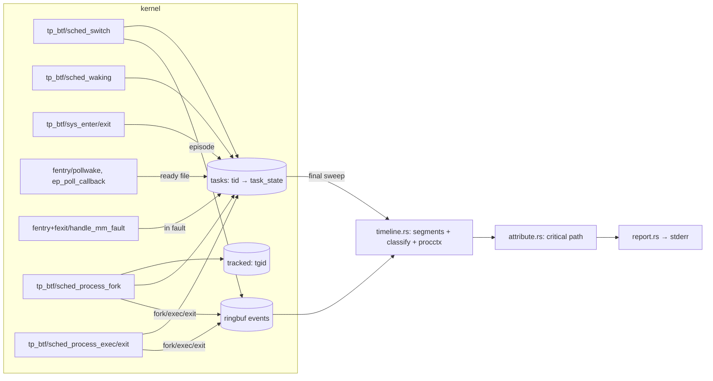

# whytime — agent guide

`whytime -- COMMAND` runs COMMAND, traces it and every process it starts with eBPF, and
prints to stderr where its wall-clock time went (on-CPU, waiting on children, timer sleep,
fsync, network peers, locks, ...). COMMAND's output passes through; whytime exits with
COMMAND's code. `whytime -p PID` does the same for a running process and its descendants,
from the attach until PID exits, `--duration` elapses or Ctrl-C.

**Name.** The crate and binary are `whytime` (https://github.com/Arinerron/whytime): the
`why` crate name is taken on crates.io. Use `whytime` everywhere in code, docs and output.

**Status: MVP.** Wrap mode and attach mode (`-p PID`), plus trace files for both:
`--record FILE` saves a run and `whytime report FILE` replays it offline into the identical
report. Flamegraphs and hostname/DNS correlation for network subjects are later milestones.

## Commands

The shared tracekit crates are a git submodule: clone with `--recursive`, or run
`git submodule update --init` once (else cargo fails with "failed to read
`…/tracekit/crates/wire/Cargo.toml`"). All cargo invocations need these, because `/tmp` has
a tight quota:

```sh
mkdir -p ~/.cache/whytime-tmp ~/.cache/whytime-target
export TMPDIR=~/.cache/whytime-tmp CARGO_TARGET_DIR=~/.cache/whytime-target
```

| What | Command |
|---|---|
| Build (debug) | `cargo build` (default member: `whytime`) |
| Release binary | `cargo build --release -p whytime` → `$CARGO_TARGET_DIR/x86_64-unknown-linux-musl/release/whytime` (static) |
| Unit tests | `cargo test --workspace` |
| End-to-end suite | `cargo xtask test-e2e` (needs passwordless `sudo -n`) |
| aarch64 | `cargo check --target aarch64-unknown-linux-musl --workspace`; `cargo build --release -p whytime --target aarch64-unknown-linux-musl` (static, linked by `rust-lld`; smoke with `qemu-aarch64 …/whytime --version`) |
| Completions | `whytime completions <bash\|zsh\|fish\|elvish\|powershell>` (stdout) |
| Man pages | `cargo xtask man [DIR]` (default `$CARGO_TARGET_DIR/man`) |
| Run | `sudo $CARGO_TARGET_DIR/x86_64-unknown-linux-musl/release/whytime -- sleep 1` |
| Attach | `sudo whytime -p PID [--duration 30s] [--record t.wt]` (report on exit, deadline or Ctrl-C; exit 0) |
| Doctor | `whytime doctor [--json]` (exit 0 ready, 3 cannot run) |
| Record / replay | `sudo whytime --record t.wt -- CMD` (or `-p PID --record t.wt`), then `whytime report t.wt [--json]` (no privileges; exit 0, or 2 if the file cannot be replayed) |
| Debug logging | `WHYTIME_LOG=debug whytime ...` (prints the verifier log on load failures) |

Toolchain: `rust-toolchain.toml` pins **stable** with the `x86_64-unknown-linux-musl` and
`aarch64-unknown-linux-musl` targets, and `.cargo/config.toml` makes x86_64 musl the default
build target, so every binary (including tests and xtask) is static; aarch64 links with
`rust-lld` against Rust's self-contained musl (no cross gcc). No nightly, no `bpf-linker`: the
BPF side is C, compiled by clang (22 here; any clang with BPF CO-RE works, override with
`CLANG=`).

License: MIT (`LICENSE`). The BPF object's `SEC("license")` string stays `Dual MIT/GPL`: the
verifier only lets GPL-compatible programs call GPL-only helpers (`bpf_probe_read_kernel`,
`bpf_get_current_task_btf`, ...). Vendored libbpf headers are `LGPL-2.1 OR BSD-2-Clause`.

CI (`.github/workflows/ci.yml`): x86_64 build + unit tests, aarch64 check/build/qemu smoke,
and `cargo xtask test-e2e` inside a virtme-ng VM. `release.yml`: `v*` tags publish static
x86_64/aarch64 tarballs with completions and man pages. Both check out with
`submodules: recursive`; `.github/actions/setup` installs clang and the toolchain.

`crates/whytime/src/cli.rs` is also compiled into xtask (`#[path]`, for `cargo xtask man`):
keep it self-contained (std, clap, clap_complete only; no `crate::` items).

Do not run `cargo fmt`/`cargo clippy` as part of feature work unless asked; lints are the
tracekit block (`clippy::all` + `pedantic`) in the root `Cargo.toml`.

## Layout

```
Cargo.toml                 workspace (excludes tracekit/), shared deps, lint block, release
                           profile (lto, strip, abort)
crates/whytime-abi/        wire! records + wire_consts! shared with C; feature std → header(),
                           feature user → aya::Pod impls
crates/whytime-bpf/        build.rs + bpf/ ; exports OBJECT (the .o) and ABI_HASH
  bpf/whytime.bpf.c        the BPF programs (C CO-RE)
  bpf/vmlinux_min.h        hand-curated preserve_access_index subset of vmlinux.h (pt_regs per arch)
  bpf/include/bpf/         vendored libbpf v1.8.0 headers
crates/whytime/            the binary
  src/main.rs              wrap flow, event loop (epoll: ring, pidfd, signalfd), sudo handling,
                           helpers shared with attach (preflight, load, collect, recording,
                           meta, report), `report` subcommand (replay)
  src/attach.rs            attach flow: target checks, tree membership, seeding, event loop
  src/snapshot.rs          /proc → task_state of pre-existing threads (syscall, fd, peers)
  src/cli.rs               clap derive CLI, --duration parser
  src/tracer.rs            aya loader: load, attach (required + optional sets), maps, detach
  src/percpu.rs            vmlinux BTF reader: __preempt_count's distance from runqueues
  src/spawn.rs             fork, park-on-pipe, priv drop, exec with error pipe, pidfd
  src/timeline.rs          records → per-thread segments, procctx table, final sweep
  src/classify.rs          (syscall, fd, kernel path, ready fd, fault, waker) → class + subject;
                           FdTarget: /proc fd link and maps fallback
  src/sys.rs               syscall table (libc numbers) → kind + BPF sys_flags bits
  src/attribute.rs         critical-path walk (follows wakers) → spans that partition the window
  src/report.rs            whytime.report/1 JSON + human rendering
  src/record.rs            trace files: Recorder (--record), format, parse + replay
  src/testkit.rs           #[cfg(test)] synthetic records and traces for unit tests
  src/doctor.rs            bpfdoctor Tool, probe.sched / syscalls / readiness / faults checks
  src/logger.rs            tiny stderr logger (WHYTIME_LOG)
crates/whytime-testbins/   e2e workloads: wt-sleep, wt-burn, wt-fsync, wt-child, wt-futex, wt-tcp,
                           wt-attach, wt-threads, wt-vfork, wt-flock, wt-syscalls, wt-poll,
                           wt-fault, wt-fifo
xtask/                     cargo xtask test-e2e | man [DIR]
.github/                   workflows ci.yml, release.yml; actions/setup (clang, rustup)
tracekit/                  git submodule, Arinerron/tracekit pinned at a release tag (v0.1.0)
LICENSE                    MIT
```

Shared foundation: the `tracekit` submodule (https://github.com/Arinerron/tracekit), path
deps `tracekit/crates/{wire,procctx,bpfdoctor}`, pinned at a release tag. **Do not modify**
it here; report gaps to the orchestrator. It is a workspace of its own, hence
`exclude = ["tracekit"]` in the root `Cargo.toml` (without it cargo cannot inherit the
crates' `workspace.package` fields). Bump it to a new release with
`git -C tracekit fetch --tags && git -C tracekit checkout vX.Y.Z && git add tracekit`, then
build and commit the new gitlink.

## How the BPF object is built

`crates/whytime-bpf/build.rs`:

1. renders `whytime_abi::header()` to `$OUT_DIR/whytime_wire.h` (structs, `_Static_assert`s on
   every size/offset, `#define`s for the `wire_consts!`, `WHYTIME_WIRE_H_ABI_HASH`) and
   writes the hash to `$OUT_DIR/abi_hash.rs`;
2. runs `clang -target bpfel -O2 -g -mcpu=v3 -Wall -Werror -D__TARGET_ARCH_{x86,arm64} -I bpf
   -I bpf/include -I $OUT_DIR -c bpf/whytime.bpf.c -o $OUT_DIR/whytime.bpf.o` (arch from
   `CARGO_CFG_TARGET_ARCH`; other arches panic, as `vmlinux_min.h` declares `pt_regs` for
   x86 (`di`, `si`, `dx`) and arm64 (`pt_regs.orig_x0` via libbpf's `pt_regs___arm64`, then
   `user_pt_regs.regs[]`) only);
3. `src/lib.rs` embeds it with `aya::include_bytes_aligned!`.

To change a record: edit `crates/whytime-abi/src/lib.rs` only; the C side picks the new
layout up through the generated header (a mismatch is a clang error), then update the C code
that fills it and `timeline.rs` that reads it.

## Architecture and data flow



Wrap-mode startup (`main.rs`, `spawn.rs`):

1. `bpfdoctor` preflight; on FAIL print diagnostics, exit 125.
2. Load the object and attach all programs (`tracer.rs`). Scheduler programs are required;
   the syscall, readiness and page-fault sets are optional: if one fails, continue with a
   warning and a report note (`record::Probes`, in the trace header). Before loading,
   `percpu.rs` reads `/sys/kernel/btf/vmlinux` and sets the `.rodata` global
   `preempt_count_from_rq` (see `on_waking`). With `--record`, create the trace file now
   (before COMMAND runs, so a bad path fails fast with 125).
3. Under sudo (`euid 0` + `SUDO_UID`/`SUDO_GID`), compute the invoking user's credentials
   and groups, and restore `HOME`/`USER`/`LOGNAME` to that user.
4. Ignore SIGINT/SIGQUIT (the TTY delivers them to COMMAND's process group, which whytime
   shares; whytime must survive to report). Route SIGTERM/SIGHUP to a signalfd; they are
   forwarded to COMMAND with `pidfd_send_signal`.
5. `fork`; the child blocks reading a CLOEXEC "go" pipe. The parent inserts the child's tgid
   into `tracked`, then writes "go". The child drops to the invoking user, resets signal
   dispositions and mask, and `execvp`s. A second CLOEXEC pipe returns `(stage, errno)` on
   failure: exec ENOENT → 127, other exec errors → 126, privilege drop failure → 125.
6. The window starts at the child's `sched_process_exec` record (the root's first task
   entry is created there) and ends at the root thread group's exit record (or
   `--duration` after the start). The loop polls ring buffer, pidfd and signalfd with epoll.
7. On window end: drop the `Ebpf` (detaches every program; the maps were taken out and stay
   alive), wait 2 ms for in-flight programs, drain the ring, then **sweep** the `tasks` map
   to close every still-open interval at the window end. With `--record`, write the sweep
   and the end frame. Attribute, report, return COMMAND's code (with `--duration`, keep
   forwarding signals until it exits).

Attach-mode startup (`attach.rs`, `snapshot.rs`; `whytime -p PID`):

1. Check the target before anything privileged (exit 1 with a `fix:` line when refused):
   `/proc/PID` exists and is a thread-group leader (a thread id → "use -p TGID"), not a
   zombie, not whytime itself (it would trace its own event loop) and not pid 1 (everything
   descends from init: a whole-system trace with init's event loop as the critical path).
   Without root, the target's real/effective/saved uid and gid must all be the invoking
   user's (the ptrace rule; file capabilities must not let users watch each other), unless
   whytime has `CAP_SYS_PTRACE`. Then `pidfd_open` the target.
2. Preflight and load as in wrap mode (exit 125 on failure); with `--record`, create the
   trace file. Block SIGINT/SIGTERM/SIGHUP into a signalfd: from here on they end the
   observation; the target is never signalled.
3. **Membership** (`track_tree`): scan `/proc/*/stat`, walk parent links from the target
   (skipping whytime), insert each live process into `tracked` with `BPF_NOEXIST`; repeat
   until a scan inserts nothing. `EEXIST` means a tracked parent forked it after its insert:
   the kernel side owns it (its FORK record is queued). Termination: a process still
   untracked after a scan was forked by a parent before that parent's insert, so the next
   scan sees it; a scan that inserts nothing proves every live member was tracked before
   it began. Lost only: a process forked in that race whose parent exits before the next
   scan (reparented out of the tree). Capped at 32 scans (warning).
4. **Threads** (`seed_threads`), after membership so new threads are already created in
   kernel: for every thread in `/proc/PID/task`, build a `task_state`
   (`snapshot::task_state`, the one function to adapt when `task_state` changes) and insert
   it with `BPF_NOEXIST` (`EEXIST`: the kernel created it on a fork or exec; its records
   describe it). Re-read the thread's stat afterwards; if it exited meanwhile, delete the
   entry (no exit record would). A member with no live thread left is untracked.
5. **Trace** (`Trace::seed`, pure: replay can feed it recorded `ProcSeed`s): one `Proc` per
   member (target = root, parents linked by ppid), one `Thread` per seeded entry, and a
   procctx record per member through `on_exec` with the comm, ppid and argv read from
   `/proc`; key = `(pid, StartClock::ticks_to_start(starttime))`, which is tick precision
   (10 ms at `USER_HZ` 100) instead of the kernel's exact `start_boottime`. Later records
   never re-key a process: `on_exec` keeps the known key, and a FORK recorded before the
   window start names a task the seeding may already have added (it reuses it).
6. The window starts after seeding (monotonic now) and ends at the target's thread-group
   exit (EXIT record, or the pidfd), `--duration` after the start, or the first
   SIGINT/SIGTERM/SIGHUP (`ended_by: interrupt`). If the target's exit record shows up in
   the final drain before the deadline/signal time, the window ends there (`exit`). With
   `--record`, the header and seed frames are written when the window starts. Detach,
   drain, sweep and report as in wrap mode; whytime exits 0. `exit_code` is the target's
   (from its EXIT record) when it exited in the window.

`task_state` from `/proc` (`snapshot.rs`), per `/proc/TID/stat` state letter:

| State | Entry | Fields set (all others zero, as in a fresh kernel entry) |
|---|---|---|
| `R` | `ST_RUNNING` | `seg.start`/`last_ts` = now, `sys` = none. A thread that was queued, not on a CPU, gets its first queue wait folded into the first mixed segment (split proportionally) |
| `S` `D` `I` `P` ... | `ST_BLOCKED` | also `block_ts` = now, `block_state` (`S`→1, `D`→2, `I`→0x402, `P`→0x40), `sys` from `/proc/TID/syscall`: `nr`, `detail.args` = its arguments 0–2, `detail.flags` = `SYSD_DESCRIBED`, and for `SYSF_FD0` syscalls `fd` = arg0 described like `describe_blocked` (`stat` of `/proc/TGID/task/TID/fd/N` → `S_IFMT`, ino, dev re-encoded as `major << 20 \| minor`; `flags:` from `fdinfo`; sockets: family/peer from `/proc/TGID/net/{tcp,udp}{,6}` and `unix`, cached per network namespace; `detail.magic` = `statfs` `f_type` of the link; anonymous inodes: `detail.path` = the name after `anon_inode:` in the link, no `SYSD_PATH_*` flag). No path is captured for files (no `SYSD_PATH_ROOTED`), so their subject comes from the classifier's `FdTarget` fallback when the record is processed; a descriptor `/proc` cannot stat stays undescribed (the kernel describes it if the syscall blocks again). `running` there → `ST_RUNNING`; `-1` → no syscall; unreadable (no ptrace access) → `nr = NR_UNREADABLE` (-2, user space only) → `other` "blocked since attach, syscall unreadable", counted in a report note |
| `T` / `t` | `ST_BLOCKED` | `block_state` `TASK_STOPPED` / `TASK_TRACED`, `sys` = none (stops happen after `sys_exit`) → `other` "stopped" |
| `Z` `X` | none | exited |

## Probes (verified BTF prototypes on 7.2.6)

| Program | Attach point | Prototype (`btf_trace_*`) | Does | Fallback |
|---|---|---|---|---|
| `on_switch` | `tp_btf/sched_switch` | `(void *, bool preempt, struct task_struct *prev, struct task_struct *next, unsigned int prev_state)` | prev: add on-CPU time; `!preempt && prev_state != 0` → BLOCKED (record block ts + state), else RUNNABLE. next: RUNNABLE → add runqueue time; BLOCKED/WOKEN → emit EPISODE, open a new segment. CPU holders: a preempted prev remembers `next` (`pend_tgid/comm`); when a RUNNABLE thread runs again, the longest such wait of the segment and its holder go to `seg.preempt_*` (a new task's holder is the `prev` it replaced); an episode carries `prev` as `run_holder_*`. At a block: `note_block` (clear the waker; inside a page fault `describe_file(vma->vm_file)` into `fault`), then at the first block of a syscall **describe** it (below) | required; needs ≥ 5.18 for `prev_state` (min_kernel) |
| `on_waking` | `tp_btf/sched_waking` | `(void *, struct task_struct *p)` | BLOCKED → WOKEN, record wake ts and the waker (current) tid/tgid, plus its comm when it is outside `tracked` and not exiting. Interrupt context (preempt_count has NMI, HARDIRQ or SOFTIRQ_OFFSET bits) → waker stays 0/0. preempt_count: `thread_info.preempt_count` where it exists (arm64, riscv); on x86-64 the per-CPU `__preempt_count` at `current->se.cfs_rq->rq` (checked `rq->curr == current`) + `preempt_count_from_rq` (user space: `.data..percpu` DATASEC offsets in vmlinux BTF, `pcpu_hot.preempt_count` on 6.2–6.14); aya cannot load `__ksym`s. Without either (no BTF var, no `CONFIG_FAIR_GROUP_SCHED`): waker = current, as before | required |
| `on_fork` | `tp_btf/sched_process_fork` | `(void *, struct task_struct *parent, struct task_struct *child)` | parent tracked → add child tgid to `tracked` (in kernel: the child can never run untracked), create its task entry (RUNNABLE), emit FORK | required |
| `on_exec` | `tp_btf/sched_process_exec` | `(void *, struct task_struct *p, pid_t old_pid, struct linux_binprm *)` | tracked tgid: create the root's task entry (window start) or flush the segment; migrate `old_pid`'s entry if a non-leader thread exec'd; emit EXEC with comm, argv (≤ 256 B from `mm->arg_start`), leader `start_boottime` | required |
| `on_exit` | `tp_btf/sched_process_exit` | `(void *, struct task_struct *p, bool group_dead)` | close the segment, emit EXIT (exit_code, group_dead), delete the task entry; last thread → remove from `tracked` | `group_dead` is computed from `p->signal->live.counter == 0` instead of the argument, which older kernels lack |
| `on_sys_enter` | `tp_btf/sys_enter` | `(void *, struct pt_regs *regs, long id)` | remember nr and arguments 0–2 (`PT_REGS_PARMn_SYSCALL`: direct BTF loads, no helper calls), clear `detail.flags`; nothing else, it runs on every syscall | optional: if the pair fails, all blocked time is `other` and a note says so |
| `on_sys_exit` | `tp_btf/sys_exit` | `(void *, struct pt_regs *regs, long ret)` | clear nr | attached before `sys_enter` so a half-attached pair is harmless |
| `on_pollwake` | `fentry/pollwake` | `int (struct wait_queue_entry *wait, unsigned mode, int sync, void *key)` | poll/select: `container_of(wait, poll_table_entry, wait)->filp` is the ready file, `((poll_wqueues *)wait->private)->polling_task` the poller; tracked + BLOCKED + key matches `entry->key` → the first source claims `ready` (`describe_file`, fd −1) | optional (with `on_ep_poll_callback`: `probe.readiness`); without them poll waits stay `poll` |
| `on_ep_poll_callback` | `fentry/ep_poll_callback` | same | epoll: `container_of(wait, eppoll_entry, wait)->base` is the epitem, its `ffd.file`/`ffd.fd` the ready file; the thread woken is the first entry of `epi->ep->wq` (exclusive waiters), `->private` its task; skipped when the item is disabled (`event.events` only `EP_PRIVATE_BITS`) or the key misses its events | optional |
| `on_fault_exit` / `on_fault_enter` | `fexit` / `fentry` `handle_mm_fault` | `vm_fault_t (struct vm_area_struct *vma, unsigned long address, unsigned int flags, struct pt_regs *regs)` | entry: `in_fault = 1`, `fault_file = vma->vm_file`; exit: `in_fault = 0`. Covers faults inside syscalls (copy_to_user) too | optional (`probe.faults`); fexit attaches first |

**Describe** (`describe_blocked`, once per syscall, guarded by `SYSD_DESCRIBED`): at
`sched_switch` `current` is still `prev`, so its fd table and user memory are at hand. Per
`sys_flags[nr]`: arg0's fd (`task->files->fdt->fd[fd]` → `describe_file`: `f_inode->i_mode &
S_IFMT`, ino, `i_sb->s_dev`, `f_flags`; sockets: `private_data→sk→__sk_common` family,
daddr/v6_daddr, dport), the filesystem (`i_sb->s_magic`), for regular files, directories,
block devices and anonymous inodes the **path** (`capture_path`: `f_path.dentry→d_parent`
names, crossing mounts through `container_of(vfsmount, struct mount, mnt)` →
`mnt_mountpoint`/`mnt_parent`, until the mount whose parent is itself; ≤ 32 steps, names leaf
first into 256 bytes, whole names only), and for `connect` the user sockaddr. Syscalls that
never block cost only the `sys_enter`/`sys_exit` stores.

Maps: `events` RINGBUF 4 MiB; `tasks` HASH tid → `task_state` (32768); `task_zero` ARRAY of
one zeroed `task_state`, the template `new_task()` copies (task_state exceeds the 512-byte BPF
stack, so no program may hold one on its stack); `tracked` HASH tgid (16384); `sys_flags` ARRAY nr → `SYSF_*` (512, filled by user space from libc numbers, so the
C code has no syscall numbers); `stats` PERCPU_ARRAY of loss counters (ring full, tasks
full, tracked full) → `quality.dropped`; `path_buf` PERCPU_ARRAY, one 512-byte buffer where
`capture_path` assembles names (twice `PATH_BYTES` so variable-offset reads verify).

CO-RE: `vmlinux_min.h` declares only the fields used, under
`#pragma clang attribute push(preserve_access_index)`, with `__VMLINUX_H__` defined so
`bpf_tracing.h` uses kernel `pt_regs` names. Field order there is irrelevant. `struct mount`
is private to `fs/` but in vmlinux BTF; its `mnt` offset comes from
`bpf_core_field_offset(struct mount, mnt)`.

## Wire records (`whytime-abi`)

All records start with `ev_header {kind, tid, tgid, _pad, ts}` (`ts` = `bpf_ktime_get_ns`,
CLOCK_MONOTONIC, the same clock user space reads for deadlines). `cpu_segment {start,
run_ns, rq_ns, preempt_max_ns, preempt_tgid, preempt_comm[16]}` is the in-kernel
accumulation since `start` (plus the longest single preemption and who held the CPU); its end
is the record's own boundary, so a thread's segments chain without gaps. New fields are
appended at the end of a struct, 8-byte aligned.

| Record | Size | Fields |
|---|---|---|
| `fork_record` (EV_FORK) | 40 | hdr (parent), child_tid, child_tgid, child_start (`start_boottime`) |
| `exec_record` (EV_EXEC) | 376 | hdr, seg (up to exec), start (leader `start_boottime` = procctx key), ppid, old_tid, comm[16], argv_len, argv[256] |
| `episode_record` (EV_EPISODE) | 592 | hdr (ts = switch-in), seg (up to block), block_ts, wake_ts (0 = unseen), sys_info, waker_tid/tgid (0/0 = unknown or interrupt context), block_state (`prev_state`), sys_detail, flags (`EPF_FAULT`, `EPF_READY`), run_holder_tgid/comm (ran just before the switch-in), waker_comm (out-of-tree waker, else empty), ready (sys_info of the file that ended a poll), fault (sys_info of the faulting vma's file; mode 0 = anonymous) |
| `exit_record` (EV_EXIT) | 96 | hdr, seg (up to exit), start, code (`task->exit_code`), group_dead |
| `task_state` (map value) | 600 | seg, last_ts, block_ts, wake_ts, sys_info, tgid, state (`ST_*`), block_state, waker_tid/tgid, sys_detail, ready, fault, fault_file (kernel `struct file *`), in_fault, has_ready, pend_tgid/comm (took the CPU at the last preemption), waker_comm |
| `sys_info` | 48 | nr (−1 = none), fd, mode (`S_IFMT` bits), f_flags, ino, dev (kernel `dev_t`), family, port (host order), addr[16]; for the syscall all but nr valid only with `SYSD_DESCRIBED`; `ready`/`fault` are complete when set (user space classifies them as described, without a path) |
| `sys_detail` | 296 | args[3] (raw, from `sys_enter`), magic (`s_magic`), flags (`SYSD_DESCRIBED`, `SYSD_PATH_ROOTED` = whole path, `SYSD_PATH_TRUNCATED` = tail only, neither = pseudo-fs name), path_len, path[256] (names leaf first, NUL-terminated: `lock\0app\0home\0` = `/home/app/lock`) |

One EPISODE per block → wake → run cycle; on-CPU and preemption are accumulated in kernel,
so a CPU-bound task emits nothing until it blocks or exits.

## Attribution model (what the numbers mean)

The window is `[exec of COMMAND, exit of COMMAND's last thread)` (attach mode: `[end of
seeding, exit of the target's last thread / deadline / signal)`); `wall_ns` is its length.
The walk (`attribute.rs`) cuts it into **spans** (`Attribution.spans`: `start, end, class,
subject, proc, thread, depth`), time-ordered and gap-free; report lines are the spans summed
by `(class, subject)`, so every nanosecond is in exactly one line and shares sum to 1 (the
e2e suite checks 1 ± 0.001; in practice exactly 1 up to float rounding). `critical` in JSON
is "some span came from this process". The walk:

- Follows COMMAND's **main thread**: the original leader while it lives, then whichever
  live thread outlives the rest (covers `pthread_exit` from main and multithreaded exec).
- Mixed segments split proportionally into on-CPU and `runqueue` (preempted, or woken and
  not yet running); in spans the on-CPU part comes first. On-CPU of COMMAND's own process
  (any thread) is `cpu` ("on-CPU (comm)"); on-CPU of a descendant process is `child`
  ("waiting on child: comm", subject = the descendant that was computing).
- Blocked time goes to its class from the in-flight syscall and descriptor:
  `fsync` (fsync/fdatasync/sync_file_range/syncfs/msync and writes to `O_DSYNC`/`O_SYNC`
  files; subject = directory, `~`-abbreviated), `file` (other regular-file/blockdev I/O and
  path syscalls), `lock` (`flock`, `fcntl` with `F_SETLKW`/`F_OFD_SETLKW`; subject = the
  file's directory), `aio` (`io_uring_enter`, `io_getevents`, `io_pgetevents`), `net` (inet
  sockets; subject = peer `ip:port` from `connect`'s sockaddr or the socket's `daddr:dport`;
  distinct socket inodes = "connections"), `ipc` (pipes, FIFOs, unix sockets, eventfds, SysV
  semaphores/message queues, POSIX message queues), `tty` (character devices), `futex`,
  `sleep` (nanosleep/clock_nanosleep, timerfd reads), `poll` (poll/select/epoll; inotify and
  fanotify reads with subject `inotify`/`fanotify`), `signal` (incl. signalfd reads), `other`
  (unknown syscall, off-CPU outside syscalls, stopped, or `untraced` gaps from lost records),
  `fault` (blocked inside a page fault; subject = the mapped file's directory, from
  `/proc/<pid>/maps` via `FdTarget::mapped_file` matched by dev:ino, or `anonymous memory
  (swap)`; takes precedence over the syscall the fault interrupted). Anonymous inodes are
  recognized by `s_magic == ANON_INODE_FS_MAGIC` and classified by the file's dentry name
  (`[timerfd]`, `[eventfd]`, ...); other ones are `other`.
- A poll/select/epoll wait whose readiness source was seen is classified as that descriptor
  would be: socket → `net`/`ipc`, FIFO → `ipc`, character device → `tty`; anything else
  (eventfd, timerfd, inotify, regular files) stays `poll`.
- `ipc` and `poll` blocks woken by a process-context task outside the traced tree get
  subject `woken by <comm>` (e.g. dbus-daemon). Wakers in interrupt context are unknown
  (0/0), never the interrupted task.
- All of this holds unless the block is **followed**:
- **Following**: a block explained by another tracked task is replaced by a walk of that
  task over the same interval, recursively with the same rules (its blocks keep their own
  class, so a lock held across a sleep is `sleep`, `sh -c 'sleep 1'` is `sleep`):
  - `futex`, `ipc`, `poll` blocks whose waker (`Block.waker_tid`/`waker_tgid`) is a
    tracked thread → that **thread** (any tracked process, including other threads of the
    same one: joined workers, lock holders, pipe writers/readers, a child whose exit
    signal ended a `pselect`);
  - **retried waits**: a `futex`/`poll` block without a tracked waker (a timeout, usually)
    takes the waker of the same thread's next block of that class if only `Mixed`/`Runq`
    segments with less than 1/8 of the block's length on-CPU lie between (it re-checked
    and waited again), chaining through further such blocks; memoized per segment.
    Needed in practice: xz's main thread waits in 300 ms timed condvar waits, CPython's
    GIL in 5 ms ones, so most of their waits end by timeout, not by the worker's wake;
  - `wait4`/`waitid` → the child **process** that ended it (the waker if it is a child;
    else the child that exited last inside the block; else the youngest child alive at its
    end), along its main line;
  - `clone`/`clone3`/`vfork` blocks woken by a child (`CLONE_VFORK`: `posix_spawn`, `vfork`)
    → that child until its exec/exit; its pre-exec CPU is `child` with the parent's comm.
  Waker 0 (unknown, or interrupt context, contract with the kernel side) is never
  followed. Lookups take the latest task with that tid/tgid born by the wake, dead or alive
  (exit-time wakeups may follow the exit record). Parts of the interval outside the
  followed task's lifetime keep the waiting block's line (for waits: `child`, subject the
  child). A task already on the walk stack (mutual waits, A↔B) and anything at
  `MAX_DEPTH` (64) is not followed; the block keeps its own class.

Honesty limits (state them when presenting results):

- One critical path. Work that ran in parallel with the path (threads or children other
  than the one that ended a wait) does not appear; `processes[].cpu_ns` in JSON shows every
  process's total CPU. Joining N parallel workers shows the one that finished the wait.
- Following trusts the last waker: a futex is followed to the thread that woke it (the
  releasing lock holder, the signalling producer), which is the critical path only if that
  thread was what the waiter needed. A `poll`/`epoll` wait is followed only when a tracked
  thread raised the wakeup; readiness from outside the tree (network, devices, daemons)
  stays `poll` (or the ready descriptor's class). Retried waits are joined without knowing
  the futex address, by timing only; a timed wait whose chain ends without a tracked wake
  stays `futex`/`poll`.
- The readiness source is the first descriptor reported ready while the thread blocked; an
  epoll wait with several waiters on one eventpoll is credited to the first waiter.
- Hidden dependencies outside the tree (a daemon, the X server, a remote service) are only
  visible as the resource COMMAND blocked on (`net`, `ipc`).
- Network subjects are `ip:port`; DNS/hostname correlation is a later milestone (the report
  notes this whenever a `net` line exists).
- `file`/`fsync`/`lock` paths are captured in kernel at the syscall's first block, so they
  survive short-lived processes. They show the file as it was then (a later rename is not
  seen; the first path seen per dev:ino is kept), relative to the root of the blocked task's
  mount namespace: a process in a container shows the path inside the container, and a
  chroot is not applied. Paths longer than 256 bytes or 32 dentries/mounts are truncated;
  then `/proc/<pid>/fd/<fd>` (checked against the kernel's dev:ino) is tried when the record
  is processed, then the captured tail (`…/a/b`), else the subject is `dev M:m ino N`.
- A syscall is described at its first block only; one that blocks again on another
  descriptor keeps the first description (none of the classified syscalls does).
- A wake that races the switch-out (seen before the block is recorded) is not observed;
  that whole off-CPU gap counts as blocked (µs scale) with waker 0, so it is not followed
  (child waits fall back to the exit-time heuristic).
- Mixed segments split on-CPU vs. preempted proportionally when clipped to a sub-interval.
- Attach mode does not see time before the attach. Each pre-existing thread's first
  interval is classified from `/proc` at attach (state letter, `/proc/TID/syscall`, fd
  description), sampled a few µs before its entry exists: a thread that changes state in
  between has that first interval misread (µs-scale race). Its file subject has no kernel
  path: it comes from `/proc/<pid>/fd/<fd>` when the record is processed (`dev M:m ino N` if
  the descriptor is gone by then). A thread running inside a syscall at attach that then
  blocks in it shows that block as `other` (outside syscalls), because its `sys_enter`
  predates the attach. Without ptrace access to the target (`kernel.yama.ptrace_scope` ≥ 1
  under file capabilities), `/proc/TID/syscall` is unreadable and blocked threads' first
  interval is `other` (a note says so).
- Attach-mode procctx keys are `/proc` start times (tick precision, see above), and a
  process forked by a not-yet-tracked member in the scan race, whose parent exits before
  the next scan, is not traced.

## Report

Human (stderr): `wall`, then lines ≥ 1% (at most 8, `other`-class lines such as
`other (outside syscalls (page faults, kernel locks))` included), a final `other` collecting
the rest, then `critical path: N processes · M events lost` and notes (one per unavailable
optional probe set).
JSON (`--json`, stderr), schema `whytime.report/1`:

| Field | Type | Meaning |
|---|---|---|
| `schema` | string | `"whytime.report/1"` |
| `command` | string[] | COMMAND and its arguments; attach mode: the target's argv (its comm if empty) |
| `attached_pid` | u32, optional | the target PID; present only in attach mode |
| `wall_ns` | u64 | window length: COMMAND's exec (attach: end of seeding) to its exit, the `--duration` deadline or (attach) the signal |
| `ended_by` | `"exit"` \| `"duration"` \| `"interrupt"` | why the window ended (`interrupt`: attach mode only) |
| `exit_code` | i32 \| null | COMMAND's code (128 + signal if killed); attach mode: the target's if it exited in the window; null if still running |
| `lines[]` | object[] | the breakdown, largest first; `share`s sum to 1 |
| `lines[].class` | string | `cpu`, `child`, `runqueue`, `sleep`, `fsync`, `file`, `aio`, `net`, `ipc`, `futex`, `lock`, `poll`, `signal`, `tty`, `fault`, `other` (see `classify::Class`) |
| `lines[].share` | f64 | fraction of `wall_ns` |
| `lines[].ns` | u64 | nanoseconds |
| `lines[].subject` | string | what within the class: comm, directory, `ip:port`, syscall |
| `lines[].connections` | usize, optional | distinct sockets (`net` lines only) |
| `processes[]` | object[] | every process of the tree, in order of appearance |
| `processes[].pid` / `.ppid` | u32 / u32 \| null | ids |
| `processes[].comm` / `.argv` | string / string[] | last comm; argv capped at 256 B in kernel |
| `processes[].cpu_ns` | u64 | on-CPU time over all its threads |
| `processes[].exit_code` | i32 \| null | null while running |
| `processes[].critical` | bool | some span of the attribution came from it |
| `quality.events` | u64 | ring buffer records received |
| `quality.dropped` | u64 | records or tracked tasks lost in kernel |
| `quality.syscalls` | bool | syscall tracepoints attached (blocks classified by resource) |
| `quality.readiness` | bool | poll/epoll readiness probes attached (poll waits classified by the ready descriptor) |
| `quality.faults` | bool | page-fault probes attached (blocks in page faults are `fault`) |
| `notes` | string[] | caveats for this report |

**Versioning policy.** `whytime.report/1` changes only additively: new optional fields, new
`class` values, new notes. Removing or renaming a field, changing its type, or changing its
meaning bumps the schema to `whytime.report/2` (`Report::SCHEMA`). Consumers must ignore
unknown fields and treat an unknown `class` as `other`. Every new field or class goes into
this table.

Exit codes: COMMAND's (128 + signal if killed); 125 whytime failed before/at start (with
doctor diagnostics); 126 not executable; 127 not found; `doctor`: 0 ready / 3 cannot run;
`report`: 0, or 2 if the trace file cannot be replayed. Attach mode: 0 after the report, 1
PID cannot be attached to (missing, thread, zombie, whytime, pid 1, another user's), 125 as
above.

## Trace files (`--record` / `report`)

`--record FILE` (wrap or attach mode, with or without `--json`/`--duration`) writes, next to
the normal run, everything the report is computed from; `whytime report FILE [--json]` feeds
it through the same `Trace::seed` → `Trace::ingest` → `sweep` → `attribute` → `Report` code
and prints the identical report (byte for byte: the e2e suite compares the JSON, for both
modes). Replay needs no BPF, no privileges and none of the traced processes. The format
(versioned, little-endian frames) is documented in `record.rs`'s module doc. Contents:

- preamble: magic `WHYTRACE`, format version, `whytime_bpf::ABI_HASH`;
- header frame: arch (syscall numbers), command line, root pid, home dir for `~`, optional
  probe sets attached (syscalls, readiness, faults), `AT_CLKTCK` (procctx start clock); attach mode also the count of blocked
  threads whose syscall was unreadable (its presence marks an attached trace: root pid =
  target, command line = the target's);
- attach mode only, before any record: the seed frame, `Trace::seed`'s input (window start,
  and per `ProcSeed` key, ppid, comm, argv, seed time and seeded threads). The `task_state`s
  attach wrote into the `tasks` map are not recorded: they reach the trace only through
  later records and the sweep;
- every ring buffer record verbatim, in arrival order (undecodable ones too: they count in
  `quality.events`);
- every `FdTarget` answer, keyed by `(dev, ino)` like the classifier's cache and recorded by
  the `Logged` wrapper as lookups happen: `/proc/<pid>/fd/<fd>` → path (lookup frames; asked
  only when the kernel's path walk did not reach the root: truncated walks, threads seeded at
  attach; kernel paths travel inside the records) and `/proc/<pid>/maps` → a page fault's
  mapped file (mapping frames);
- the final `tasks` sweep, then the end frame: window start/end, ended by (exit, duration,
  interrupt), exit code, dropped count. A file without the end frame (whytime killed or
  failed, or the target exited during attach) is "truncated".

procctx needs nothing recorded: whytime calls only its event handlers and `get_key`, which
never read `/proc` (attach's seeding feeds it `on_exec` events built from the seed frame).
Rules that keep replay exact:

- **Anything external that affects the report goes through the recording**: a new lookup
  (`/proc`, DNS, clocks, env) needs a seam like `FdTarget` with a live (logged) and a
  replayed implementation, plus a frame; a new `Meta` input goes in the header or end frame
  (`main.rs::meta` builds `Meta` from them for all three paths: wrap, attach, replay); a new
  input to the trace before its first record goes in the seed frame.
- Changing framing or a payload: bump `record::VERSION`. Changing a wire record: the ABI hash
  changes and old files are refused with both hashes named (re-record them).
- Files are rejected, never half-replayed: preamble, frame structure and every payload are
  checked before the first record is ingested. Exit 2 with `FILE: <reason>`.
- Under sudo the file is created by root and then `fchown`ed to the invoking user (regular
  files only: never `--record /dev/null`'s owner).

## Unit tests

`testkit.rs` (`#[cfg(test)]`) builds ring records from all-zero bytes and sets only named
fields (`exec`, `fork`, `episode`, `exit`, `task`, `seg`, `sys`), so fields appended to the
ABI keep a neutral 0 and tests survive layout growth; an `episode` inside a syscall is
`SYSD_DESCRIBED` without a captured path, so file subjects go through the trace's
`FdTarget`. `testkit::trace(pid)` is a `Trace` with no `/proc` access. Timeline, attribution
and attach-seeding tests feed records like the ring buffer would and assert on segments and
lines; follow-the-waker tests in `attribute.rs` push `Proc`/`Thread`/`Seg`s into such a
trace directly and check that the spans tile the window. `classify.rs` tests build
`SysDetail`s (kernel paths rooted, truncated, anonymous inodes) with an in-memory `FdTarget`.
`record.rs` tests round-trip a recorded run (wrap and attach) to the identical JSON report and
reject damaged files. `snapshot.rs` tests read this process's own `/proc` (threads blocked on
a socket, a pipe and an eventfd).

## Privileges

Required: `CAP_BPF` + `CAP_PERFMON` (verified sufficient), or root. Two ways:

- `sudo whytime -- CMD`: COMMAND runs as the invoking user (`SUDO_UID`/`SUDO_GID`, groups
  from `getgrouplist(SUDO_USER)`), with `HOME`/`USER`/`LOGNAME` restored.
- `sudo setcap cap_bpf,cap_perfmon+ep /path/to/whytime` once, then run unprivileged. File
  caps are ignored on `nosuid` mounts (`/tmp` here): install to an ext4 path. Exec drops
  the caps for COMMAND (non-root exec without ambient caps).

Optional: `CAP_SYS_PTRACE` to resolve, through `/proc/<pid>/fd`, file paths the kernel's
walk could not capture (see the `file` limit above) of descendants running as another user,
and, in attach mode without root, to read `/proc/TID/syscall` of the target's threads
under Yama `ptrace_scope` ≥ 1 (else their first interval is `other`) and to attach to
processes of other users. Without root or it, attach mode only accepts the invoking
user's own processes.

## Doctor checks

`Doctor::with_shared()` (platform, kernel ≥ 5.18, BTF, capabilities, file caps, nosuid, nnp,
lockdown, LSM, sysctls incl. `perf_event_paranoid`, memlock, namespaces, seccomp, ringbuf,
memcg) plus:

| Id | Required | Observed / impact / fix |
|---|---|---|
| `probe.sched` | yes | loads the real object and attaches the 5 scheduler programs; PASS shows verified insn count. FAIL shows the errno; impact "cannot observe scheduling"; fixes by errno: EPERM/EACCES → `sudo setcap cap_bpf,cap_perfmon+ep <exe>` or run with sudo; ENOENT/EINVAL/E2BIG/EOPNOTSUPP → kernel ≥ 5.18 with `CONFIG_DEBUG_INFO_BTF`; else `WHYTIME_LOG=debug whytime doctor` for the verifier log |
| `probe.syscalls` | no | attaches `sys_exit` then `sys_enter`; WARN impact "blocked time is reported as other"; SKIP if the scheduler probe failed |
| `probe.readiness` | no | attaches `fentry/pollwake` and `fentry/ep_poll_callback`; WARN impact "poll/select/epoll waits are reported as poll"; fixes: BPF trampolines (x86-64 ≥ 5.5, arm64 ≥ 6.0) + BTF, or the verifier log; SKIP if the scheduler probe failed |
| `probe.faults` | no | attaches `fexit` then `fentry` on `handle_mm_fault`; WARN impact "page-fault time is reported as other or as the interrupted syscall"; same fixes; SKIP if the scheduler probe failed |

`kernel.kptr_restrict` is not checked: the MVP reads no kernel addresses (relevant once
flamegraphs symbolize kernel stacks). Wrap and attach mode run `Doctor::preflight()` first,
and after a load failure re-run `ids_for_errno(errno)` and print the non-passing checks.

## Performance budget

Measured (7.2.6, x86-64, other agents' load around 10 on 22 cores; CPU and wall agree):
`dd if=/dev/zero of=/dev/null bs=1 count=3000000` (6 M syscalls), best of 3, interleaved:

| Run | Wall | Extra per syscall |
|---|---|---|
| untraced | 1.42 s | — |
| traced, describing at every `sys_enter` (before lazy description) | 2.84 s | ~238 ns |
| traced, lazy description at block time (now) | 1.99 s | ~95 ns |
| traced, `sys_enter`/`sys_exit` programs that only `return 0` (floor) | 1.70 s | ~46 ns |

So the syscall programs themselves now cost ~50 ns per syscall (two hash lookups, three
argument loads, a few stores); the rest is the `raw_syscalls` tracepoint machinery, which
puts every task on the system on the syscall slow path while whytime runs. The `overhead`
e2e scenario guards this (`wt-syscalls`: 1.4–1.8× on-CPU time traced vs untraced, limit
2.5). Measure with `bpftool prog show` after `sysctl kernel.bpf_stats_enabled=1` only for
per-program cost; the programs fire for every task, so averages mix tracked and untracked.

Targets (not benchmarked unless noted):

- `sched_switch` with untracked prev and next: two hash lookups (skipped for the idle task),
  no clock read, ≤ ~150 ns. A tracked thread's first block in a described syscall adds
  ~10 probe reads plus up to 32 dentry/mount steps for the path.
- `sys_enter`/`sys_exit` for untracked tasks: one hash lookup, ≤ ~100 ns.
- `sched_waking`, fork/exec/exit: one lookup for untracked tasks. A tracked wakee adds the
  preempt_count read (3 probe reads on x86-64) and one `tracked` lookup.
- `pollwake`/`ep_poll_callback`: a few probe reads and one `tasks` lookup per wakeup callback
  system-wide (they fire for every poll/epoll wakeup, tracked or not).
- `handle_mm_fault` entry/exit: one `tasks` lookup per page fault system-wide.
- Ring traffic: one 592-byte record per block cycle of a tracked thread; CPU-bound threads
  emit nothing (on-CPU accumulates in kernel). Measured with 424-byte records (before
  feat/wake): a pipe ping-pong (~200 k episodes in 1.8 s) loses none with the 4 MiB ring.

## e2e suite

`cargo xtask test-e2e` builds release `whytime` + testbins, then runs (all via
`sudo -n whytime --json --` unless noted; every report must sum to 1 ± 0.001 with
`quality.dropped == 0`). Its scratch directory is `~/.cache/whytime-e2e`, or
`$WHYTIME_E2E_DIR` (set a distinct one per checkout to run suites in parallel):

1. `sleep`: `wt-sleep 1000` → `sleep` ≥ 0.9, wall 1.0 s ± 10%
2. `cpu-burn`: `wt-burn 1000` → `cpu` ≥ 0.9
3. `fsync`: `wt-fsync ~/.cache/whytime-e2e 200` (ext4; the suite refuses tmpfs) → top line
   `fsync`/`file` ≥ 0.5
4. `child`: `wt-child 1000` (spawns `wt-burn`, waits) → `child` subject `wt-burn` ≥ 0.8
5. `lock-holder`: `wt-futex 500` (a thread sleeps holding a mutex the main thread waits
   on) → `sleep` ≥ 0.8 (the futex is followed to the holder)
6. `tcp-slow`: xtask runs a 127.0.0.1 server in its own process (outside the tree) that
   replies 300 ms after accept; `wt-tcp ADDR 3` → `net` subject = server `ip:port` ≥ 0.6
7. `exit-code`: `sh -c 'exit 7'` → exit 7
8. `nopriv`: the build output run as the user without caps → exit 125 and a `setcap` line
9. `setcap`: copy to `~/.cache/whytime-e2e/bin`, `setcap cap_bpf,cap_perfmon+ep`, run
   unprivileged on `wt-sleep 300` → `sleep` ≥ 0.9
10. `threads-cpu`: `wt-threads 4 600` (main joins 4 spinning threads) → `cpu` subject
    `wt-threads` ≥ 0.8
11. `threads-timed`: `wt-threads 4 600 50` (main first waits on a condvar in 50 ms timed
    waits, most of which time out) → `cpu` subject `wt-threads` ≥ 0.8 (retried waits)
12. `vfork`: `wt-vfork 600` (`clone(CLONE_VM|CLONE_VFORK)` child spins 600 ms, then execs
    `wt-sleep 0`) → `child` subject `wt-vfork` ≥ 0.8
13. `flock-path`: `wt-flock DIR 600` (fresh DIR in the scratch dir): a holder child keeps a
    `flock` for 600 ms; a waiter child blocks on it; once `/proc/<waiter>/syscall` shows it
    asleep in `flock`, the parent renames DIR, then waits for the waiter, which exits right
    after getting the lock → `lock` subject = DIR (`~`-abbreviated, the pre-rename name, so
    only the in-kernel path passes) ≥ 0.6, and no `dev M:m ino N` subject
14. `overhead`: `wt-syscalls 2000000` (one-byte `/dev/zero` reads), 5 traced runs (on-CPU
    time from the report's `processes[].cpu_ns`) interleaved with 5 untraced ones (rusage);
    least traced / least untraced ≤ 2.5 (measured 1.4–1.8 under parallel load; CPU time,
    unlike wall time, ignores waits for a CPU on a loaded machine)
15. `poll-ready`: same server; `wt-poll ADDR 4` waits for each reply in `epoll_wait` and
    `poll` in turn → `net` subject = server `ip:port` ≥ 0.6 (readiness probes; without
    them these waits are `poll`)
16. `fault`: xtask runs `wt-fault write $WORK/fault.bin 128` (synced, pages dropped), then
    `wt-fault touch FILE` drops them again, maps it with `MADV_RANDOM` (no fault
    read-around), checks with `mincore` that no page is cached, and reads one byte every 16
    pages last-to-first (2048 major faults, each waiting for its own page) → `fault` subject
    = the `~`-abbreviated work directory ≥ 0.9 of the blocked time (all but `cpu` and
    `runqueue`; measured 100%) and ≥ 0.2 of the wall. The wall share is machine- and
    load-bound: ~25 µs of traced CPU per fault next to a ~60 µs NVMe read, plus a runqueue
    wait per wakeup (60–75% at load 10–15 on 22 cores, 29–55% with 3 runnable tasks per CPU)
17. `waker`: xtask makes `$WORK/waker.fifo` and `$WORK/waker.watched`; `sh` starts
    `wt-fifo write FIFO FILE 8 100` (comm `wt-fifo-writer`, outside the tree) and execs
    whytime on `wt-fifo read FIFO FILE 8`, which alternates `poll` on an inotify watch of
    FILE and blocking FIFO reads → `poll` subject `woken by wt-fifo-writer` ≥ 0.35 and
    `ipc` subject `woken by wt-fifo-writer` ≥ 0.35 (the out-of-tree writer is not followed,
    so the FIFO wait keeps its classified subject)
18. `record-replay`: `--json --record F -- wt-child 300`, then unprivileged
    `whytime report F --json` → JSON identical to the live report (every field), human
    replay exits 0, F belongs to the invoking user; F cut in half → exit 2, "truncated"

Attach scenarios run an `sh` script (`attach_cmd`): start the target in the background,
wait 0.3 s, `sudo -n whytime --json -p $!` with the scenario's flags, then print `target
alive` if the target still runs (it must, unless it exited by itself), stop it, and exit
with whytime's status (must be 0):

19. `attach-blocked`: `wt-sleep 30000`, `--duration 1s` → `ended_by` duration, `sleep` ≥
    0.9 (classified from `/proc` at attach), wall 1.0 s ± 10%, target alive
20. `attach-running`: `wt-burn 30000`, `--duration 1s` → `cpu` ≥ 0.9, target alive
21. `attach-threads`: `wt-futex 30000` (two threads), `--duration 1s` → `futex` ≥ 0.9 (the
    holder never releases in the window, so there is no waker to follow)
22. `attach-exit`: `sh -c '"$0" 1200; exit 3' wt-sleep` (pre-existing child) → `ended_by`
    exit, `exit_code` 3, `wt-sleep` in `processes[]` with ppid = target, `sleep` ≥ 0.9
23. `attach-spawn`: `wt-attach 1500 800` (sleeps, then forks `wt-burn 800` after the
    attach) → `ended_by` exit, `wt-burn` in `processes[]`, `child` subject `wt-burn` ≥ 0.3
24. `attach-interrupt`: `wt-sleep 30000`; the script polls until whytime observes (sudo's
    child is `whytime`, SIGINT in `SigBlk`, `State` S: past seeding, in `epoll_wait`; whytime
    inherits SIGINT ignored from the background job, so an earlier one would be lost), sends
    `sudo -n kill -INT` 1 s later and prints `/proc/uptime` at ready, before and after the
    kill → `ended_by` interrupt, `sleep` ≥ 0.9, wall within ready→kill ± 0.1 s, target alive
25. `attach-nopid`: unprivileged `whytime -p 4194304` (above any `pid_max`) → exit 1, "no
    process"
26. `attach-record`: `sh -c 'while :; do "$0" "$1" 20; done' wt-fsync DIR` (seeds, then
    fork/exec/exit, fsync records and file lookups in the window), `--duration 1s --record
    F` → `ended_by` duration, target alive, `quality.events` > 0, then the `record-replay`
    checks: unprivileged `whytime report F --json` identical to the live report, human
    replay exits 0, F owned by the invoking user, F cut in half → exit 2, "truncated"

## Gotchas

- clang folds `if (!p && !n)` on two map-value pointers into `p | n`; the verifier rejects
  pointer arithmetic (`R1 pointer |= pointer prohibited`). Test them in separate branches.
- Nested `BPF_CORE_READ(BPF_CORE_READ(...))` does not compile ("nested
  builtin_preserve_access_index"); read into a local first.
- CO-RE relocation failures are silent at build time and show up in the verifier log as
  `unknown#195896080`; use `WHYTIME_LOG=debug`.
- `bool` cannot be an aya global (`aya::Pod`); pass `u8`. The one global,
  `preempt_count_from_rq`, is a `const volatile s64` set with `override_global` (0 = unknown,
  so the verifier drops the per-CPU read).
- aya loads no `__ksym` externs (no `.ksyms` handling): per-CPU kernel variables are reached
  through an object BPF can address (`runqueues` via `current->se.cfs_rq->rq`) plus a BTF
  offset computed in user space.
- `task_state` is larger than the 512-byte BPF stack: never build one on the stack; create
  entries with `new_task()` (copies the `task_zero` template), move them map-to-map.
- x86-64 runs interrupts taken in user mode, and the softirqs at their exit, on the task's own
  stack: stack-pointer tests cannot tell interrupt context; read preempt_count.
- Anonymous inodes (eventfd, timerfd, signalfd, inotify, epoll, pidfd) have
  `i_mode & S_IFMT == 0` on 7.2.
- `/tmp` is `nosuid` here: file capabilities on a binary there are ignored.
- Under sudo, `sh -c '... of=~/x'` does not expand `~` after `of=` (POSIX `sh`); use `$HOME`.
- `dash` (CI's `/bin/sh`) prints `Terminated` on stderr when `wait` reaps a killed job;
  the attach script silences that `wait`, which would otherwise follow the JSON report.
- The report is the last thing on stderr; the e2e harness locates it by the
  `"schema": "whytime.report/1"` prefix, so test workloads must not write JSON to stderr.
  A trace-file write error is printed before the report for the same reason.
- `wire::from_bytes` needs 8-byte alignment (the ring hands records out aligned); replay
  copies each record into an aligned scratch buffer before `Trace::ingest`.
- Tracking membership is inserted in kernel at fork; user space inserts only COMMAND's pid
  before releasing it, or (attach) processes that already exist. Never add user-space
  insertion at fork (it races the child).
- Attach mode seeds `tracked` and `tasks` from user space with `BPF_NOEXIST` only, after
  the programs are attached: the kernel side may already have created an entry (fork,
  exec), and overwriting it would lose that state. `EEXIST` means "the records describe
  it"; do not seed the trace for it either.
- A pre-existing process's procctx key comes from `/proc` ticks, not `start_boottime`;
  exec/fork handling in `timeline.rs` keeps the first key of a live process, so procctx
  sees one lifetime. Compare starts in ticks (`StartClock::start_to_ticks`), never in ns.
- `/proc/TID/syscall` needs ptrace *attach* access (Yama applies), while `/proc/TID/fd`,
  `fdinfo` and `stat` need only read access: under file capabilities the syscall may be
  unreadable while everything else works.
- A non-interactive shell's background job inherits SIGINT ignored. Attach mode blocks
  SIGINT into a signalfd, and blocked signals are queued even when ignored, so it still
  sees Ctrl-C/`kill -INT`; never switch that to a handler-based approach without resetting
  the disposition.
- Anonymous inodes (eventfd, timerfd, signalfd, inotify, epoll, ...) carry no usable file
  type in `i_mode` (`i_mode & S_IFMT` is 0 on 7.2); recognize them by `i_sb->s_magic`
  (`ANON_INODE_FS_MAGIC`), whatever the mode. They all share one inode, so never key anything
  about them by dev:ino; their identity is the dentry name.
- A helper writing at a variable offset into a buffer (`bpf_probe_read_kernel_str(buf + off,
  PATH_BYTES - off, ...)`) only verifies if `off_max + size_max` fits: the verifier does not
  relate the two registers. Mask `off` below `PATH_BYTES` and give the buffer `2 *
  PATH_BYTES` (the per-CPU `path_buf` map), then copy the used part out.
- At `sched_switch`, `current` is `prev` (the switch has not happened), so the blocking task's
  fd table and user memory can be read there with `bpf_get_current_task_btf()` and
  `bpf_probe_read_user`.
- Running the e2e suite in virtme-ng (as CI does): `vng --run v6.12.40 --disable-microvm
  --user "$USER" --disk e2e.img --exec 'export PATH="$HOME/.cargo/bin:$PATH"; ...'`. The
  microvm machine hung at ACPI init with that Ubuntu mainline kernel; vng passes the script
  base64-encoded on the kernel command line, so an over-long one (e.g. the host's whole
  `PATH` inlined) hangs the guest with no output; the guest's default PATH finds a system
  cargo without the musl target; the guest root is read-only virtiofs, so put
  `WHYTIME_E2E_DIR` on a mounted ext4 image (`/dev/vda`). vng returns the guest's exit code.
