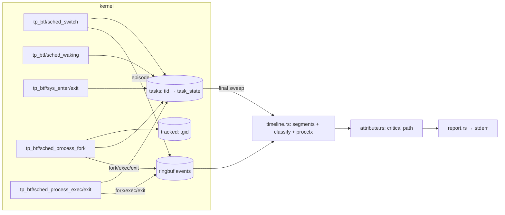

# whytime — agent guide

`whytime -- COMMAND` runs COMMAND, traces it and every process it starts with eBPF, and
prints to stderr where its wall-clock time went (on-CPU, waiting on children, timer sleep,
fsync, network peers, locks, ...). COMMAND's output passes through; whytime exits with
COMMAND's code.

**Name.** The repo directory is `why`, but the crate and binary are `whytime`: the `why`
crate name is taken on crates.io. Use `whytime` everywhere in code, docs and output.

**Status: MVP.** Wrap mode only. Attach mode (`-p PID`), flamegraphs, and hostname/DNS
correlation for network subjects are later milestones.

## Commands

All cargo invocations need these, because `/tmp` has a tight quota:

```sh
mkdir -p ~/.cache/whytime-tmp ~/.cache/whytime-target
export TMPDIR=~/.cache/whytime-tmp CARGO_TARGET_DIR=~/.cache/whytime-target
```

| What | Command |
|---|---|
| Build (debug) | `cargo build` (default member: `whytime`) |
| Release binary | `cargo build --release -p whytime` → `$CARGO_TARGET_DIR/x86_64-unknown-linux-musl/release/whytime` (static) |
| Unit tests | `cargo test --workspace` |
| End-to-end suite | `cargo xtask test-e2e` (needs passwordless `sudo -n`) |
| aarch64 | `cargo check --target aarch64-unknown-linux-musl --workspace`; `cargo build --release -p whytime --target aarch64-unknown-linux-musl` (static, linked by `rust-lld`; smoke with `qemu-aarch64 …/whytime --version`) |
| Completions | `whytime completions <bash\|zsh\|fish\|elvish\|powershell>` (stdout) |
| Man pages | `cargo xtask man [DIR]` (default `$CARGO_TARGET_DIR/man`) |
| Run | `sudo $CARGO_TARGET_DIR/x86_64-unknown-linux-musl/release/whytime -- sleep 1` |
| Doctor | `whytime doctor [--json]` (exit 0 ready, 3 cannot run) |
| Debug logging | `WHYTIME_LOG=debug whytime ...` (prints the verifier log on load failures) |

Toolchain: `rust-toolchain.toml` pins **stable** with the `x86_64-unknown-linux-musl` and
`aarch64-unknown-linux-musl` targets, and `.cargo/config.toml` makes x86_64 musl the default
build target, so every binary (including tests and xtask) is static; aarch64 links with
`rust-lld` against Rust's self-contained musl (no cross gcc). No nightly, no `bpf-linker`: the
BPF side is C, compiled by clang (22 here; any clang with BPF CO-RE works, override with
`CLANG=`).

License: MIT (`LICENSE`). The BPF object's `SEC("license")` string stays `Dual MIT/GPL`: the
verifier only lets GPL-compatible programs call GPL-only helpers (`bpf_probe_read_kernel`,
`bpf_get_current_task_btf`, ...). Vendored libbpf headers are `LGPL-2.1 OR BSD-2-Clause`.

CI (`.github/workflows/ci.yml`): x86_64 build + unit tests, aarch64 check/build/qemu smoke,
and `cargo xtask test-e2e` inside a virtme-ng VM. `release.yml`: `v*` tags publish static
x86_64/aarch64 tarballs with completions and man pages. Both check out
`Arinerron/tracekit` next to the repo via `.github/actions/setup` (its `tracekit-*` inputs).

`crates/whytime/src/cli.rs` is also compiled into xtask (`#[path]`, for `cargo xtask man`):
keep it self-contained (std, clap, clap_complete only; no `crate::` items).

Do not run `cargo fmt`/`cargo clippy` as part of feature work unless asked; lints are the
tracekit block (`clippy::all` + `pedantic`) in the root `Cargo.toml`.

## Layout

```
Cargo.toml                 workspace, shared deps, lint block, release profile (lto, strip, abort)
crates/whytime-abi/        wire! records + wire_consts! shared with C; feature std → header(),
                           feature user → aya::Pod impls
crates/whytime-bpf/        build.rs + bpf/ ; exports OBJECT (the .o) and ABI_HASH
  bpf/whytime.bpf.c        the BPF programs (C CO-RE)
  bpf/vmlinux_min.h        hand-curated preserve_access_index subset of vmlinux.h (pt_regs per arch)
  bpf/include/bpf/         vendored libbpf v1.8.0 headers
crates/whytime/            the binary
  src/main.rs              wrap flow, event loop (epoll: ring, pidfd, signalfd), sudo handling
  src/cli.rs               clap derive CLI, --duration parser
  src/tracer.rs            aya loader: load, attach, maps, detach
  src/spawn.rs             fork, park-on-pipe, priv drop, exec with error pipe, pidfd
  src/timeline.rs          records → per-thread segments, procctx table, final sweep
  src/classify.rs          (syscall, fd type, socket) → class + subject; /proc path resolution
  src/sys.rs               syscall table (libc numbers) → kind + BPF sys_flags bits
  src/attribute.rs         critical-path walk → lines that partition the window
  src/report.rs            whytime.report/1 JSON + human rendering
  src/doctor.rs            bpfdoctor Tool, probe.sched / probe.syscalls checks
  src/logger.rs            tiny stderr logger (WHYTIME_LOG)
crates/whytime-testbins/   e2e workloads: wt-sleep, wt-burn, wt-fsync, wt-child, wt-futex, wt-tcp
xtask/                     cargo xtask test-e2e | man [DIR]
.github/                   workflows ci.yml, release.yml; actions/setup (tracekit checkout, clang, rustup)
LICENSE                    MIT
```

Shared foundation (path deps, **do not modify**; report gaps to the orchestrator):
`../tracekit/crates/{wire,procctx,bpfdoctor}`.

## How the BPF object is built

`crates/whytime-bpf/build.rs`:

1. renders `whytime_abi::header()` to `$OUT_DIR/whytime_wire.h` (structs, `_Static_assert`s on
   every size/offset, `#define`s for the `wire_consts!`, `WHYTIME_WIRE_H_ABI_HASH`) and
   writes the hash to `$OUT_DIR/abi_hash.rs`;
2. runs `clang -target bpfel -O2 -g -mcpu=v3 -Wall -Werror -D__TARGET_ARCH_{x86,arm64} -I bpf
   -I bpf/include -I $OUT_DIR -c bpf/whytime.bpf.c -o $OUT_DIR/whytime.bpf.o` (arch from
   `CARGO_CFG_TARGET_ARCH`; other arches panic, as `vmlinux_min.h` declares `pt_regs` for
   x86 (`di`, `si`, `dx`) and arm64 (`pt_regs.orig_x0` via libbpf's `pt_regs___arm64`, then
   `user_pt_regs.regs[]`) only);
3. `src/lib.rs` embeds it with `aya::include_bytes_aligned!`.

To change a record: edit `crates/whytime-abi/src/lib.rs` only; the C side picks the new
layout up through the generated header (a mismatch is a clang error), then update the C code
that fills it and `timeline.rs` that reads it.

## Architecture and data flow



Wrap-mode startup (`main.rs`, `spawn.rs`):

1. `bpfdoctor` preflight; on FAIL print diagnostics, exit 125.
2. Load the object and attach all programs (`tracer.rs`). Scheduler programs are required;
   if the syscall pair fails, continue with a warning and a report note.
3. Under sudo (`euid 0` + `SUDO_UID`/`SUDO_GID`), compute the invoking user's credentials
   and groups, and restore `HOME`/`USER`/`LOGNAME` to that user.
4. Ignore SIGINT/SIGQUIT (the TTY delivers them to COMMAND's process group, which whytime
   shares; whytime must survive to report). Route SIGTERM/SIGHUP to a signalfd; they are
   forwarded to COMMAND with `pidfd_send_signal`.
5. `fork`; the child blocks reading a CLOEXEC "go" pipe. The parent inserts the child's tgid
   into `tracked`, then writes "go". The child drops to the invoking user, resets signal
   dispositions and mask, and `execvp`s. A second CLOEXEC pipe returns `(stage, errno)` on
   failure: exec ENOENT → 127, other exec errors → 126, privilege drop failure → 125.
6. The window starts at the child's `sched_process_exec` record (the root's first task
   entry is created there) and ends at the root thread group's exit record (or
   `--duration` after the start). The loop polls ring buffer, pidfd and signalfd with epoll.
7. On window end: drop the `Ebpf` (detaches every program; the maps were taken out and stay
   alive), wait 2 ms for in-flight programs, drain the ring, then **sweep** the `tasks` map
   to close every still-open interval at the window end. Attribute, report, return
   COMMAND's code (with `--duration`, keep forwarding signals until it exits).

## Probes (verified BTF prototypes on 7.2.6)

| Program | Attach point | Prototype (`btf_trace_*`) | Does | Fallback |
|---|---|---|---|---|
| `on_switch` | `tp_btf/sched_switch` | `(void *, bool preempt, struct task_struct *prev, struct task_struct *next, unsigned int prev_state)` | prev: add on-CPU time; `!preempt && prev_state != 0` → BLOCKED (record block ts + state), else RUNNABLE. next: RUNNABLE → add runqueue time; BLOCKED/WOKEN → emit EPISODE, open a new segment | required; needs ≥ 5.18 for `prev_state` (min_kernel) |
| `on_waking` | `tp_btf/sched_waking` | `(void *, struct task_struct *p)` | BLOCKED → WOKEN, record wake ts and the waker (current) tid/tgid | required |
| `on_fork` | `tp_btf/sched_process_fork` | `(void *, struct task_struct *parent, struct task_struct *child)` | parent tracked → add child tgid to `tracked` (in kernel: the child can never run untracked), create its task entry (RUNNABLE), emit FORK | required |
| `on_exec` | `tp_btf/sched_process_exec` | `(void *, struct task_struct *p, pid_t old_pid, struct linux_binprm *)` | tracked tgid: create the root's task entry (window start) or flush the segment; migrate `old_pid`'s entry if a non-leader thread exec'd; emit EXEC with comm, argv (≤ 256 B from `mm->arg_start`), leader `start_boottime` | required |
| `on_exit` | `tp_btf/sched_process_exit` | `(void *, struct task_struct *p, bool group_dead)` | close the segment, emit EXIT (exit_code, group_dead), delete the task entry; last thread → remove from `tracked` | `group_dead` is computed from `p->signal->live.counter == 0` instead of the argument, which older kernels lack |
| `on_sys_enter` | `tp_btf/sys_enter` | `(void *, struct pt_regs *regs, long id)` | remember nr; per `sys_flags[nr]` describe arg0's fd (`task->files->fdt->fd[fd]` → `f_inode->i_mode & S_IFMT`, ino, `i_sb->s_dev`, `f_flags`; sockets: `private_data→sk→__sk_common` family, daddr/v6_daddr, dport) and for `connect` the user sockaddr | optional: if the pair fails, all blocked time is `other` and a note says so |
| `on_sys_exit` | `tp_btf/sys_exit` | `(void *, struct pt_regs *regs, long ret)` | clear nr | attached before `sys_enter` so a half-attached pair is harmless |

Maps: `events` RINGBUF 4 MiB; `tasks` HASH tid → `task_state` (32768); `tracked` HASH tgid
(16384); `sys_flags` ARRAY nr → `SYSF_*` (512, filled by user space from libc numbers, so the
C code has no syscall numbers); `stats` PERCPU_ARRAY of loss counters (ring full, tasks
full, tracked full) → `quality.dropped`.

CO-RE: `vmlinux_min.h` declares only the fields used, under
`#pragma clang attribute push(preserve_access_index)`, with `__VMLINUX_H__` defined so
`bpf_tracing.h` uses kernel `pt_regs` names. Field order there is irrelevant.

## Wire records (`whytime-abi`)

All records start with `ev_header {kind, tid, tgid, _pad, ts}` (`ts` = `bpf_ktime_get_ns`,
CLOCK_MONOTONIC, the same clock user space reads for deadlines). `cpu_segment {start,
run_ns, rq_ns}` is the in-kernel accumulation since `start`; its end is the record's own
boundary, so a thread's segments chain without gaps.

| Record | Size | Fields |
|---|---|---|
| `fork_record` (EV_FORK) | 40 | hdr (parent), child_tid, child_tgid, child_start (`start_boottime`) |
| `exec_record` (EV_EXEC) | 344 | hdr, seg (up to exec), start (leader `start_boottime` = procctx key), ppid, old_tid, comm[16], argv_len, argv[256] |
| `episode_record` (EV_EPISODE) | 128 | hdr (ts = switch-in), seg (up to block), block_ts, wake_ts (0 = unseen), sys_info, waker_tid/tgid, block_state (`prev_state`) |
| `exit_record` (EV_EXIT) | 64 | hdr, seg (up to exit), start, code (`task->exit_code`), group_dead |
| `task_state` (map value) | 120 | seg, last_ts, block_ts, wake_ts, sys_info, tgid, state (`ST_*`), block_state, waker_tid/tgid |
| `sys_info` | 48 | nr (−1 = none), fd, mode (`S_IFMT` bits), f_flags, ino, dev (kernel `dev_t`), family, port (host order), addr[16] |

One EPISODE per block → wake → run cycle; on-CPU and preemption are accumulated in kernel,
so a CPU-bound task emits nothing until it blocks or exits.

## Attribution model (what the numbers mean)

The window is `[exec of COMMAND, exit of COMMAND's last thread)`; `wall_ns` is its length.
Every nanosecond is assigned to exactly one `(class, subject)` line, so shares sum to 1
(the e2e suite checks 1 ± 0.001; in practice exactly 1 up to float rounding). The walk
(`attribute.rs`):

- Follows COMMAND's **main thread**: the original leader while it lives, then whichever
  live thread outlives the rest (covers `pthread_exit` from main and multithreaded exec).
- Mixed segments split proportionally into on-CPU and `runqueue` (preempted, or woken and
  not yet running). On-CPU of COMMAND's own process is `cpu` ("on-CPU (comm)").
- Blocked time goes to its class from the in-flight syscall and descriptor:
  `fsync` (fsync/fdatasync/sync_file_range/syncfs/msync and writes to `O_DSYNC`/`O_SYNC`
  files; subject = directory, `~`-abbreviated), `file` (other regular-file/blockdev I/O and
  path syscalls), `net` (inet sockets; subject = peer `ip:port` from `connect`'s sockaddr or
  the socket's `daddr:dport`; distinct socket inodes = "connections"), `ipc` (pipes, FIFOs,
  unix sockets), `tty` (character devices), `futex`, `sleep` (nanosleep/clock_nanosleep),
  `poll` (poll/select/epoll), `signal`, `other` (unknown syscall, page faults/no syscall,
  stopped, or `untraced` gaps from lost records).
- **Descent**: a `wait4`/`waitid` block is explained by the child that ended it (the waker
  if it is a child; else the child that exited last inside the block; else the youngest
  child alive at its end). A pipe/unix-socket block woken by another tracked process is
  explained by that process. The interval is walked recursively in that process; its
  on-CPU time becomes `child` ("waiting on child: comm", subject = the descendant that was
  computing), its blocks keep their own class (so `sh -c 'sleep 1'` reports `sleep`).
  Parts of the interval outside the descendant's lifetime stay with the waiting class.

Honesty limits (state them when presenting results):

- One critical path. Work that ran in parallel with the path (other threads of COMMAND,
  sibling children not waited on at that moment) does not appear; `processes[].cpu_ns`
  in JSON shows every process's total CPU.
- Futex waits are not followed to the lock holder (unknown in MVP), so a lock held across a
  sleep or I/O shows as `futex`. Same for `poll`/`epoll`: the readiness source is unknown.
- Hidden dependencies outside the tree (a daemon, the X server, a remote service) are only
  visible as the resource COMMAND blocked on (`net`, `ipc`).
- Network subjects are `ip:port`; DNS/hostname correlation is a later milestone (the report
  notes this whenever a `net` line exists).
- `file`/`fsync` paths come from `/proc/<pid>/fd/<fd>` when the record is processed and are
  checked against the kernel's dev:ino; otherwise the subject is `dev M:m ino N`.
- A wake that races the switch-out (seen before the block is recorded) is not observed;
  that whole off-CPU gap counts as blocked (µs scale), and child descent falls back to the
  exit-time heuristic.
- Mixed segments split on-CPU vs. preempted proportionally when clipped to a sub-interval.

## Report

Human (stderr): `wall`, then lines ≥ 1% (max 8), `other` collecting the rest and every
`other`-class line, then `critical path: N processes · M events lost` and notes.
JSON (`--json`, stderr), schema `whytime.report/1`:

| Field | Type | Meaning |
|---|---|---|
| `schema` | string | `"whytime.report/1"` |
| `command` | string[] | COMMAND and its arguments |
| `wall_ns` | u64 | window length: COMMAND's exec to its exit (or the `--duration` deadline) |
| `ended_by` | `"exit"` \| `"duration"` | why the window ended |
| `exit_code` | i32 \| null | COMMAND's code (128 + signal if killed); null if still running |
| `lines[]` | object[] | the breakdown, largest first; `share`s sum to 1 |
| `lines[].class` | string | `cpu`, `child`, `runqueue`, `sleep`, `fsync`, `file`, `net`, `ipc`, `futex`, `poll`, `signal`, `tty`, `other` (see `classify::Class`) |
| `lines[].share` | f64 | fraction of `wall_ns` |
| `lines[].ns` | u64 | nanoseconds |
| `lines[].subject` | string | what within the class: comm, directory, `ip:port`, syscall |
| `lines[].connections` | usize, optional | distinct sockets (`net` lines only) |
| `processes[]` | object[] | every process of the tree, in order of appearance |
| `processes[].pid` / `.ppid` | u32 / u32 \| null | ids |
| `processes[].comm` / `.argv` | string / string[] | last comm; argv capped at 256 B in kernel |
| `processes[].cpu_ns` | u64 | on-CPU time over all its threads |
| `processes[].exit_code` | i32 \| null | null while running |
| `processes[].critical` | bool | the attribution walked through it |
| `quality.events` | u64 | ring buffer records received |
| `quality.dropped` | u64 | records or tracked tasks lost in kernel |
| `quality.syscalls` | bool | syscall tracepoints attached (blocks classified by resource) |
| `notes` | string[] | caveats for this report |

**Versioning policy.** `whytime.report/1` changes only additively: new optional fields, new
`class` values, new notes. Removing or renaming a field, changing its type, or changing its
meaning bumps the schema to `whytime.report/2` (`Report::SCHEMA`). Consumers must ignore
unknown fields and treat an unknown `class` as `other`. Every new field or class goes into
this table.

Exit codes: COMMAND's (128 + signal if killed); 125 whytime failed before/at start (with
doctor diagnostics); 126 not executable; 127 not found; `doctor`: 0 ready / 3 cannot run.

## Privileges

Required: `CAP_BPF` + `CAP_PERFMON` (verified sufficient), or root. Two ways:

- `sudo whytime -- CMD`: COMMAND runs as the invoking user (`SUDO_UID`/`SUDO_GID`, groups
  from `getgrouplist(SUDO_USER)`), with `HOME`/`USER`/`LOGNAME` restored.
- `sudo setcap cap_bpf,cap_perfmon+ep /path/to/whytime` once, then run unprivileged. File
  caps are ignored on `nosuid` mounts (`/tmp` here): install to an ext4 path. Exec drops
  the caps for COMMAND (non-root exec without ambient caps).

Optional: `CAP_SYS_PTRACE` to resolve file paths of descendants running as another user.

## Doctor checks

`Doctor::with_shared()` (platform, kernel ≥ 5.18, BTF, capabilities, file caps, nosuid, nnp,
lockdown, LSM, sysctls incl. `perf_event_paranoid`, memlock, namespaces, seccomp, ringbuf,
memcg) plus:

| Id | Required | Observed / impact / fix |
|---|---|---|
| `probe.sched` | yes | loads the real object and attaches the 5 scheduler programs; PASS shows verified insn count. FAIL shows the errno; impact "cannot observe scheduling"; fixes by errno: EPERM/EACCES → `sudo setcap cap_bpf,cap_perfmon+ep <exe>` or run with sudo; ENOENT/EINVAL/E2BIG/EOPNOTSUPP → kernel ≥ 5.18 with `CONFIG_DEBUG_INFO_BTF`; else `WHYTIME_LOG=debug whytime doctor` for the verifier log |
| `probe.syscalls` | no | attaches `sys_exit` then `sys_enter`; WARN impact "blocked time is reported as other"; SKIP if the scheduler probe failed |

`kernel.kptr_restrict` is not checked: the MVP reads no kernel addresses (relevant once
flamegraphs symbolize kernel stacks). Wrap mode runs `Doctor::preflight()` first, and after a
load failure re-runs `ids_for_errno(errno)` and prints the non-passing checks.

## Performance budget

Targets, to be measured (not yet benchmarked):

- `sched_switch` with untracked prev and next: two hash lookups (skipped for the idle task),
  no clock read, ≤ ~150 ns.
- `sys_enter`/`sys_exit` for untracked tasks: one hash lookup, ≤ ~100 ns. Tracked tasks
  additionally do an array lookup and, for fd syscalls, ~6–10 probe reads.
- `sched_waking`, fork/exec/exit: one lookup for untracked tasks.
- Ring traffic: one 128-byte record per block cycle of a tracked thread; CPU-bound threads
  emit nothing (on-CPU accumulates in kernel).

## e2e suite

`cargo xtask test-e2e` builds release `whytime` + testbins, then runs (all via
`sudo -n whytime --json --` unless noted; every report must sum to 1 ± 0.001 with
`quality.dropped == 0`). Its scratch directory is `~/.cache/whytime-e2e`, or
`$WHYTIME_E2E_DIR` (set a distinct one per checkout to run suites in parallel):

1. `sleep`: `wt-sleep 1000` → `sleep` ≥ 0.9, wall 1.0 s ± 10%
2. `cpu-burn`: `wt-burn 1000` → `cpu` ≥ 0.9
3. `fsync`: `wt-fsync ~/.cache/whytime-e2e 200` (ext4; the suite refuses tmpfs) → top line
   `fsync`/`file` ≥ 0.5
4. `child`: `wt-child 1000` (spawns `wt-burn`, waits) → `child` subject `wt-burn` ≥ 0.8
5. `futex`: `wt-futex 800` → `futex` ≥ 0.5
6. `tcp-slow`: xtask runs a 127.0.0.1 server in its own process (outside the tree) that
   replies 300 ms after accept; `wt-tcp ADDR 3` → `net` subject = server `ip:port` ≥ 0.6
7. `exit-code`: `sh -c 'exit 7'` → exit 7
8. `nopriv`: the build output run as the user without caps → exit 125 and a `setcap` line
9. `setcap`: copy to `~/.cache/whytime-e2e/bin`, `setcap cap_bpf,cap_perfmon+ep`, run
   unprivileged on `wt-sleep 300` → `sleep` ≥ 0.9

## Gotchas

- clang folds `if (!p && !n)` on two map-value pointers into `p | n`; the verifier rejects
  pointer arithmetic (`R1 pointer |= pointer prohibited`). Test them in separate branches.
- Nested `BPF_CORE_READ(BPF_CORE_READ(...))` does not compile ("nested
  builtin_preserve_access_index"); read into a local first.
- CO-RE relocation failures are silent at build time and show up in the verifier log as
  `unknown#195896080`; use `WHYTIME_LOG=debug`.
- `bool` cannot be an aya global (`aya::Pod`); pass `u8`. (whytime currently has no globals.)
- `/tmp` is `nosuid` here: file capabilities on a binary there are ignored.
- Under sudo, `sh -c '... of=~/x'` does not expand `~` after `of=` (POSIX `sh`); use `$HOME`.
- The report is the last thing on stderr; the e2e harness locates it by the
  `"schema": "whytime.report/1"` prefix, so test workloads must not write JSON to stderr.
- Tracking membership is inserted in kernel at fork; user space inserts only COMMAND's pid,
  before releasing it. Never add user-space insertion at fork (it races the child).
- Running the e2e suite in virtme-ng (as CI does): `vng --run v6.12.40 --disable-microvm
  --user "$USER" --disk e2e.img --exec 'export PATH="$HOME/.cargo/bin:$PATH"; ...'`. The
  microvm machine hung at ACPI init with that Ubuntu mainline kernel; vng passes the script
  base64-encoded on the kernel command line, so an over-long one (e.g. the host's whole
  `PATH` inlined) hangs the guest with no output; the guest's default PATH finds a system
  cargo without the musl target; the guest root is read-only virtiofs, so put
  `WHYTIME_E2E_DIR` on a mounted ext4 image (`/dev/vda`). vng returns the guest's exit code.
