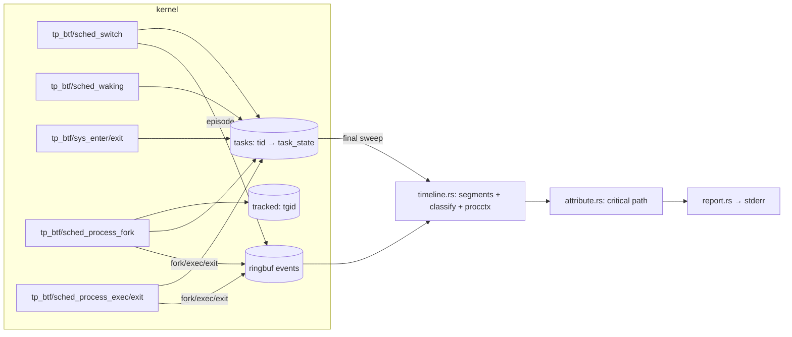

# whytime — agent guide

`whytime -- COMMAND` runs COMMAND, traces it and every process it starts with eBPF, and
prints to stderr where its wall-clock time went (on-CPU, waiting on children, timer sleep,
fsync, network peers, locks, ...). COMMAND's output passes through; whytime exits with
COMMAND's code. `whytime -p PID` does the same for a running process and its descendants,
from the attach until PID exits, `--duration` elapses or Ctrl-C.

**Name.** The repo directory is `why`, but the crate and binary are `whytime`: the `why`
crate name is taken on crates.io. Use `whytime` everywhere in code, docs and output.

**Status: MVP.** Wrap mode and attach mode (`-p PID`). Flamegraphs and hostname/DNS
correlation for network subjects are later milestones.

## Commands

All cargo invocations need these, because `/tmp` has a tight quota:

```sh
mkdir -p ~/.cache/whytime-tmp ~/.cache/whytime-target
export TMPDIR=~/.cache/whytime-tmp CARGO_TARGET_DIR=~/.cache/whytime-target
```

| What | Command |
|---|---|
| Build (debug) | `cargo build` (default member: `whytime`) |
| Release binary | `cargo build --release -p whytime` → `$CARGO_TARGET_DIR/x86_64-unknown-linux-musl/release/whytime` (static) |
| Unit tests | `cargo test --workspace` |
| End-to-end suite | `cargo xtask test-e2e` (needs passwordless `sudo -n`) |
| Run | `sudo $CARGO_TARGET_DIR/x86_64-unknown-linux-musl/release/whytime -- sleep 1` |
| Attach | `sudo whytime -p PID [--duration 30s]` (report on exit, deadline or Ctrl-C; exit 0) |
| Doctor | `whytime doctor [--json]` (exit 0 ready, 3 cannot run) |
| Debug logging | `WHYTIME_LOG=debug whytime ...` (prints the verifier log on load failures) |

Toolchain: `rust-toolchain.toml` pins **stable** with the `x86_64-unknown-linux-musl`
target, and `.cargo/config.toml` makes musl the default build target, so every binary
(including tests and xtask) is static. No nightly, no `bpf-linker`: the BPF side is C,
compiled by clang (22 here; any clang with BPF CO-RE works, override with `CLANG=`).

Do not run `cargo fmt`/`cargo clippy` as part of feature work unless asked; lints are the
tracekit block (`clippy::all` + `pedantic`) in the root `Cargo.toml`.

## Layout

```
Cargo.toml                 workspace, shared deps, lint block, release profile (lto, strip, abort)
crates/whytime-abi/        wire! records + wire_consts! shared with C; feature std → header(),
                           feature user → aya::Pod impls
crates/whytime-bpf/        build.rs + bpf/ ; exports OBJECT (the .o) and ABI_HASH
  bpf/whytime.bpf.c        the BPF programs (C CO-RE)
  bpf/vmlinux_min.h        hand-curated preserve_access_index subset of vmlinux.h
  bpf/include/bpf/         vendored libbpf v1.8.0 headers
crates/whytime/            the binary
  src/main.rs              wrap flow, event loop (epoll: ring, pidfd, signalfd), sudo handling,
                           helpers shared with attach (preflight, load, collect, report)
  src/attach.rs            attach flow: target checks, tree membership, seeding, event loop
  src/snapshot.rs          /proc → task_state of pre-existing threads (syscall, fd, peers)
  src/cli.rs               clap derive CLI, --duration parser
  src/tracer.rs            aya loader: load, attach, maps, detach
  src/spawn.rs             fork, park-on-pipe, priv drop, exec with error pipe, pidfd
  src/timeline.rs          records → per-thread segments, procctx table, final sweep
  src/classify.rs          (syscall, fd type, socket) → class + subject; /proc path resolution
  src/sys.rs               syscall table (libc numbers) → kind + BPF sys_flags bits
  src/attribute.rs         critical-path walk → lines that partition the window
  src/report.rs            whytime.report/1 JSON + human rendering
  src/doctor.rs            bpfdoctor Tool, probe.sched / probe.syscalls checks
  src/logger.rs            tiny stderr logger (WHYTIME_LOG)
crates/whytime-testbins/   e2e workloads: wt-sleep, wt-burn, wt-fsync, wt-child, wt-futex, wt-tcp,
                           wt-attach
xtask/                     cargo xtask test-e2e
```

Shared foundation (path deps, **do not modify**; report gaps to the orchestrator):
`../tracekit/crates/{wire,procctx,bpfdoctor}`.

## How the BPF object is built

`crates/whytime-bpf/build.rs`:

1. renders `whytime_abi::header()` to `$OUT_DIR/whytime_wire.h` (structs, `_Static_assert`s on
   every size/offset, `#define`s for the `wire_consts!`, `WHYTIME_WIRE_H_ABI_HASH`) and
   writes the hash to `$OUT_DIR/abi_hash.rs`;
2. runs `clang -target bpfel -O2 -g -mcpu=v3 -Wall -Werror -D__TARGET_ARCH_x86 -I bpf
   -I bpf/include -I $OUT_DIR -c bpf/whytime.bpf.c -o $OUT_DIR/whytime.bpf.o`;
3. `src/lib.rs` embeds it with `aya::include_bytes_aligned!`.

To change a record: edit `crates/whytime-abi/src/lib.rs` only; the C side picks the new
layout up through the generated header (a mismatch is a clang error), then update the C code
that fills it and `timeline.rs` that reads it.

## Architecture and data flow



Wrap-mode startup (`main.rs`, `spawn.rs`):

1. `bpfdoctor` preflight; on FAIL print diagnostics, exit 125.
2. Load the object and attach all programs (`tracer.rs`). Scheduler programs are required;
   if the syscall pair fails, continue with a warning and a report note.
3. Under sudo (`euid 0` + `SUDO_UID`/`SUDO_GID`), compute the invoking user's credentials
   and groups, and restore `HOME`/`USER`/`LOGNAME` to that user.
4. Ignore SIGINT/SIGQUIT (the TTY delivers them to COMMAND's process group, which whytime
   shares; whytime must survive to report). Route SIGTERM/SIGHUP to a signalfd; they are
   forwarded to COMMAND with `pidfd_send_signal`.
5. `fork`; the child blocks reading a CLOEXEC "go" pipe. The parent inserts the child's tgid
   into `tracked`, then writes "go". The child drops to the invoking user, resets signal
   dispositions and mask, and `execvp`s. A second CLOEXEC pipe returns `(stage, errno)` on
   failure: exec ENOENT → 127, other exec errors → 126, privilege drop failure → 125.
6. The window starts at the child's `sched_process_exec` record (the root's first task
   entry is created there) and ends at the root thread group's exit record (or
   `--duration` after the start). The loop polls ring buffer, pidfd and signalfd with epoll.
7. On window end: drop the `Ebpf` (detaches every program; the maps were taken out and stay
   alive), wait 2 ms for in-flight programs, drain the ring, then **sweep** the `tasks` map
   to close every still-open interval at the window end. Attribute, report, return
   COMMAND's code (with `--duration`, keep forwarding signals until it exits).

Attach-mode startup (`attach.rs`, `snapshot.rs`; `whytime -p PID`):

1. Check the target before anything privileged (exit 1 with a `fix:` line when refused):
   `/proc/PID` exists and is a thread-group leader (a thread id → "use -p TGID"), not a
   zombie, not whytime itself (it would trace its own event loop) and not pid 1 (everything
   descends from init: a whole-system trace with init's event loop as the critical path).
   Without root, the target's real/effective/saved uid and gid must all be the invoking
   user's (the ptrace rule; file capabilities must not let users watch each other), unless
   whytime has `CAP_SYS_PTRACE`. Then `pidfd_open` the target.
2. Preflight and load as in wrap mode (exit 125 on failure). Block SIGINT/SIGTERM/SIGHUP
   into a signalfd: from here on they end the observation; the target is never signalled.
3. **Membership** (`track_tree`): scan `/proc/*/stat`, walk parent links from the target
   (skipping whytime), insert each live process into `tracked` with `BPF_NOEXIST`; repeat
   until a scan inserts nothing. `EEXIST` means a tracked parent forked it after its insert:
   the kernel side owns it (its FORK record is queued). Termination: a process still
   untracked after a scan was forked by a parent before that parent's insert, so the next
   scan sees it; a scan that inserts nothing proves every live member was tracked before
   it began. Lost only: a process forked in that race whose parent exits before the next
   scan (reparented out of the tree). Capped at 32 scans (warning).
4. **Threads** (`seed_threads`), after membership so new threads are already created in
   kernel: for every thread in `/proc/PID/task`, build a `task_state`
   (`snapshot::task_state`, the one function to adapt when `task_state` changes) and insert
   it with `BPF_NOEXIST` (`EEXIST`: the kernel created it on a fork or exec; its records
   describe it). Re-read the thread's stat afterwards; if it exited meanwhile, delete the
   entry (no exit record would). A member with no live thread left is untracked.
5. **Trace** (`Trace::seed`, pure: replay can feed it recorded `ProcSeed`s): one `Proc` per
   member (target = root, parents linked by ppid), one `Thread` per seeded entry, and a
   procctx record per member through `on_exec` with the comm, ppid and argv read from
   `/proc`; key = `(pid, StartClock::ticks_to_start(starttime))`, which is tick precision
   (10 ms at `USER_HZ` 100) instead of the kernel's exact `start_boottime`. Later records
   never re-key a process: `on_exec` keeps the known key, and a FORK recorded before the
   window start names a task the seeding may already have added (it reuses it).
6. The window starts after seeding (monotonic now) and ends at the target's thread-group
   exit (EXIT record, or the pidfd), `--duration` after the start, or the first
   SIGINT/SIGTERM/SIGHUP (`ended_by: interrupt`). If the target's exit record shows up in
   the final drain before the deadline/signal time, the window ends there (`exit`). Detach,
   drain, sweep and report as in wrap mode; whytime exits 0. `exit_code` is the target's
   (from its EXIT record) when it exited in the window.

`task_state` from `/proc` (`snapshot.rs`), per `/proc/TID/stat` state letter:

| State | Entry | Fields set (all others zero, as in a fresh kernel entry) |
|---|---|---|
| `R` | `ST_RUNNING` | `seg.start`/`last_ts` = now, `sys` = none. A thread that was queued, not on a CPU, gets its first queue wait folded into the first mixed segment (split proportionally) |
| `S` `D` `I` `P` ... | `ST_BLOCKED` | also `block_ts` = now, `block_state` (`S`→1, `D`→2, `I`→0x402, `P`→0x40), `sys` from `/proc/TID/syscall`: `nr`, and for `SYSF_FD0` syscalls `fd` = arg0 described like `describe_fd` (`stat` of `/proc/TGID/task/TID/fd/N` → `S_IFMT`, ino, dev re-encoded as `major << 20 \| minor`; `flags:` from `fdinfo`; sockets: family/peer from `/proc/TGID/net/{tcp,udp}{,6}` and `unix`, cached per network namespace). `running` there → `ST_RUNNING`; `-1` → no syscall; unreadable (no ptrace access) → `nr = NR_UNREADABLE` (-2, user space only) → `other` "blocked since attach, syscall unreadable", counted in a report note |
| `T` / `t` | `ST_BLOCKED` | `block_state` `TASK_STOPPED` / `TASK_TRACED`, `sys` = none (stops happen after `sys_exit`) → `other` "stopped" |
| `Z` `X` | none | exited |

## Probes (verified BTF prototypes on 7.2.6)

| Program | Attach point | Prototype (`btf_trace_*`) | Does | Fallback |
|---|---|---|---|---|
| `on_switch` | `tp_btf/sched_switch` | `(void *, bool preempt, struct task_struct *prev, struct task_struct *next, unsigned int prev_state)` | prev: add on-CPU time; `!preempt && prev_state != 0` → BLOCKED (record block ts + state), else RUNNABLE. next: RUNNABLE → add runqueue time; BLOCKED/WOKEN → emit EPISODE, open a new segment | required; needs ≥ 5.18 for `prev_state` (min_kernel) |
| `on_waking` | `tp_btf/sched_waking` | `(void *, struct task_struct *p)` | BLOCKED → WOKEN, record wake ts and the waker (current) tid/tgid | required |
| `on_fork` | `tp_btf/sched_process_fork` | `(void *, struct task_struct *parent, struct task_struct *child)` | parent tracked → add child tgid to `tracked` (in kernel: the child can never run untracked), create its task entry (RUNNABLE), emit FORK | required |
| `on_exec` | `tp_btf/sched_process_exec` | `(void *, struct task_struct *p, pid_t old_pid, struct linux_binprm *)` | tracked tgid: create the root's task entry (window start) or flush the segment; migrate `old_pid`'s entry if a non-leader thread exec'd; emit EXEC with comm, argv (≤ 256 B from `mm->arg_start`), leader `start_boottime` | required |
| `on_exit` | `tp_btf/sched_process_exit` | `(void *, struct task_struct *p, bool group_dead)` | close the segment, emit EXIT (exit_code, group_dead), delete the task entry; last thread → remove from `tracked` | `group_dead` is computed from `p->signal->live.counter == 0` instead of the argument, which older kernels lack |
| `on_sys_enter` | `tp_btf/sys_enter` | `(void *, struct pt_regs *regs, long id)` | remember nr; per `sys_flags[nr]` describe arg0's fd (`task->files->fdt->fd[fd]` → `f_inode->i_mode & S_IFMT`, ino, `i_sb->s_dev`, `f_flags`; sockets: `private_data→sk→__sk_common` family, daddr/v6_daddr, dport) and for `connect` the user sockaddr | optional: if the pair fails, all blocked time is `other` and a note says so |
| `on_sys_exit` | `tp_btf/sys_exit` | `(void *, struct pt_regs *regs, long ret)` | clear nr | attached before `sys_enter` so a half-attached pair is harmless |

Maps: `events` RINGBUF 4 MiB; `tasks` HASH tid → `task_state` (32768); `tracked` HASH tgid
(16384); `sys_flags` ARRAY nr → `SYSF_*` (512, filled by user space from libc numbers, so the
C code has no syscall numbers); `stats` PERCPU_ARRAY of loss counters (ring full, tasks
full, tracked full) → `quality.dropped`.

CO-RE: `vmlinux_min.h` declares only the fields used, under
`#pragma clang attribute push(preserve_access_index)`, with `__VMLINUX_H__` defined so
`bpf_tracing.h` uses kernel `pt_regs` names. Field order there is irrelevant.

## Wire records (`whytime-abi`)

All records start with `ev_header {kind, tid, tgid, _pad, ts}` (`ts` = `bpf_ktime_get_ns`,
CLOCK_MONOTONIC, the same clock user space reads for deadlines). `cpu_segment {start,
run_ns, rq_ns}` is the in-kernel accumulation since `start`; its end is the record's own
boundary, so a thread's segments chain without gaps.

| Record | Size | Fields |
|---|---|---|
| `fork_record` (EV_FORK) | 40 | hdr (parent), child_tid, child_tgid, child_start (`start_boottime`) |
| `exec_record` (EV_EXEC) | 344 | hdr, seg (up to exec), start (leader `start_boottime` = procctx key), ppid, old_tid, comm[16], argv_len, argv[256] |
| `episode_record` (EV_EPISODE) | 128 | hdr (ts = switch-in), seg (up to block), block_ts, wake_ts (0 = unseen), sys_info, waker_tid/tgid, block_state (`prev_state`) |
| `exit_record` (EV_EXIT) | 64 | hdr, seg (up to exit), start, code (`task->exit_code`), group_dead |
| `task_state` (map value) | 120 | seg, last_ts, block_ts, wake_ts, sys_info, tgid, state (`ST_*`), block_state, waker_tid/tgid |
| `sys_info` | 48 | nr (−1 = none), fd, mode (`S_IFMT` bits), f_flags, ino, dev (kernel `dev_t`), family, port (host order), addr[16] |

One EPISODE per block → wake → run cycle; on-CPU and preemption are accumulated in kernel,
so a CPU-bound task emits nothing until it blocks or exits.

## Attribution model (what the numbers mean)

The window is `[exec of COMMAND, exit of COMMAND's last thread)` (attach mode: `[end of
seeding, exit of the target's last thread / deadline / signal)`); `wall_ns` is its length.
Every nanosecond is assigned to exactly one `(class, subject)` line, so shares sum to 1
(the e2e suite checks 1 ± 0.001; in practice exactly 1 up to float rounding). The walk
(`attribute.rs`):

- Follows COMMAND's **main thread**: the original leader while it lives, then whichever
  live thread outlives the rest (covers `pthread_exit` from main and multithreaded exec).
- Mixed segments split proportionally into on-CPU and `runqueue` (preempted, or woken and
  not yet running). On-CPU of COMMAND's own process is `cpu` ("on-CPU (comm)").
- Blocked time goes to its class from the in-flight syscall and descriptor:
  `fsync` (fsync/fdatasync/sync_file_range/syncfs/msync and writes to `O_DSYNC`/`O_SYNC`
  files; subject = directory, `~`-abbreviated), `file` (other regular-file/blockdev I/O and
  path syscalls), `net` (inet sockets; subject = peer `ip:port` from `connect`'s sockaddr or
  the socket's `daddr:dport`; distinct socket inodes = "connections"), `ipc` (pipes, FIFOs,
  unix sockets), `tty` (character devices), `futex`, `sleep` (nanosleep/clock_nanosleep),
  `poll` (poll/select/epoll), `signal`, `other` (unknown syscall, page faults/no syscall,
  stopped, or `untraced` gaps from lost records).
- **Descent**: a `wait4`/`waitid` block is explained by the child that ended it (the waker
  if it is a child; else the child that exited last inside the block; else the youngest
  child alive at its end). A pipe/unix-socket block woken by another tracked process is
  explained by that process. The interval is walked recursively in that process; its
  on-CPU time becomes `child` ("waiting on child: comm", subject = the descendant that was
  computing), its blocks keep their own class (so `sh -c 'sleep 1'` reports `sleep`).
  Parts of the interval outside the descendant's lifetime stay with the waiting class.

Honesty limits (state them when presenting results):

- One critical path. Work that ran in parallel with the path (other threads of COMMAND,
  sibling children not waited on at that moment) does not appear; `processes[].cpu_ns`
  in JSON shows every process's total CPU.
- Futex waits are not followed to the lock holder (unknown in MVP), so a lock held across a
  sleep or I/O shows as `futex`. Same for `poll`/`epoll`: the readiness source is unknown.
- Hidden dependencies outside the tree (a daemon, the X server, a remote service) are only
  visible as the resource COMMAND blocked on (`net`, `ipc`).
- Network subjects are `ip:port`; DNS/hostname correlation is a later milestone (the report
  notes this whenever a `net` line exists).
- `file`/`fsync` paths come from `/proc/<pid>/fd/<fd>` when the record is processed and are
  checked against the kernel's dev:ino; otherwise the subject is `dev M:m ino N`.
- A wake that races the switch-out (seen before the block is recorded) is not observed;
  that whole off-CPU gap counts as blocked (µs scale), and child descent falls back to the
  exit-time heuristic.
- Mixed segments split on-CPU vs. preempted proportionally when clipped to a sub-interval.
- Attach mode does not see time before the attach. Each pre-existing thread's first
  interval is classified from `/proc` at attach (state letter, `/proc/TID/syscall`, fd
  description), sampled a few µs before its entry exists: a thread that changes state in
  between has that first interval misread (µs-scale race). A thread running inside a
  syscall at attach that then blocks in it shows that block as `other` (outside syscalls),
  because its `sys_enter` predates the attach. Without ptrace access to the target
  (`kernel.yama.ptrace_scope` ≥ 1 under file capabilities), `/proc/TID/syscall` is
  unreadable and blocked threads' first interval is `other` (a note says so).
- Attach-mode procctx keys are `/proc` start times (tick precision, see above), and a
  process forked by a not-yet-tracked member in the scan race, whose parent exits before
  the next scan, is not traced.

## Report

Human (stderr): `wall`, then lines ≥ 1% (max 8), `other` collecting the rest and every
`other`-class line, then `critical path: N processes · M events lost` and notes.
JSON (`--json`, stderr): `{schema: "whytime.report/1", command, attached_pid?, wall_ns,
ended_by, exit_code, lines: [{class, share, ns, subject, connections?}], processes: [{pid,
ppid, comm, argv, cpu_ns, exit_code, critical}], quality: {events, dropped, syscalls},
notes}`. `ended_by` is `exit`, `duration` or (attach only) `interrupt`; `attached_pid` is
present only in attach mode, where `command` is the target's argv (its comm if empty) and
`exit_code` is the target's if it exited in the window, else `null`.

Exit codes: COMMAND's (128 + signal if killed); 125 whytime failed before/at start (with
doctor diagnostics); 126 not executable; 127 not found; `doctor`: 0 ready / 3 cannot run.
Attach mode: 0 after the report, 1 PID cannot be attached to (missing, thread, zombie,
whytime, pid 1, another user's), 125 as above.

## Privileges

Required: `CAP_BPF` + `CAP_PERFMON` (verified sufficient), or root. Two ways:

- `sudo whytime -- CMD`: COMMAND runs as the invoking user (`SUDO_UID`/`SUDO_GID`, groups
  from `getgrouplist(SUDO_USER)`), with `HOME`/`USER`/`LOGNAME` restored.
- `sudo setcap cap_bpf,cap_perfmon+ep /path/to/whytime` once, then run unprivileged. File
  caps are ignored on `nosuid` mounts (`/tmp` here): install to an ext4 path. Exec drops
  the caps for COMMAND (non-root exec without ambient caps).

Optional: `CAP_SYS_PTRACE` to resolve file paths of descendants running as another user,
and, in attach mode without root, to read `/proc/TID/syscall` of the target's threads
under Yama `ptrace_scope` ≥ 1 (else their first interval is `other`) and to attach to
processes of other users. Without root or it, attach mode only accepts the invoking
user's own processes.

## Doctor checks

`Doctor::with_shared()` (platform, kernel ≥ 5.18, BTF, capabilities, file caps, nosuid, nnp,
lockdown, LSM, sysctls incl. `perf_event_paranoid`, memlock, namespaces, seccomp, ringbuf,
memcg) plus:

| Id | Required | Observed / impact / fix |
|---|---|---|
| `probe.sched` | yes | loads the real object and attaches the 5 scheduler programs; PASS shows verified insn count. FAIL shows the errno; impact "cannot observe scheduling"; fixes by errno: EPERM/EACCES → `sudo setcap cap_bpf,cap_perfmon+ep <exe>` or run with sudo; ENOENT/EINVAL/E2BIG/EOPNOTSUPP → kernel ≥ 5.18 with `CONFIG_DEBUG_INFO_BTF`; else `WHYTIME_LOG=debug whytime doctor` for the verifier log |
| `probe.syscalls` | no | attaches `sys_exit` then `sys_enter`; WARN impact "blocked time is reported as other"; SKIP if the scheduler probe failed |

`kernel.kptr_restrict` is not checked: the MVP reads no kernel addresses (relevant once
flamegraphs symbolize kernel stacks). Wrap and attach mode run `Doctor::preflight()` first,
and after a load failure re-run `ids_for_errno(errno)` and print the non-passing checks.

## Performance budget

Targets, to be measured (not yet benchmarked):

- `sched_switch` with untracked prev and next: two hash lookups (skipped for the idle task),
  no clock read, ≤ ~150 ns.
- `sys_enter`/`sys_exit` for untracked tasks: one hash lookup, ≤ ~100 ns. Tracked tasks
  additionally do an array lookup and, for fd syscalls, ~6–10 probe reads.
- `sched_waking`, fork/exec/exit: one lookup for untracked tasks.
- Ring traffic: one 128-byte record per block cycle of a tracked thread; CPU-bound threads
  emit nothing (on-CPU accumulates in kernel).

## e2e suite

`cargo xtask test-e2e` builds release `whytime` + testbins, then runs (all via
`sudo -n whytime --json --` unless noted; every report must sum to 1 ± 0.001 with
`quality.dropped == 0`). Its scratch directory is `~/.cache/whytime-e2e`, or
`$WHYTIME_E2E_DIR` (set a distinct one per checkout to run suites in parallel):

1. `sleep`: `wt-sleep 1000` → `sleep` ≥ 0.9, wall 1.0 s ± 10%
2. `cpu-burn`: `wt-burn 1000` → `cpu` ≥ 0.9
3. `fsync`: `wt-fsync ~/.cache/whytime-e2e 200` (ext4; the suite refuses tmpfs) → top line
   `fsync`/`file` ≥ 0.5
4. `child`: `wt-child 1000` (spawns `wt-burn`, waits) → `child` subject `wt-burn` ≥ 0.8
5. `futex`: `wt-futex 800` → `futex` ≥ 0.5
6. `tcp-slow`: xtask runs a 127.0.0.1 server in its own process (outside the tree) that
   replies 300 ms after accept; `wt-tcp ADDR 3` → `net` subject = server `ip:port` ≥ 0.6
7. `exit-code`: `sh -c 'exit 7'` → exit 7
8. `nopriv`: the build output run as the user without caps → exit 125 and a `setcap` line
9. `setcap`: copy to `~/.cache/whytime-e2e/bin`, `setcap cap_bpf,cap_perfmon+ep`, run
   unprivileged on `wt-sleep 300` → `sleep` ≥ 0.9

Attach scenarios run an `sh` script (`attach_cmd`): start the target in the background,
wait 0.3 s, `sudo -n whytime --json -p $!` with the scenario's flags, then print `target
alive` if the target still runs (it must, unless it exited by itself), stop it, and exit
with whytime's status (must be 0):

10. `attach-blocked`: `wt-sleep 30000`, `--duration 1s` → `ended_by` duration, `sleep` ≥
    0.9 (classified from `/proc` at attach), wall 1.0 s ± 10%, target alive
11. `attach-running`: `wt-burn 30000`, `--duration 1s` → `cpu` ≥ 0.9, target alive
12. `attach-threads`: `wt-futex 30000` (two threads), `--duration 1s` → `futex` ≥ 0.9
13. `attach-exit`: `sh -c '"$0" 1200; exit 3' wt-sleep` (pre-existing child) → `ended_by`
    exit, `exit_code` 3, `wt-sleep` in `processes[]` with ppid = target, `sleep` ≥ 0.9
14. `attach-spawn`: `wt-attach 1500 800` (sleeps, then forks `wt-burn 800` after the
    attach) → `ended_by` exit, `wt-burn` in `processes[]`, `child` subject `wt-burn` ≥ 0.3
15. `attach-interrupt`: `wt-sleep 30000`, `sudo -n pkill -INT -P <sudo pid>` after 1 s
    (whytime inherits SIGINT ignored from the background job) → `ended_by` interrupt,
    `sleep` ≥ 0.9, target alive
16. `attach-nopid`: unprivileged `whytime -p 4194304` (above any `pid_max`) → exit 1, "no
    process"

## Gotchas

- clang folds `if (!p && !n)` on two map-value pointers into `p | n`; the verifier rejects
  pointer arithmetic (`R1 pointer |= pointer prohibited`). Test them in separate branches.
- Nested `BPF_CORE_READ(BPF_CORE_READ(...))` does not compile ("nested
  builtin_preserve_access_index"); read into a local first.
- CO-RE relocation failures are silent at build time and show up in the verifier log as
  `unknown#195896080`; use `WHYTIME_LOG=debug`.
- `bool` cannot be an aya global (`aya::Pod`); pass `u8`. (whytime currently has no globals.)
- `/tmp` is `nosuid` here: file capabilities on a binary there are ignored.
- Under sudo, `sh -c '... of=~/x'` does not expand `~` after `of=` (POSIX `sh`); use `$HOME`.
- The report is the last thing on stderr; the e2e harness locates it by the
  `"schema": "whytime.report/1"` prefix, so test workloads must not write JSON to stderr.
- Tracking membership is inserted in kernel at fork; user space inserts only COMMAND's pid
  before releasing it, or (attach) processes that already exist. Never add user-space
  insertion at fork (it races the child).
- Attach mode seeds `tracked` and `tasks` from user space with `BPF_NOEXIST` only, after
  the programs are attached: the kernel side may already have created an entry (fork,
  exec), and overwriting it would lose that state. `EEXIST` means "the records describe
  it"; do not seed the trace for it either.
- A pre-existing process's procctx key comes from `/proc` ticks, not `start_boottime`;
  exec/fork handling in `timeline.rs` keeps the first key of a live process, so procctx
  sees one lifetime. Compare starts in ticks (`StartClock::start_to_ticks`), never in ns.
- `/proc/TID/syscall` needs ptrace *attach* access (Yama applies), while `/proc/TID/fd`,
  `fdinfo` and `stat` need only read access: under file capabilities the syscall may be
  unreadable while everything else works.
- A non-interactive shell's background job inherits SIGINT ignored. Attach mode blocks
  SIGINT into a signalfd, and blocked signals are queued even when ignored, so it still
  sees Ctrl-C/`kill -INT`; never switch that to a handler-based approach without resetting
  the disposition.
