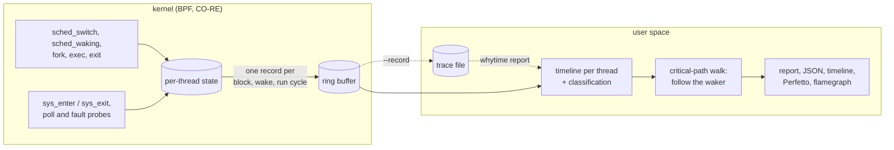

# whytime

[](https://github.com/Arinerron/whytime/actions/workflows/ci.yml)
[](https://github.com/Arinerron/whytime/releases/latest)
[](LICENSE)

`time` tells you how long a command took; whytime tells you where that wall-clock time went.

```
$ sudo whytime -- sh -c 'sleep 0.5; dd if=/dev/zero of=$HOME/.cache/wt-demo bs=4k count=200 oflag=dsync 2>/dev/null; curl -s -o /dev/null https://speed.cloudflare.com/__down?bytes=20000000'
wall 3.83s
cpu 194ms across 3 processes · 0.05× parallel
  47%  blocked on network: speed.cloudflare.com:443 (1 connection)
  34%  fsync on ~/.cache
  13%  timer sleep (sleep)
   4%  on-CPU (curl)
   2%  other
critical path: 3 processes · 0 events lost
```

```
$ sudo whytime -- xz -T4 -k -c big.bin > /dev/null
wall 33.1s
cpu 98.4s across 1 process · 3.0× parallel
 100%  on-CPU (xz)
  <1%  other
critical path: 1 process · 0 events lost
```

whytime runs a command (or attaches to a running process), traces it and every process it
starts with eBPF, and splits the wall time along the critical path into lines that always
add up to 100%: on-CPU, waiting on a child, timer sleeps, fsync and file I/O per directory,
network peers by hostname, pipes and IPC, locks, page faults, waiting for a CPU. In the `xz`
run, the main thread spends nearly all its time waiting for its worker threads, yet the
report says on-CPU: whytime followed each wait to the worker that ended it, and the second
line shows that about three CPUs were busy on average.

The command's own output passes through untouched; the report goes to stderr, and whytime
exits with the command's exit code.

## Contents

- [Why](#why)
- [Install](#install)
- [Requirements](#requirements)
- [Usage](#usage)
- [Reading the report](#reading-the-report)
- [How it works](#how-it-works)
- [Limits](#limits)
- [JSON schema stability](#json-schema-stability)
- [Building from source](#building-from-source)
- [Contributing](#contributing)
- [License](#license)

## Why

| Tool | What it gives you | What it cannot say |
|---|---|---|
| `time` | real, user and sys totals | where the rest of `real` went |
| `perf record` / `perf top` | where CPU time goes (sampled stacks) | anything about time spent off-CPU |
| `offcputime`, `offwaketime` (BCC) | off-CPU stacks summed per thread, with wakers | which of those waits the command actually waited for; totals add up to threads x time, not to the wall time |
| **whytime** | the wall time partitioned along the critical path, across the whole process tree | see [Limits](#limits) |

The difference is the partition. whytime follows the command's main thread from exec to
exit, and whenever it waits on another traced thread or process (a futex, a pipe, `wait4`
on a child, a `vfork`) it follows the task that woke it over that interval, recursively.
Every nanosecond of the window lands in exactly one line, so the shares answer "what would
I have to make faster for this to finish sooner", not "what was busy".

## Install

Static binaries for x86_64 and aarch64 are published on the
[releases page](https://github.com/Arinerron/whytime/releases/latest). Each tarball holds
the binary, `LICENSE`, `THIRD_PARTY_LICENSES.md` (the licenses of the code compiled into
it), `README.md`, `completions/` and `man/`:

```sh
tag=$(curl -fsSLo /dev/null -w '%{url_effective}' https://github.com/Arinerron/whytime/releases/latest)
tag=${tag##*/}                                   # e.g. v0.1.0
name=whytime-$tag-$(uname -m)-linux-musl         # x86_64 or aarch64
curl -fsSLO "https://github.com/Arinerron/whytime/releases/download/$tag/$name.tar.gz"
curl -fsSLO "https://github.com/Arinerron/whytime/releases/download/$tag/$name.tar.gz.sha256"
sha256sum -c "$name.tar.gz.sha256"
tar -xzf "$name.tar.gz"
sudo install -m 755 "$name/whytime" /usr/local/bin/whytime
```

### Privileges

whytime needs `CAP_BPF` and `CAP_PERFMON`, or root. Pick one:

- Run it with `sudo`. The command still runs as you: your uid, gid, supplementary groups,
  and `HOME`/`USER`/`LOGNAME`, not root. Trace and output files are handed to you.
- Grant the capabilities once and run it unprivileged:

  ```sh
  sudo setcap cap_bpf,cap_perfmon+ep /usr/local/bin/whytime
  ```

  The capabilities are dropped when the command is executed. File capabilities are ignored
  on `nosuid` mounts (often `/tmp`), so install to a regular path. Kernel frames in
  flamegraphs additionally need `cap_syslog` (or root).

Every user who can execute a binary with file capabilities gets them; see
[SECURITY.md](SECURITY.md) for shared machines.

### Shell completions and man pages

From the release tarball:

```sh
sudo install -m 644 "$name"/man/*.1 /usr/local/share/man/man1/
sudo install -m 644 "$name/completions/whytime.bash" /usr/share/bash-completion/completions/whytime
sudo install -m 644 "$name/completions/_whytime" /usr/share/zsh/site-functions/_whytime
install -Dm 644 "$name/completions/whytime.fish" ~/.config/fish/completions/whytime.fish
# also completions/whytime.elv (elvish) and completions/_whytime.ps1 (PowerShell)
```

Or generate a completion script from the binary:
`whytime completions <bash|zsh|fish|elvish|powershell>` writes it to stdout.

## Requirements

- Linux 5.18 or newer, x86_64 or aarch64, with BTF (`/sys/kernel/btf/vmlinux`, from
  `CONFIG_DEBUG_INFO_BTF=y`). 5.18 is when `sched_switch` started passing the previous
  task's state, which whytime needs to tell blocking from preemption.
- `whytime doctor` checks all of this and prints the exact fix for anything missing.

| Distribution | Kernel | Status |
|---|---|---|
| Arch Linux | current | developed on 7.2 |
| Ubuntu mainline build (CI, in a virtme-ng VM) | 6.12 | full e2e suite in CI |
| Debian 12 / 13 | 6.1 / 6.12 | should work (BTF on by default) |
| Ubuntu 24.04, or 22.04 with the HWE kernel | 6.8 | should work |
| Fedora (supported releases), openSUSE Tumbleweed | 6.x | should work |
| RHEL, AlmaLinux, Rocky Linux 10; Amazon Linux 2023 | 6.12 / 6.1+ | should work |
| Ubuntu 22.04 GA kernel (5.15), RHEL 9 and clones (5.14) | < 5.18 | refused by the version check |

"Should work" means the kernel version and BTF requirements are met; only the first two
rows run the test suite. Some probes are optional, and whytime still runs without them,
with a note in the report: syscall tracepoints (else blocked time is `other`), poll and
epoll readiness and page-fault probes (fentry/fexit: x86_64 any supported kernel, aarch64
6.0+), and the resolver capture (else peers stay `ip:port`). `--flamegraph`/`--folded` also
need `kernel.perf_event_max_stack` at least 127 (the default).

## Usage

```
whytime [OPTIONS] -- COMMAND [ARGS...]    run COMMAND and report
whytime [OPTIONS] -p PID                  attach to a running process
whytime report [OPTIONS] FILE             replay a trace file, no privileges needed
whytime doctor [--json]                   can whytime run here? fixes if not
whytime completions SHELL                 shell completion script on stdout
```

| Option | Modes | Effect |
|---|---|---|
| `--json` | run, attach, report | print the report as JSON (schema `whytime.report/1`) instead of text |
| `--timeline` | run, attach, report | add the window in 10 equal slices, each with its largest lines |
| `--perfetto FILE` | run, attach, report | write every thread's timeline and the critical path as Chrome Trace Event JSON |
| `--flamegraph FILE` | run, attach, report | write a wall-clock flamegraph of the critical path (SVG) |
| `--folded FILE` | run, attach, report | write the same stacks in folded format (microseconds) |
| `--duration D` | run, attach | stop observing after `D` (`500ms`, `30s`, `1.5s`, `2m`, `1h`; bare number = seconds) |
| `--record FILE` | run, attach | also save a trace file for `whytime report` |
| `-p`, `--pid PID` | attach | observe PID and its descendants instead of running a command |

`-h`/`--help` and `-V`/`--version` work everywhere. Options go before the command (an
unknown one is an error); `--` is optional unless the command starts with `-`.
`WHYTIME_LOG=debug` prints debug logging, including the BPF verifier log when loading fails.

### Wrap a command

```sh
sudo whytime -- make -j8
sudo whytime -- sh -c 'cmd1 | cmd2'      # pipelines and scripts: wrap a shell
```

The window runs from the command's exec to the exit of its last thread; background
processes it leaves behind are not waited for. Everything it starts is traced too. Exit
status:

| Status | Meaning |
|---|---|
| the command's | the command ran (128 + N if it was killed by signal N) |
| 125 | whytime could not start tracing (doctor diagnostics are printed), or an output file could not be created |
| 126 / 127 | the command is not executable / not found |

Ctrl-C goes to the command, as without whytime; whytime still reports when it exits.
Signals that were ignored when whytime started (under `nohup`, or in a non-interactive
shell's background job) stay ignored for the command, which also gets whytime's resource
limits unchanged.

### Attach to a running process

```
$ sh -c 'while true; do sleep 0.2; dd if=/dev/zero of=/dev/null bs=1M count=3000 2>/dev/null; done' &
$ sudo whytime -p $! --duration 3s --record demo.wt
wall 3.00s
cpu 1.54s across 17 processes · 0.51× parallel
  51%  waiting on child: dd … count=3000
  48%  timer sleep (sleep)
   1%  other
critical path: 17 processes · 0 events lost
note: attached to running pid 2814784: time before attach is not covered, and each pre-existing thread's first interval is classified from /proc
note: --duration elapsed; the command was still running
```

`-p PID` traces PID and its descendants, existing and new, from the attach until PID exits,
`--duration` elapses or you press Ctrl-C. The target is never signalled. What each existing
thread was doing at the attach (its syscall and the file, pipe or socket it waits on) is
read from `/proc`. whytime exits 0 after the report, 1 if PID cannot be attached to (no such
process, a thread id rather than a process, a zombie, pid 1, whytime itself, or, without
root, another user's process), 125 if tracing could not start.

### Time-boxing with `--duration`

`--duration 30s` reports after 30 seconds and leaves the command (or PID) running. In wrap
mode whytime then keeps forwarding signals and still exits with the command's code once it
ends; `ended_by` in the JSON says whether the window ended by `exit`, `duration` or (attach
mode) `interrupt`.

### JSON

`--json` prints the report as one JSON object on stderr instead of the text report:

```
$ sudo whytime --json -- sh -c 'sleep 0.3; curl -s -o /dev/null https://example.com' 2> report.json
$ cat report.json
{
  "schema": "whytime.report/1",
  "command": [
    "sh",
    "-c",
    "sleep 0.3; curl -s -o /dev/null https://example.com"
  ],
  "wall_ns": 437624792,
  "ended_by": "exit",
  "exit_code": 0,
  "parallelism": {
    "cpu_ns": 58391286,
    "processes": 2,
    "factor": 0.1334277377959885
  },
  "lines": [
    {
      "class": "sleep",
      "share": 0.6854867354041496,
      "ns": 299985990,
      "subject": "sleep"
    },
    ...
    {
      "class": "net",
      "share": 0.11814139862533199,
      "ns": 51701605,
      "subject": "example.com:443",
      "connections": 1,
      "addr": "104.20.23.154:443"
    },
    ...
  ],
  "processes": [
    ...
  ],
  "quality": {
    "events": 33,
    "dropped": 0,
    "syscalls": true,
    "readiness": true,
    "faults": true,
    "dns": true
  },
  "notes": []
}
```

(`...` marks omitted entries.) `net` lines carry `connections` and, for a peer named after
its lookup, the numeric `addr`; `runqueue` lines carry `held_by`, who held the CPU
meanwhile; `--timeline` adds `timeline`; attach mode adds `attached_pid`. `quality` says
which optional probes were attached and whether the kernel lost records. The full field
reference is in [AGENTS.md](AGENTS.md#report).

### Timeline

`--timeline` cuts the window into 10 equal slices and lists each slice's largest lines:

```
$ sudo whytime --timeline --perfetto t.json -- sh -c 'sleep 0.5; dd if=/dev/zero of=$HOME/.cache/wt-demo bs=4k count=200 oflag=dsync 2>/dev/null; curl -s -o /dev/null https://speed.cloudflare.com/__down?bytes=20000000'
wall 2.74s
cpu 145ms across 3 processes · 0.05× parallel
  48%  fsync on ~/.cache
  27%  blocked on network: speed.cloudflare.com:443 (1 connection)
  18%  timer sleep (sleep)
   4%  on-CPU (curl)
   1%  waiting on child: dd
   2%  other
timeline (274ms slices):
  0.00–0.27s  sleep sleep 98% · cpu sh 1%
  0.27–0.55s  sleep sleep 85% · fsync ~/.cache 14%
  0.55–0.82s  fsync ~/.cache 97% · child dd 3%
  0.82–1.09s  fsync ~/.cache 97% · child dd 3%
  1.09–1.37s  fsync ~/.cache 97% · child dd 2%
  1.37–1.64s  fsync ~/.cache 97% · child dd 3%
  1.64–1.92s  fsync ~/.cache 80% · ipc woken by systemd-resolve 7% · net speed.cloudflare.com:443 4%
  1.92–2.19s  net speed.cloudflare.com:443 89% · cpu curl 11%
  2.19–2.46s  net speed.cloudflare.com:443 87% · cpu curl 12% · runqueue curl 1%
  2.46–2.74s  net speed.cloudflare.com:443 89% · cpu curl 10% · runqueue curl 1%
critical path: 3 processes · 0 events lost
```

Timeline rows use the JSON class names (`sleep`, `fsync`, `net`, ...) and subjects.

### Perfetto

`--perfetto t.json` writes a Chrome Trace Event file. Open it in
[ui.perfetto.dev](https://ui.perfetto.dev) (or `chrome://tracing`): one track per traced
thread with its on-CPU, runqueue and blocked stretches (named by class and subject; the
syscall, waker and CPU holder in the arguments), fork, exec and exit markers, and a
`critical path` track with exactly the stretches the report adds up.

### Flamegraphs

```sh
sudo whytime --flamegraph out.svg -- ./build.sh
sudo whytime --folded out.folded -p 4242 --duration 10s
```

`--flamegraph FILE` draws a wall-clock flamegraph of the critical path as a self-contained
SVG (click to zoom, Ctrl-F to search); `--folded FILE` writes the same stacks as
`frame;frame;... count` lines, counts in microseconds, for `flamegraph.pl`, inferno or
speedscope. The total width is the wall time, so the graph adds up exactly like the report.

Each stack reads, from the root:

1. **The report line**, with the same text as in the report (`on-CPU (xz)`, `fsync on
   ~/.cache`, `blocked on network: example.com:443 (2 connections)`, `waiting for a CPU (xz)
   — mostly sway 78%`). The root frames are the report's lines, and their widths are its
   shares.
2. The process name of the task the time is attributed to, then the thread's name if it
   differs.
3. The call stack, outermost first: user frames, then kernel frames suffixed `_[k]`. For
   on-CPU time these come from a 199 Hz sampler (time split evenly over the samples); for
   blocked time, from the stack where the thread blocked.

Placeholder frames: `[runqueue]` (waiting for a CPU has no stack of its own), `[no sample]`
(an on-CPU stretch with no sample within 5 ms), `[no stack]` (a thread blocked since before
an attach), `[stack lost]`, `[unknown]` (an address in no executable mapping, typically a
broken frame-pointer chain or JIT code), `[libfoo.so]` (no symbol: stripped), `[vdso]`, and
`[kernel]_[k]` (kernel addresses hidden by `kptr_restrict`).

User stacks unwind by frame pointers only, so code built without them shows `[unknown]`
frames or skipped callers; symbols come from `.symtab`/`.dynsym` (no DWARF, no inlined
frames). Kernel frames need root or `cap_syslog`. Flamegraphs cost more than plain runs
(two stack walks per block of a traced thread, plus the sampler).

### Trace files: `--record` and `whytime report`

The attach example above also saved `demo.wt`. Replaying it, as a regular user:

```
$ whytime report demo.wt
wall 3.00s
cpu 1.54s across 17 processes · 0.51× parallel
  51%  waiting on child: dd … count=3000
  48%  timer sleep (sleep)
   1%  other
critical path: 17 processes · 0 events lost
note: attached to running pid 2814784: time before attach is not covered, and each pre-existing thread's first interval is classified from /proc
note: --duration elapsed; the command was still running
```

```sh
sudo whytime --record build.wt -- make                 # wrap mode works the same way
whytime report build.wt --json --timeline --perfetto t.json
```

A trace file holds the raw kernel records and every lookup the report used (in attach mode,
also what whytime read from `/proc` at the attach), so `whytime report` reproduces the report
byte for byte on any machine, without BPF and without the traced processes. Every report
option works on replay; `--flamegraph`/`--folded` need a trace recorded with one of them
(the stacks and their symbols are in the file). Under `sudo`, whytime creates this file and
the other output files as you: it writes only where you could, and the files are yours.
`whytime report` exits 0, or 2 if the file is truncated, damaged, recorded by an incompatible
whytime version, or has no stacks for a requested flamegraph, or if an output file or the
report cannot be written.

Trace files can contain command lines, paths and hostnames: read
[SECURITY.md](SECURITY.md#trace-files-contain-sensitive-data) before sharing one.

### `whytime doctor`

```
$ sudo whytime doctor
whytime doctor · kernel 7.2.6-arch2-1 x86_64
 PASS platform.os_arch      Linux x86_64
 PASS kernel.version        7.2.6 ≥ 5.18
 PASS kernel.btf            /sys/kernel/btf/vmlinux present
 PASS priv.capabilities     CAP_BPF, CAP_PERFMON effective
 ...
 PASS probe.sched           5 tp_btf programs loaded and attached (15107 verified insns)
 PASS probe.syscalls        tp_btf/sys_enter and sys_exit loaded and attached (22824 verified insns)
 PASS probe.dns             tp_btf/sys_exit with resolver capture loaded and attached (22802 verified insns)
 PASS probe.readiness       fentry/pollwake and ep_poll_callback loaded and attached (474 verified insns)
 PASS probe.faults          fentry and fexit/handle_mm_fault loaded and attached (36 verified insns)
 PASS probe.stacks          perf_event cpu-clock sampler on every CPU and stack capture at sched_switch loaded and attached (371 verified insns)
 PASS kernel.kallsyms       /proc/kallsyms shows addresses: kernel frames are symbolized
summary: 0 fail · 0 warn · 26 pass · 3 info · 1 skip → whytime is ready
```

`doctor` checks the platform, kernel, BTF, privileges, security modules, sysctls and
namespaces, then loads and attaches each probe set for real. Every failing or warning check
prints what it observed, the impact, and the exact fix. `--json` prints the result as JSON
(schema `bpfdoctor/1`). It exits 0 when whytime can run and 3 when it cannot; run without
privileges it shows what is missing.

## Reading the report

```
wall 2.74s                                         window length
cpu 145ms across 3 processes · 0.05× parallel      CPU used by the whole tree in the window
  48%  fsync on ~/.cache                           lines >= 1%, largest first (at most 8)
  ...
   2%  other                                       everything smaller, and unexplained time
critical path: 3 processes · 0 events lost         processes on the path; records lost in kernel
note: ...                                          caveats for this run
```

Each line is a class and a subject. File subjects are directories (`~`-abbreviated);
process subjects are the process name, with the distinguishing tail of the arguments when
processes of the same name ran with different arguments (`sort -R` and `sort -n`).

| Class | Line | Meaning |
|---|---|---|
| `cpu` | `on-CPU (comm)` | the command's own process was running on a CPU |
| `child` | `waiting on child: comm` | the path waited on a descendant process while it computed |
| `runqueue` | `waiting for a CPU (comm)` | runnable but not running (preempted, or woken and not yet scheduled); `— mostly X 61%` names the task that held the CPU when one did most of it |
| `sleep` | `timer sleep (comm)` | `nanosleep`, `clock_nanosleep`, timerfd reads |
| `fsync` | `fsync on DIR` | `fsync`, `fdatasync`, `sync_file_range`, `syncfs`, `msync`, writes to `O_SYNC`/`O_DSYNC` files |
| `file` | `file I/O on DIR` | other regular-file and block-device I/O, path syscalls |
| `lock` | `file lock wait on DIR` | `flock`, `fcntl` `F_SETLKW`/`F_OFD_SETLKW` |
| `aio` | `async I/O completion (...)` | `io_uring_enter`, `io_getevents`, `io_pgetevents` |
| `net` | `blocked on network: host:port (N connections)` | inet sockets, by peer; named after the host the command looked up, else `ip:port` |
| `ipc` | `IPC wait (...)` | pipes, FIFOs, unix sockets, eventfds, SysV and POSIX IPC; `woken by X` when a process outside the tree ended the wait |
| `futex` | `lock/futex wait (...)` | futexes (mutexes, condition variables) not ended by a traced thread |
| `poll` | `poll/epoll wait (...)` | poll/select/epoll whose ready descriptor is not a socket, FIFO or device (eventfd, timerfd, inotify, ...) |
| `signal` | `waiting for a signal (...)` | `pause`, `sigsuspend`, `sigwait`, signalfd reads |
| `tty` | `terminal/device I/O (...)` | character devices, terminals |
| `fault` | `page faults on DIR` | blocked in a page fault: a mapped file's directory, or `anonymous memory (swap)` |
| `other` | `other (...)` | unknown syscalls, off-CPU outside syscalls, stopped, `untraced` gaps from lost records |

Waits on another traced task never appear as such: a futex, pipe or poll wait ended by a
traced thread, a `wait4` on a child, or a `vfork` is replaced by what that task did in the
meantime, so a lock held across a sleep reads as `sleep`, and `sh -c 'sleep 1'` reads as
`timer sleep (sleep)`. A poll/select/epoll wait is reported as the descriptor that became
ready (so `curl` shows its server, not `poll`).

## How it works



- In the kernel, scheduler tracepoints keep each traced thread's state and emit one record
  per block, wake and run cycle: when it blocked, who woke it, how long it waited for a CPU
  and who held it. CPU-bound threads emit nothing until they block; on-CPU time accumulates
  in the kernel. Membership in the traced tree is decided in the kernel at fork, so no
  child can escape.
- When a traced thread blocks inside a syscall, the BPF program describes what it is
  blocked on while the thread's file table is still at hand: the descriptor type, the file's
  path (walked from the dentry), the socket's peer. Resolver traffic (DNS on port 53, and
  systemd-resolved's varlink socket) is captured so peers can be named after the host the
  command looked up.
- After the window, user space builds a timeline per thread and walks the critical path
  from the command's main thread, following wakers into other traced threads and processes.
  The walk produces gap-free spans that tile the window; the report sums them.

The developer guide, [AGENTS.md](AGENTS.md), documents every probe, record, rule and limit
in detail.

## Limits

- **One critical path.** Work that ran in parallel with it (other workers than the one
  that ended a wait) is not in the lines. The `cpu ... × parallel` line and
  `processes[].cpu_ns` show all CPU used.
- **Following trusts the last waker.** A futex wait is followed to the thread that woke it,
  which is the right one only if that thread was what the waiter needed. Timed waits that
  time out are joined to a later wake by timing alone.
- **Dependencies outside the tree** (a daemon, a database, a remote service, the X server)
  appear only as the resource the command blocked on (`net`, `ipc`, `woken by X`).
- **Hostnames** are known only for lookups the traced tree made during the window through
  DNS on port 53 or systemd-resolved; `/etc/hosts`, caches, DNS-over-TLS/HTTPS, and lookups
  before an attach leave `ip:port`.
- **Attach mode** does not see time before the attach, and each existing thread's first
  interval is classified from `/proc` a few microseconds before tracing starts.
- **File paths** are captured at the first block of a syscall, as seen from the blocked
  task's mount namespace (container paths are inside the container), and truncated beyond
  256 bytes or 32 components.
- **Flamegraph stacks** need frame pointers for complete user stacks, use symbol tables
  only, and show interpreters' C frames rather than script functions. One stack stands for
  a whole block; on-CPU time is sampled at 199 Hz.
- **Overhead.** The syscall tracepoints put every task on the system on the syscall slow
  path while whytime runs: about 100 ns per syscall, so a syscall-bound microbenchmark
  (one-byte reads) takes 1.4 to 1.8 times as much CPU traced; commands that make fewer
  syscalls pay proportionally less. Flamegraph capture adds two stack walks per block of a
  traced thread and a sampler, which shows on context-switch-heavy work.

The full list, with the reasoning behind each, is in
[AGENTS.md](AGENTS.md#attribution-model-what-the-numbers-mean) and
[AGENTS.md](AGENTS.md#flamegraphs---flamegraph-file---folded-file).

## JSON schema stability

`--json` emits schema `whytime.report/1`, versioned independently of whytime:

- Within `/1`, changes are additive only: new optional fields, new `class` values, new
  notes.
- Removing or renaming a field, changing its type, or changing its meaning bumps the
  schema to `whytime.report/2`.
- Consumers must ignore unknown fields and treat an unknown `class` as `other`.

Trace files (`--record`) have their own format version; a whytime with a different record
layout refuses older files (exit 2) rather than misreading them.

## Building from source

Needs clang with the BPF target (any recent clang; override with `CLANG=`) and Rust stable
through [rustup](https://rustup.rs). `rust-toolchain.toml` installs the musl targets; no
nightly and no `bpf-linker`.

```sh
git clone --recursive https://github.com/Arinerron/whytime
cd whytime
cargo build --release -p whytime
sudo install target/x86_64-unknown-linux-musl/release/whytime /usr/local/bin/
cargo xtask man target/man          # whytime.1, whytime-report.1, whytime-doctor.1, ...
```

The binary is static (musl). For aarch64:
`cargo build --release -p whytime --target aarch64-unknown-linux-musl` (linked with the
toolchain's `rust-lld`; no cross compiler). Cloned without `--recursive`? Run
`git submodule update --init`: the shared [tracekit](https://github.com/Arinerron/tracekit)
crates are a submodule. Tests, the end-to-end suite and conventions are in
[CONTRIBUTING.md](CONTRIBUTING.md).

## Contributing

Bug reports, ideas and pull requests are welcome: see [CONTRIBUTING.md](CONTRIBUTING.md)
and the [Code of Conduct](CODE_OF_CONDUCT.md). Report vulnerabilities privately as
described in [SECURITY.md](SECURITY.md). Release notes are in [CHANGELOG.md](CHANGELOG.md).

## License

MIT, see [LICENSE](LICENSE). The BPF object declares the runtime license string
`Dual MIT/GPL` because the kernel only grants GPL-only helpers to programs with a
GPL-compatible license string (MIT code may be distributed under the GPL). The vendored
libbpf headers in `crates/whytime-bpf/bpf/include/bpf/` keep their own license,
`LGPL-2.1 OR BSD-2-Clause`. The SVG flamegraph is drawn by whytime itself; every Rust
dependency is MIT, Apache-2.0, Zlib or Unicode-3.0 licensed (or dual-licensed with one of
them). Release tarballs carry their license texts in `THIRD_PARTY_LICENSES.md`, which
`cargo xtask licenses` generates.
